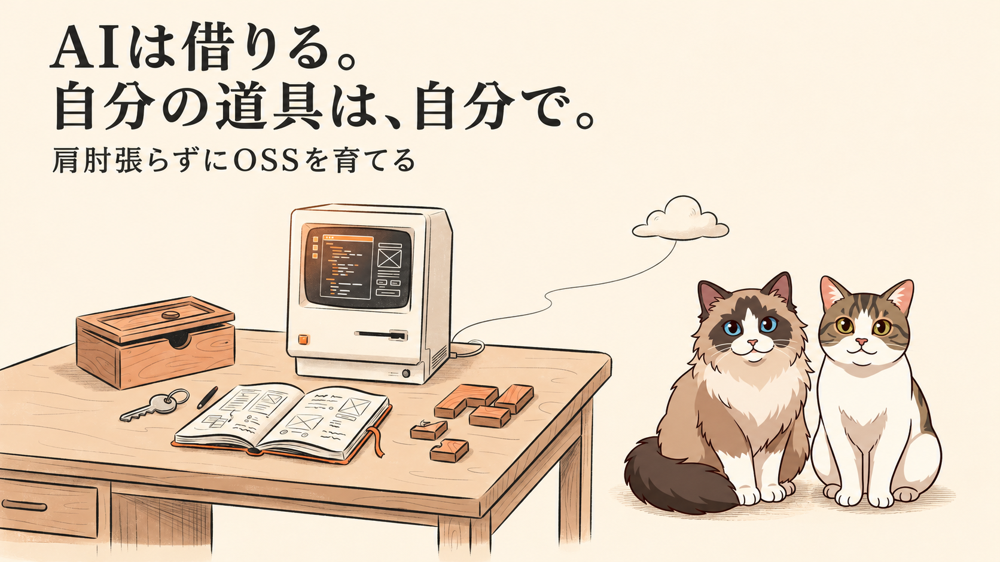
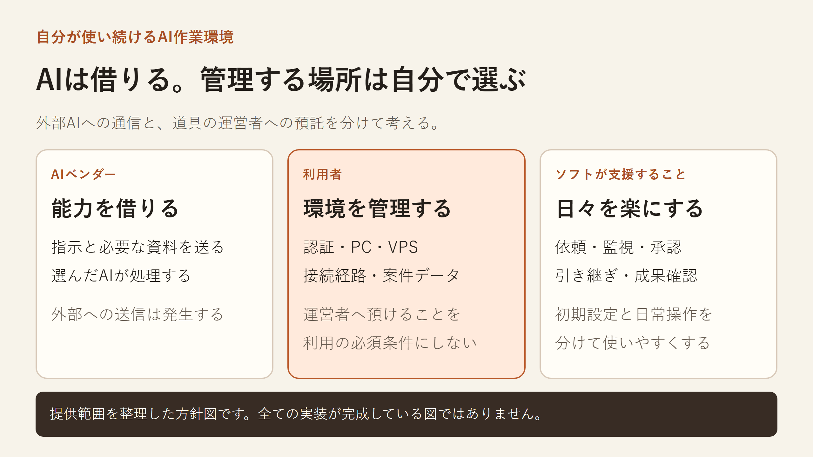

先に、結論を3行で書きます。

- 外部AIを使うことと、自作ツールの運営者へ認証や接続管理を預けることを分けて考えました。
- PC・サーバー・ネットワークは利用者が選び、ソフトは依頼・監視・承認・引き継ぎを使いやすくする方針です。
- many-ai-cliとMany Irisの構想整理であり、統合の完成やゼロトラストの実装を報告する記事ではありません。

時間に合わせて、読み方を選べます。

- 少し忙しい人向け：[5分で読める要約版（個人サイト）](https://ishizakahiroshi.com/articles/2026/2026-11-02_keep-control-of-my-ai-workspace/)
- もっと深掘りしたい人は、このまま本文へどうぞ。

## まず、誰が何を管理するかを分けました

複数のAIコーディングCLIを操作・監視するmany-ai-cliと、案件や計画の現在地を扱いたいMany Irisについて、提供範囲を整理しています。

many-ai-cliのコードと概要はこちらです。
GitHub：https://github.com/ishizakahiroshi/many-ai-cli
紹介ページ：https://ishizakahiroshi.com/work.html?id=many-ai-cli

前回は、スマホのChatGPTとローカルAIをつなぐ実験を書きました。接続できても、仕事の受領・実行・結果照合まで自動でつながるとは限らない、という内容です。
前回の記事：https://qiita.com/ishizakahiroshi/items/8bfb324e9d8869303fe6

その後、認証や中継の設定をどこまでツール側が吸収するかを考えました。利用者がログインするだけでPCにつながる体験を提供するなら、提供側にはアカウント、接続先の登録、中継、資格の失効、障害対応が必要になります。

今回は、そのサービス運営を初版の必須条件にせず、自分で管理する環境で使う道具として整理することにしました。

| 管理するもの | 基本の担当 | ソフト側で使いやすくすること |
|---|---|---|
| PC・VPS・ネットワーク | 利用者 | 接続先の登録、到達状態の表示、設定不足の診断 |
| AIサービスとその認証 | 利用者が選んだサービスと利用者 | 利用者の環境にある認証を扱い、認証切れを説明する |
| 依頼・実行・監視 | ソフト | 同じ仕事と実行状態を対応付ける |
| 計画・承認・引き継ぎ | ソフトで扱う構想 | 許可範囲、判断待ち、結果不明を区別する |
| 環境の更新・復旧 | 利用者 | 状態の保存、更新の説明、復元しやすい構造 |

表の後半は、今後具体化・検証する設計を含みます。運営者が管理しないことと、ソフトに認証や認可が要らないことは別です。

## 「自分で管理する」と「全部手作業」は分けたい

初回の環境構築は、自分でできる人に使ってもらえればよいと思っています。その代わり、日常の操作は楽にしたいです。

案件を選ぶ。指定した計画を任せる。途中で判断が必要なら返事をする。担当AIが替わっても、何を許可して、どこまで終わったかを追える。最後に成果物と根拠まで確かめる。

many-ai-cliの実行側と、Many Irisの計画・状況・根拠を、一式の体験としてつなげたいと考えています。毎回チャットやターミナルを読み直して、利用者が全体を再構成する負担を減らすためです。

図は、AIから借りる能力と、利用者が管理する環境、ソフトが支援する操作を分けたものです。外部AIへ送った指示や資料は、そのベンダーが処理する前提です。

「データを一切外へ出さない」という意味ではありません。自作ツールの運営者へ、新たに認証情報や接続権限を預けることを必須にしない、という提供方針です。

## 接続経路と、処理を動かす場所も別でした

PCで処理することと、Cloudflareなどを到達経路に使うことは両立します。指揮者や認証をCloudflare側に置く案も、個人のVPSに置く案も考えられます。

ただし、それらを最初から全て実装する必要はありません。まず自分が使う構成で、登録から依頼、承認、結果確認までの一周を作るつもりです。

MCPという接続方式を選んでも、ネットワーク上で届くかどうかは別に確認します。スマホアプリ自身が呼ぶ場合と、ChatGPTのようなサービス側が呼ぶ場合では、通信の出発点が違います。

T3 Codeの公式文書も、クラウド上の外部AIにはインターネットから届く環境アドレスが必要で、Tailscaleのアドレスは自分のtailnet内から使うものと区別しています。
https://github.com/pingdotgg/t3code/blob/47f2c8d29e981c7723467efe137ee19e91df924e/docs/user/outside-agents.md

## 自主管理というだけでは、独自の機能にはならない

参考にしたT3 Codeには、LAN・Tailscale・SSHの接続方法があります。Orcaにも、Tailscaleなどを使うremote serverの説明があります。両者を「認証を必ず提供者へ預ける製品」として扱うのは正確ではありません。
T3 Code：https://github.com/pingdotgg/t3code/blob/47f2c8d29e981c7723467efe137ee19e91df924e/docs/user/remote-access.md
Orca：https://github.com/stablyai/orca/blob/10a623b910d82c80b0ccbc70030ce5c1f55afce6/docs/site/content/docs/remote-servers.mdx

| 比べる軸 | 接続をサービス側に任せる形 | 利用者が自分で管理する形 |
|---|---|---|
| 初期設定 | 提供側が吸収する部分が増える | 利用者が環境や経路を用意する |
| 接続基盤の運用 | サービス提供側が担う | 利用者が選んだ環境で担う |
| 日常の使いやすさ | ソフトの設計で変わる | こちらもソフトの設計で改善できる |

これは製品を二分する表ではなく、提供形態の比較です。同じ製品が両方を用意することもあります。

自分の道具では、案件の現在地、許可した計画、担当交代、成果の根拠までつなぐ体験を確かめたいです。上流にも関連する機能はあるので、優れているかどうかは同じ仕事で使ってみないと分かりません。

## ゼロトラストという言葉は、少し慎重に使います

Nextcloudの、自分のサーバーや選んだホスティング先で動かせる考え方は参考になります。 <!-- doxguard: allow Nextcloud -->
https://nextcloud.com/home-users/

今回の整理の中心は、自己管理と、データや認証の主導権です。ゼロトラストは、ネットワーク上の場所や所有者だけを根拠に暗黙の信頼を与えず、認証・認可を行う考え方です。
https://www.nist.gov/publications/zero-trust-architecture

ローカルで動かしたり、OSSとして公開したりするだけで、その設計が実現するわけではありません。AIの指示をどの権限で実行するか、事前許可の範囲をどう照合するかは、別に実装して確かめる必要があります。

## まず、自分が使うところを仕上げます

自己管理できる分、AI CLIやOSの変更への追従、認証の更新、設定やデータの復旧は残ります。保守コストが自動的に最小になるわけではありません。

だからこそ、自分に必要な範囲から作ります。CloudflareとVPSを両対応にすることより、毎日使う一周が分かりやすく、困ったときに戻せることを先に確かめたいです。

使い方や環境が合う人がいれば使ってもらい、違う使い方がしたければ改造してもらう。まず自分は使い続ける。今は、そのくらいの温度感で育てていこうと思っています。

many-ai-cliのコードと概要です。Many Irisとの統合は未完成で、この記事はその提供範囲を整理した記録です。
GitHub：https://github.com/ishizakahiroshi/many-ai-cli
紹介ページ：https://ishizakahiroshi.com/work.html?id=many-ai-cli

---

※ ヘッダー画像は AI（画像生成）で作成しています。本文図はHTMLで組版しています。

書いた人: ishizakahiroshi
群馬の北部で、保護猫2匹と暮らす、在宅エンジニア（何でも屋）
https://ishizakahiroshi.com/
https://github.com/ishizakahiroshi
X（業務委託・各種相談はこちら）：
https://x.com/ishizakahiroshi

バックエンド・インフラ・AI連携まわりで、業務委託のご相談を受け付けています。フルリモートです。スポットや週2〜3時間からでも歓迎で、いろんな案件に携われたらうれしいです。こんな相談、歓迎です。
