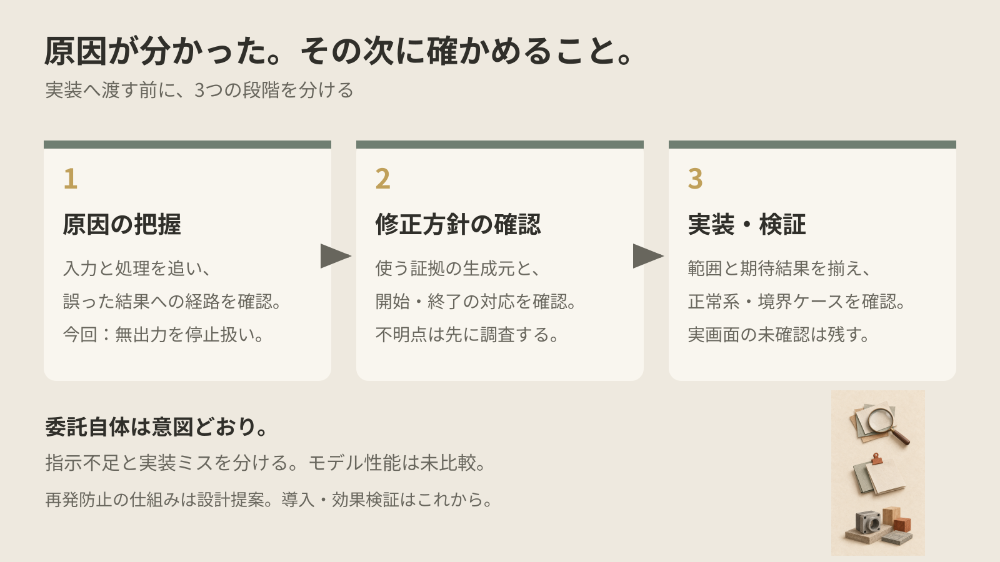
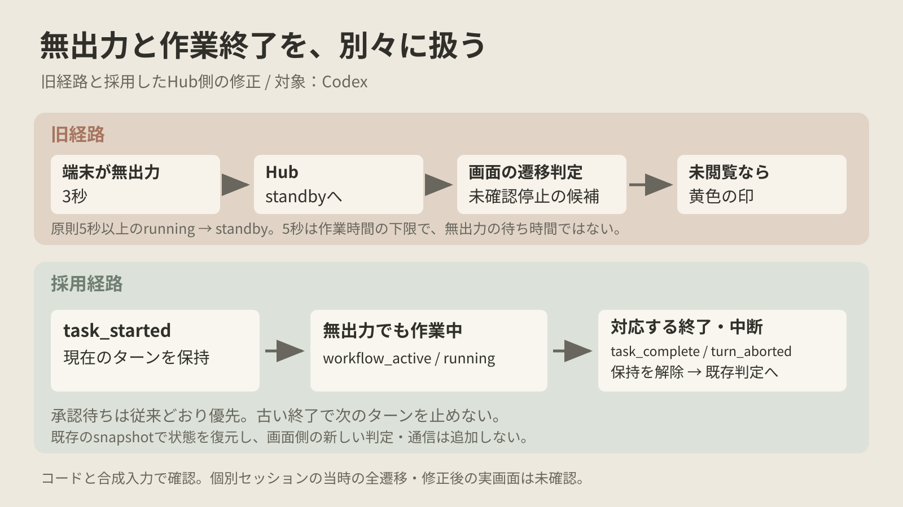

先に、結論を3行で書きます。

原因が分かっても、そのまま実装できる修正方針が揃ったとは限りません。  
今回の手戻りには、渡した方針の不足と、修正候補の実装ミスが重なっていました。  
委託前に証拠・対象範囲・確認ケースを揃え、不明点は調査として渡す形を考えています。

時間に合わせて、読み方を選べます。

- 少し忙しい人向け：[5分で読める要約版（個人サイト）](https://ishizakahiroshi.com/articles/2026/2026-10-18_bugfix-delegation-rework/)
- もっと深掘りしたい人は、このまま本文へどうぞ。

## 軽い修正のつもりが、終わらない

複数のAI CLIをまとめて扱う個人開発の[many-ai-cli](https://github.com/ishizakahiroshi/many-ai-cli)で、黄色の停止表示が気になりました。「作業が止まったが、まだ開いていない」という印なのに、開くと処理中のことがあったのです。対象はRust版でした。

many-ai-cliは、複数のAIコーディングCLIセッションの承認管理・監視を行うローカルWebダッシュボードです。画面と機能は[紹介ページ](https://ishizakahiroshi.com/work.html?id=many-ai-cli)にまとめています。

原因を調べ、bugfixのMarkdownにまとめ、それを元に子セッションへ実装・検証を任せました。これは意図どおりの依頼です。ただ、軽い修正だと思ったのに、レビューと差し戻しが続きました。

画像名の01:06から停止を伝えた03:36まで、約2時間30分。会話や待ちを含む経過時間で、純粋な実装時間やAIの稼働時間ではありません。

途中で作業を止め、何を変え、どこで判断を誤ったのか、図付きHTMLで説明してもらいました。そこで問い直したのが、「修正指示が足りなかったのか、子の実装に問題があったのか」です。

修正を足し続ける前に、目的と現在地を並べ直しました。委託の是非と、委託後の進め方は分けて見る必要がありました。

## 無出力を、作業終了とみなしていた

旧処理では、端末出力が3秒途切れるとHubが無出力と判定し、作業中の状態も落としてstandbyへ戻していました。画面側は、原則5秒以上のrunningからstandbyへの遷移を、未確認停止の候補にします。

この5秒は「無出力を待つ時間」ではなく、作業時間の下限です。単に待ち時間を伸ばしても、それを超える静かな処理は残ります。

コードと合成入力では、完了の記録がなくても黄色の候補になる経路を確認できました。ただし、報告した個別セッションの当時の全遷移を、ログで確定したわけではありません。

ここまでで分かったのは、誤判定が起きる仕組みです。「本当の終了を何で判断し、どこを直すか」は、もう一段確かめる必要がありました。

## 方針の不足と、実装ミスが重なった

最初は完了サマリーを根拠にする案でした。しかし、そのサマリーにも無出力からの推定が混ざっていました。Git差分を根拠にすると、通常の会話や差分を計測できない経路を取りこぼします。

開始と終了の対応、端末への直接入力、再接続時の復元も、後から確認する形になりました。一方、候補には古い終了で次の作業の記録を消す、再描画で印が戻らない、直接入力の2回目を重複扱いする、といった実装ミスもありました。

さらに、終了通知の条件変更まで加えたのは親側の判断です。子が勝手に広げたわけではありません。必要な再接続対応と、ついでの動作変更を同じ修正に混ぜていました。

モデルやエフォートの違いを疑う気持ちもありましたが、比較はしていません。今回の記録から、特定のモデルの性能が低かったとは言えません。

## 最後は、Hubの作業中状態に絞った

再開後は親側が引き取り、Codexのprovider記録にあるtask_started、task_complete、turn_abortedを使って、Hubが作業中の状態を保持する小さい修正にしました。

開始を確認したターンが続いていれば、無出力でもrunningを保ちます。対応する終了や中断で保持を解除し、既存の出力・承認待ち判定へ戻します。承認待ちは従来どおり優先し、古い終了で次のターンを止めないことも確認します。

画面側に別の終了判定や新しい通信を増やさず、Hubが渡す状態を直しました。無出力と作業中を別々に持つことが、今回採用した方針です。

採用差分はRustの実装4ファイル、テスト2ファイル、CHANGELOGの計7ファイル。子の22ファイルの候補は保持し、採用していません。これはファイル数による性能比較ではなく、採用した範囲の記録です。

普段のRust修正元へ反映し、そこで関連15テストとログ読取17テストが成功しました。承認待ち、中断、古い完了、直接入力、再接続snapshotを確認し、既存の別作業14ファイルも保持しています。

テストに必要なコンパイルは行いましたが、製品ビルド、Hub再起動、実画面確認、CI、commit・push、公開は未実施です。稼働版で直ったとはまだ言えません。Codex以外の停止判定も今回は変更していません。

## 「調査から動ける」と「すぐ実装できる」を分ける

誰かを責めるより、同じ渡し方でまた詰まらないかが気になりました。bugfixは障害の記録である一方、文書共通ルールは別のAIが動ける内容も求めていました。その「動ける」が、調査開始なのか、コード修正開始なのか曖昧だったのです。

見直し案は、同じ文書に短い確認欄を置くことです。

- 作業段階：調査／実装
- 原因の証拠：どの入力が、どの処理で誤った結果になるか
- 修正方針：使う情報の生成元から利用先まで、前提は確かか
- 対象範囲：今回変える動作と、変えない範囲
- 確認ケース：入力、期待結果、確認方法、未確定事項

不明点が方針を左右するなら、子にはその調査から任せます。実装前に親子で実物と照合し、手戻りが続いたら追加編集の前に方針を見直す。チェック欄が埋まることと、技術的に正しいことも分けます。

これは設計提案で、共通ルールや検査道具へ反映・自動強制済みではありません。効果もこれから確かめる段階です。今回残したいのは、原因の説明から実装へ進む間に、修正方針そのものを確認する一段を置く、という教訓です。

## あわせて読みたい

[Claude Codeの指示ファイルを監査した記録](https://qiita.com/ishizakahiroshi/items/7cc143942aab2b98e741)では、AIへ渡すルールが実際に読み込まれているかを確認しました。今回は、読み込まれることに加えて、その内容で実装に進めるかを見直しています。

今回の題材にしたmany-ai-cliは、AI CLIを並列で使い、承認待ちや状態を一画面で確認したいときのために作っています。[紹介ページ](https://ishizakahiroshi.com/work.html?id=many-ai-cli)と[リポジトリ](https://github.com/ishizakahiroshi/many-ai-cli)から概要と使い方を確認できます。Starをいただけると励みになります。

---

※ ヘッダー画像とインフォグラフィックの絵は AI（画像生成）で作成しています。

※ 本文の挿絵も AI（画像生成）で作成しています。

書いた人: ishizakahiroshi  
群馬の北部で、保護猫2匹と暮らす、在宅エンジニア（何でも屋）  
https://ishizakahiroshi.com/  
https://github.com/ishizakahiroshi  
X（業務委託・各種相談はこちら）：  
https://x.com/ishizakahiroshi

バックエンド・インフラ・AI連携まわりで、業務委託のご相談を受け付けています。フルリモートです。スポットや週2〜3時間からでも歓迎で、いろんな案件に携われたらうれしいです。こんな相談、歓迎です。
