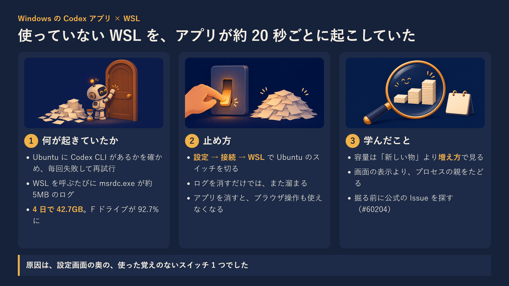
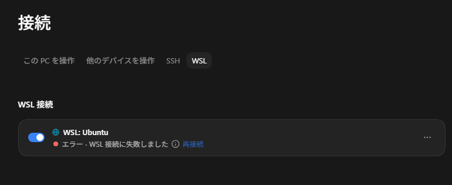
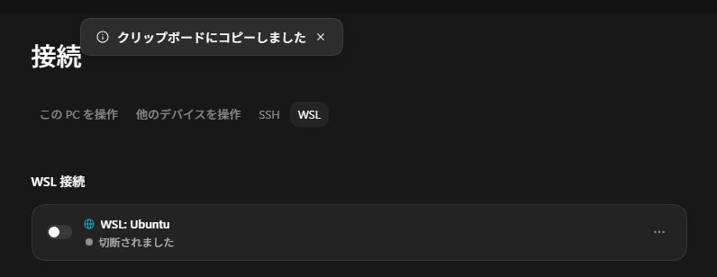
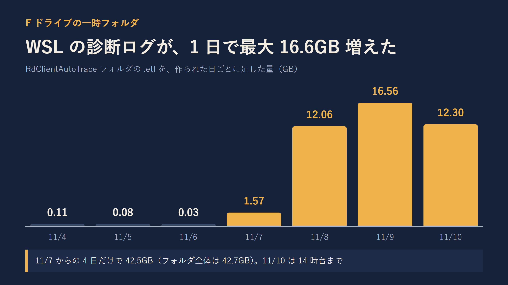

先に、結論を3行で書きます。

- Windows の Codex アプリが、WSL の Ubuntu へ約 20 秒ごとに接続を試し続けていました。そのたびに WSL の画面表示用プログラム（msrdc.exe）が約 5MB の診断ログを書き、4 日で約 42GB 溜まりました。
- 止め方は、Codex アプリの「設定 → 接続 → WSL」で Ubuntu のスイッチを切るだけでした。公式の Issue にも同じ報告があります。
- ログを消すだけでは止まりません。アプリを消すとブラウザ操作も使えなくなるので、スイッチを切るのがいちばん安全です。



時間に合わせて、読み方を選べます。

- 少し忙しい人向け：[5分で読める要約版（個人サイト）](https://ishizakahiroshi.com/articles/2026/2026-11-10_codex-app-wsl-trace-logs/)
- もっと深掘りしたい人は、このまま本文へどうぞ。

F ドライブの使用率が 92.7% になっていました。4 日前に整理して 64% まで下げたばかりのドライブです。

毎日 13:15 に掃除のスクリプトが動いているので、また Rust のビルドの残骸だろうと思っていました。違いました。犯人は、使ってもいない Codex アプリでした。

## 先に止め方：「設定 → 接続 → WSL」で Ubuntu を切る

WSL の中で Codex を使っていないなら、これで止まります。

1. Codex アプリの設定を開く
2. 「接続」の「WSL」タブを開く
3. 「WSL: Ubuntu」のスイッチを切る（表示が「切断されました」になる）



自分の環境では、切る前は「エラー・WSL 接続に失敗しました」と出たまま、スイッチが有効になっていました。使った覚えはありません。



止まったかどうかは、PowerShell で 70 秒だけ見張れば分かります。`wsl.exe` と `msrdc.exe` が新しく起動した時刻を並べます。

```powershell
$start = Get-Date; $seen = @{}
while ((Get-Date) -lt $start.AddSeconds(70)) {
  Get-CimInstance Win32_Process -Filter "Name='wsl.exe' OR Name='msrdc.exe'" |
    Where-Object CreationDate -gt $start |
    ForEach-Object { $seen[$_.ProcessId] = "$($_.CreationDate.ToString('HH:mm:ss')) $($_.Name)" }
  Start-Sleep -Milliseconds 300
}
$seen.Values | Sort-Object
```

切る前は約 20 秒おきに 3〜4 行ずつ出ていました。切った後は 0 行です。

溜まったログは、普通の一時ファイルなので消して構いません。書き込み中のものを避けて、1 時間より前のものだけ消します。

```powershell
$dir = "$env:TEMP\DiagOutputDir\RdClientAutoTrace"
# 大きさを確かめる
Get-ChildItem $dir -File -Filter 'RdClientAutoTrace-WppAutoTrace-*.etl' |
  Measure-Object Length -Sum
# 1 時間より前のものを消す
Get-ChildItem $dir -File -Filter 'RdClientAutoTrace-WppAutoTrace-*.etl' |
  Where-Object LastWriteTime -lt (Get-Date).AddHours(-1) |
  Remove-Item
```

`%TEMP%` はふつう C ドライブのユーザーフォルダの下です。自分は一時フォルダを F ドライブへ移していたので、F が埋まりました。C のままなら、C が埋まっていたはずです。

## 何が溜まっていたか

場所は `%TEMP%\DiagOutputDir\RdClientAutoTrace` です。中身は `RdClientAutoTrace-WppAutoTrace-<日時>.etl` という診断ログだけでした。

- 本数は 8,681 本、合計 42.7GB
- 1 本あたり約 5MB
- 1 時間に約 171 本、約 0.86GB。1 日にすると約 20GB

日別に並べると、増え始めた日がはっきり出ます。



11 月 7 日が 1.6GB、8 日が 12.1GB、9 日が 16.6GB、10 日は 14 時台までで 12.3GB でした。それより前は 1 日 0.1GB に届いていません。

正直、毎日の掃除のレポートには載っていました。「用途が分からない大きな一時データ」として。でも画面が開くのは「新しく現れた物」があるときだけにしていたので、同じ物が毎日少しずつ太っていくのには気づけませんでした。ここは自分の作りの穴です。

この掃除の仕組みを作ったときの話は、前に書いています。

https://qiita.com/ishizakahiroshi/items/609786acea2d1502382b

## msrdc.exe が 21 秒ごとに生まれては消えていた

`RdClientAutoTrace` は、リモートデスクトップの接続部品が書くトレースです。WSL は Linux の GUI アプリを Windows に映すとき（WSLg）、内部でリモートデスクトップの仕組みを使っていて、その窓口が `msrdc.exe` です。

プロセスの起動を見張ると、こう並びました。

```text
14:36:46 wsl.exe     （親: ChatGPT.exe）
14:36:46 msrdc.exe   （親: wslhost.exe）
14:37:07 wsl.exe     （親: ChatGPT.exe）
14:37:08 msrdc.exe   （親: wslhost.exe）
14:37:28 wsl.exe     （親: ChatGPT.exe）
14:37:29 msrdc.exe   （親: wslhost.exe）
14:37:49 wsl.exe     （親: ChatGPT.exe）
14:37:50 msrdc.exe   （親: wslhost.exe）
```

きっちり 21 秒おきです。`ChatGPT.exe` は Codex アプリの本体です。

起動していたコマンドはこれでした（長いので PATH の部分は省略しています）。

```text
wsl.exe -d Ubuntu -- /usr/bin/bash -lc "PATH=...; if ! command -v codex >/dev/null 2>&1; then
  printf '%s\n' 'Codex CLI was not found in this WSL distribution. Install Codex in WSL, add it to your shell PATH, or set CODEX_INSTALL_DIR.' >&2; exit 127; fi; exec codex --version"
```

Ubuntu の中に Codex の CLI が入っているかを、`codex --version` で確かめています。自分の Ubuntu には入っていないので、毎回 `exit 127` で失敗します。そして 21 秒後にまた確かめる。WSL を呼ぶたびに `msrdc.exe` が起動して、ログが 1 本増える。これが 4 日続いていました。

WSL 側のログが増える問題自体は、ずっと前から知られています。WSL の公式リポジトリの Discussion #8486（https://github.com/microsoft/WSL/discussions/8486 ）は 2022 年 6 月に立っていて、「1 週間で 223GB」「311GB」という報告まであります。Microsoft の修正は、その議論の中には出てきませんでした。

## 公式の Issue に、同じ症例があった

Codex のリポジトリを検索したら、ほぼ同じ報告がありました。

- openai/codex #60204「[Windows][26.1103] Missing WSL Codex CLI causes endless reconnects, Ubuntu restarts, and WSLg focus stealing」（https://github.com/openai/codex/issues/60204 ）
  - アプリを 26.1103.4239.0 に上げた後から、`remote-wsl:Ubuntu` への接続を延々と再試行し、最後は 20 秒間隔になったという報告です。報告者のログでは 107 回目の再試行まで記録されていました
  - 報告者自身のコメントに「Settings → Connections → WSL で Ubuntu の接続を切ったら止まった。戻すと再発した」とあります。自分の環境でも同じでした
  - ほかの人のコメントには「15 秒ごとに msrdc にフォーカスを奪われて PC が使えない」「サブスクの解約を考えている」まであります
- openai/codex #54509「repeated WSL workspace probes and WSLg trace-log accumulation associated with disk exhaustion」（https://github.com/openai/codex/issues/54509 ）
  - 同じフォルダに 40.55GiB 溜まり、ディスクの空きが 1.32MiB まで減った報告です。古いログを消しても、9 時間半で約 10GB に戻ったそうです
- openai/codex #30048「Codex Desktop for Windows starts WSL/Ubuntu even when Windows-native mode is selected」（https://github.com/openai/codex/issues/30048 ）
  - Windows で動かす設定にしていても、アプリが起動時に WSL を立ち上げるという報告です

自分の手元の記録とも突き合わせてみました。Windows のアプリの導入記録と、毎日の掃除が残している容量の記録です。

- 11 月 7 日 13:17 の時点では、まだ増えていませんでした。最後の書き込みは前日の 16:41 のままです
- その日の夕方 17:54〜19:17 に、Codex アプリの版が入れ替わっています（26.1029.7803.0 が登録し直され、関連する部品も新しくなった）
- 7 日に増えたのは 320 本、約 2 時間分。翌朝 9:09 に 26.1103.4239.0 が入ってからは、8 日が約 15 時間分、9 日が約 20 時間分と、ほぼ一日中出続けていました

それまでもアプリは入っていたのに、増えてはいませんでした。使っていなくても、版が入れ替わったのをきっかけに接続の試行が始まったように見えます。ただ、どの版から始まったのかは分かりません。古い版はもうディスクに残っておらず、アプリのログもアンインストールで消えてしまったからです。

最初からこの Issue を検索していれば、30 分で終わった話でした。

## アプリを消したら止まった。でも、ブラウザ操作も消えた

実は Issue を見つける前に、一度アプリをアンインストールしています。止まりました。65 秒見張って、`wsl.exe` も `msrdc.exe` も 0 回です。

ところが、Codex のブラウザ操作（Chrome を動かす機能）が使えなくなりました。Chrome とつなぐ部品（`codex-chrome-native-host.exe`）が、アプリの中に入っているからです。

仕方なく入れ直したら、版は 26.1103.7773.0 に上がっていました。それでも 21 秒ごとの接続は、そのまま戻ってきました。最後にスイッチを切って、やっと止まりました。

ちなみに、新しいチャットの「実行場所」の表示は、ずっと「このコンピューター」でした。画面だけ見ていたら、WSL に何かしているとは思わなかったはずです。

## ついでに分かった、CLI のブラウザ操作の落とし穴

ブラウザ操作を確かめる途中で、もう 2 つ引っかかりました。短く書いておきます。

- `codex exec`（1 回だけ命令を流す使い方）では、Chrome 操作が `The browser access host is unavailable` で止まります。対話で起動した `codex` なら動きました（CLI 0.166.0 と 0.167.0 で確認）。プラグインが、アプリから渡される接続先の情報を受け取れないときに出すエラーでした
- `CODEX_HOME` を別の場所に向けて使うと、アプリが入れたブラウザ用プラグインが見えません。プラグインの置き場 `openai-bundled` は予約名で、コマンドで登録し直すこともできません。別の場所の `.tmp\bundled-marketplaces` を、既定の置き場の同じフォルダへのジャンクションにして `codex plugin add browser@openai-bundled` を流したら、使えるようになりました

後者は、自分の作っている many-ai-cli（https://github.com/ishizakahiroshi/many-ai-cli ）がアカウントごとに `CODEX_HOME` を分けるので踏みました。こちらは置き場を作るときに自動でつなぐように直しています。

## なんでこんな仕様なのか（考察）

ここからは、確かめた事実と、自分の推測を分けて書きます。

確かめた事実は 3 つです。

- アプリのコード（`app.asar` の中の JavaScript）を読むと、`remote-wsl:` で始まる接続先は、明示的に切っていない限り自動接続の対象になる判定でした。WSL を入れているだけで、勝手に接続先の候補に入ります
- CLI が見つからない `exit 127` は、何度試しても直らない種類の失敗です。それでも 20 秒ごとに再試行し続け、あきらめる上限がありませんでした（#60204 のログでも 107 回目まで続いています）
- WSL 側は、`msrdc.exe` が起動するたびにトレースを 1 本書きます。この問題は 2022 年から未解決です

推測は、ここからです。たぶん、どちらの会社のバグも、単体なら「少し重い」くらいで済むものだったのだと思います。OpenAI 側は「失敗したら 20 秒後にもう一度」、Microsoft 側は「起動したらログを 1 本」。この 2 つが掛け算になったとき、1 日 20GB になる。その組み合わせを、誰も通しで見ていなかったのではないかと思います。

アプリの版の上がり方も気になりました。自分の手元だけでも、11 月 6 日から 10 日までの 5 日で 26.1029.7803 → 26.1103.4239 → 26.1103.7773 と変わっています（Windows のアプリの導入記録から。途中の 26.1103.3517 は登録に失敗して、使われないまま消えていました）。速く出すことを優先していて、Windows と WSL の組み合わせまで試験が回りきっていないのかもしれません。

正直、天下の OpenAI にしては、ちょっと雑だなと思いました。少なくとも「CLI が無い」と分かった時点で再試行をやめるか、画面に一言出してほしかった。スイッチは用意されているのに、エラーのまま有効になっていて、誰も教えてくれない。そこが一番もやっとしています。

## 学んだこと

- 容量の異常は「新しく現れた物」ではなく「増え方」で見ないと気づけない。同じ物が毎日太っていくのは、一覧を見ても目に入りませんでした
- 画面の表示と、裏で動いているものは別。迷ったら、プロセスの親をたどるのが一番早かった
- アプリを消すのは、何が一緒に使えなくなるかを確かめてから。今回はブラウザ操作が道連れでした
- 自分で掘る前に、公式の Issue を検索する。同じ症例と止め方が、2 日前に書かれていました

## おわりに

スイッチ 1 つでした。4 日分、42GB の診断ログの原因が、設定画面の奥の、使った覚えのないトグルだったわけです。

なぜ 11 月 7 日の夕方からだったのかは、古い版もログも消えてしまって、最後まで分かりませんでした。次に似たことが起きたら、アプリを消す前にログを控えておこうと思います。

ディスクの掃除は毎日動いていたのに、増え方は見ていなかった。次は、1 日で大きく増えた場所に気づける仕組みを足そうと思っています。小さく、ですね。

---

※ ヘッダー画像とインフォグラフィックの絵は AI（画像生成）で作成しています。

書いた人: ishizakahiroshi
群馬の北部で、保護猫2匹と暮らす、在宅エンジニア（何でも屋）
https://ishizakahiroshi.com/
https://github.com/ishizakahiroshi
X（業務委託・各種相談はこちら）：
https://x.com/ishizakahiroshi

バックエンド・インフラ・AI連携まわりで、業務委託のご相談を受け付けています。フルリモートです。スポットや週2〜3時間からでも歓迎で、いろんな案件に携われたらうれしいです。こんな相談、歓迎です。
