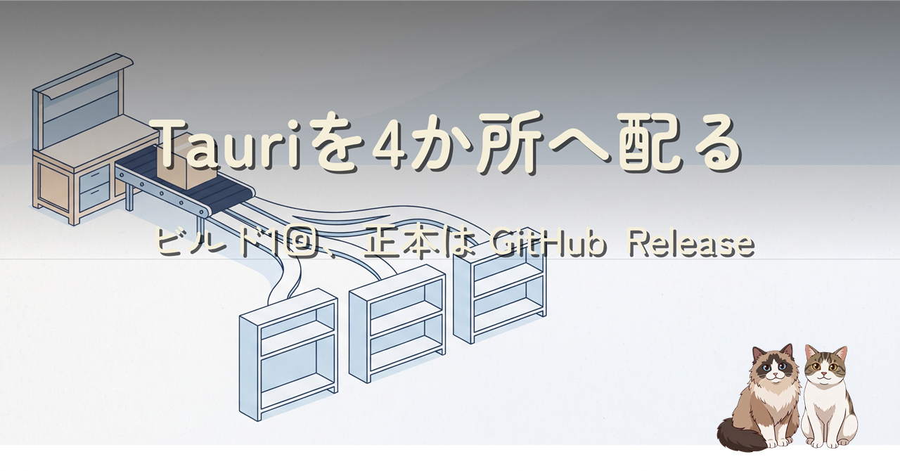
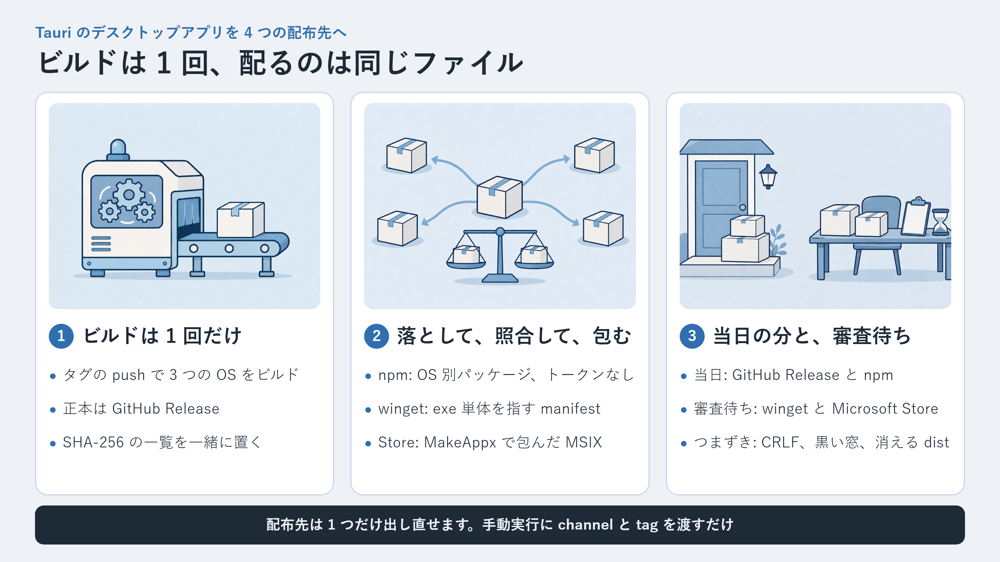
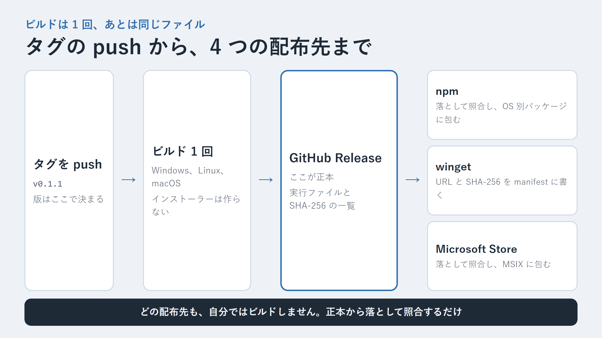
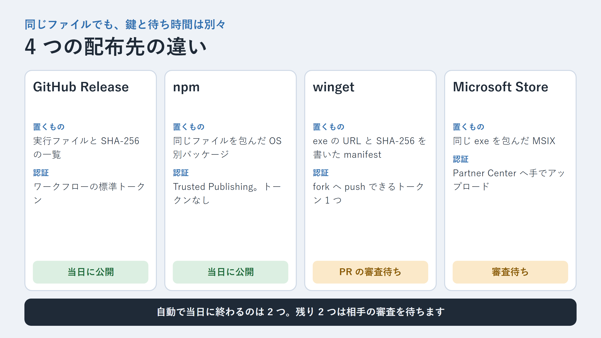

先に、結論を3行で書きます。

- ビルドはタグの push で 1 回だけ行い、GitHub Release に置いたファイルを正本にしました。npm・winget・Microsoft Store は、その正本を落として SHA-256 を照合してから配ります。
- npm はトークンを持たない Trusted Publishing、winget は exe 単体を portable として載せる PR、Microsoft Store は公開済みの exe を MakeAppx で包んだ MSIX です。
- GitHub Release と npm は当日に出ました。winget と Microsoft Store は審査待ちです。つまずきは CRLF と shebang、コンソールの窓、消える `dist` などでした。



Tauri v2 で作っている CSV エディタを、初めて外へ配りました。配布先は GitHub Release、npm、winget、Microsoft Store の 4 つです。

配布先を増やすと、ふつうは「配布先ごとにビルドして、配布先ごとに違うものが出る」方向へ転びます。それが嫌だったので、**ビルドは 1 回、配るのは全部同じファイル**という形に寄せました。その構成と、当日つまずいたところを書きます。

## 題材のアプリ

自作で [PlainSheet](https://github.com/ishizakahiroshi/PlainSheet) という表エディタを作っています。人と AI のための、ローカルファーストなプレーンテキスト表計算。

- 何ができるかの紹介ページ: https://ishizakahiroshi.com/work.html?id=PlainSheet
- リポジトリ（Star をいただけると励みになります）: https://github.com/ishizakahiroshi/PlainSheet

同じ悩みを持っている方は、下記で入ります。

```sh
npx plainsheet            # 1 回だけ試す
npm install -g plainsheet # 入れておく
```

入れたあとは `plainsheet` で起動、`plainsheet data.csv` でファイルを指定して開けます。初期化のコマンドはありません。

起動後の見え方は OS で違います。

- **Windows x64**: 窓が 1 つ開きます。やめるときは窓を閉じます。npm を使わない場合は [リリースページ](https://github.com/ishizakahiroshi/PlainSheet/releases/latest) の `PlainSheet.exe` をそのまま実行できます（インストーラーはありません）
- **macOS（Apple シリコン）**: npm 版は中の `PlainSheet.app` を `open` で起動します。リリースページからなら `PlainSheet-macos-aarch64.tar.gz` を展開します
- **Linux x64**: WebKitGTK 4.1（例: `libwebkit2gtk-4.1-0`）が必要です

ターミナルから起動するコマンドは、3 つの OS で同じ `plainsheet` です。起動したら「開く」から CSV を選ぶか、ファイルを窓へ落とします。

実機で起動まで確かめたのは Windows 11 だけです。macOS と Linux は CI のビルドが通るところまでで、起動は確かめていません。ビルドには署名をしていないので、ブラウザで落としたファイルは初回に SmartScreen や Gatekeeper の警告が出ることがあります。

## ビルドは 1 回だけ、あとは「同じファイル」を配る

決めたことは 3 つです。

- ビルドするのは、タグ `v*` を push したときの 1 回だけ
- 正本は GitHub Release。ここに置いたファイルと `SHA256SUMS.txt` がすべての基準
- ほかの配布先は、正本から**落として、SHA-256 を照合してから**配る。自分ではビルドしない



図にすると一本道です。タグを打つと 3 つの OS でビルドが走り、できたファイルが GitHub Release に並びます。npm のジョブも winget のジョブも Microsoft Store 用の手元スクリプトも、やることは「Release から落とす、照合する、包む」だけです。

こうしておくと、「npm 版だけ挙動が違う」が原理的に起きません。もう 1 つの利点は、**配布先を 1 つだけ出し直せる**ことです。ワークフローの手動実行に `channel` と `tag` を持たせました。

```yaml
on:
  workflow_dispatch:
    inputs:
      channel:
        type: choice
        default: build
        options: [build, npm, winget]
      tag:
        required: false
        type: string
  push:
    tags: ["v*"]

jobs:
  build:
    # 配布先 1 つの出し直しでは、ビルドしない
    if: github.event_name != 'workflow_dispatch' || inputs.channel == 'build'
```

```sh
gh workflow run "Tauri Build" -f channel=winget -f tag=v0.1.1
```

これは当日さっそく使いました（後述の winget です）。

ビルド自体は `tauri build --no-bundle` です。Windows と Linux はインストーラーを作らず、実行ファイルをそのまま出します。macOS だけは生のバイナリだとダブルクリックで開けないので `--bundles app` で `.app` を作り、tar.gz にしています。

Release のジョブでは、zip や tar.gz に入れた実行ファイルと、単体で置いた実行ファイルが同じバイト列かも確かめています。

```bash
unzip -p PlainSheet-windows-x86_64.zip "PlainSheet-windows-x86_64/PlainSheet.exe" > .win.bin
a=$(sha256sum .win.bin | cut -d' ' -f1)
b=$(sha256sum PlainSheet.exe | cut -d' ' -f1)
[ "$a" = "$b" ] || { echo "MISMATCH windows exe" >&2; exit 1; }
```

## npm: 本体は OS 別パッケージ、ルートは起動役だけ

デスクトップアプリを npm で配る形は、esbuild などと同じ「OS 別パッケージを optionalDependencies にぶら下げる」構成にしました。

```
npm/
├─ plainsheet/                      # ルート。launcher だけ
│  ├─ package.json
│  └─ bin/plainsheet.mjs
├─ plainsheet-windows-x64/          # bin/PlainSheet.exe
├─ plainsheet-linux-x64/            # bin/PlainSheet
└─ plainsheet-macos-apple-silicon/  # bin/PlainSheet.app
```

ルートの `package.json` はこうです。版はリポジトリでは `0.0.0` のままで、公開のときにタグから書き込みます。版を手で書く場所を増やさないためです。

```json
{
  "name": "plainsheet",
  "version": "0.0.0",
  "bin": { "plainsheet": "./bin/plainsheet.mjs" },
  "files": ["bin/plainsheet.mjs", "README.md", "LICENSE"],
  "optionalDependencies": {
    "plainsheet-windows-x64": "0.0.0",
    "plainsheet-linux-x64": "0.0.0",
    "plainsheet-macos-apple-silicon": "0.0.0"
  }
}
```

launcher は、いまの OS に合うパッケージを探して起動し、すぐ戻ります。

```js
const TARGETS = {
  "win32 x64": { pkg: "plainsheet-windows-x64", payload: "bin/PlainSheet.exe" },
  "linux x64": { pkg: "plainsheet-linux-x64", payload: "bin/PlainSheet" },
  "darwin arm64": { pkg: "plainsheet-macos-apple-silicon", payload: "bin/PlainSheet.app" },
};

// 切り離して起動する。この後ターミナルはすぐ使える
const child = spawn(command, commandArgs, { detached: true, stdio: "ignore" });
```

launcher で気をつけたのは 3 点です。

- **OS 別パッケージは、自分のインストールの中だけで探す**。Node の通常のモジュール解決は、ドライブのルートまで `node_modules` を遡ります。Windows では、サインインしているユーザーなら誰でも `C:\node_modules` を作れます。OS 別パッケージが入っていなかったときに、そこに置かれた実行ファイルを起動してしまう形は避けました
- **引数のファイルは絶対パスにしてから渡す**。macOS はアプリを `/` で起動するので、`plainsheet data.csv` の相対パスがそのままでは届きません
- **macOS は `/usr/bin/open -n <app> --args ...` で起動する**。バンドルの中のバイナリを直接叩くと、Dock のアイコンや窓の前面化が普通のアプリと違う動きになります

### 公開は Trusted Publishing で、トークンを持たない

npm への公開は Trusted Publishing（OIDC）にしました。リポジトリの secret に npm のトークンはありません。

```yaml
  npm:
    needs: release
    runs-on: ubuntu-22.04
    permissions:
      contents: read
      id-token: write
    steps:
      # registry-url は指定しない
      - uses: actions/setup-node@v4
        with:
          node-version: "24"
      - run: gh release download "$RELEASE_TAG" --dir .release-assets --pattern SHA256SUMS.txt --pattern PlainSheet.exe --pattern PlainSheet-linux-x86_64 --pattern PlainSheet-macos-aarch64.tar.gz
      - run: node scripts/release/stage-npm-from-release.mjs .release-assets "$RELEASE_TAG"
      - run: node scripts/release/publish-npm.mjs "$RELEASE_TAG"
```

押さえたのは次の点です。

- `id-token: write` を付ける
- **`setup-node` の `registry-url` を指定しない**。指定すると、トークンのプレースホルダー入りの `.npmrc` が書かれ、npm が OIDC の資格情報の代わりにそれを送ります
- npm は 11.5.1 以降が必要。Node 24 に入っている npm で足ります。ジョブの中で版を確かめて、古ければ止めています
- npmjs.com 側で、パッケージごとに Trusted Publisher（リポジトリとワークフローのファイル名）を登録する。今回はルートと OS 別 3 つの、計 4 パッケージに登録しました

公開の順番は、**OS 別 3 つが先、ルートが最後**です。ルートを先に出すと、OS 別パッケージがまだ無い数分のあいだに入れた人の環境が壊れます。スクリプトは公開の前に `npm pack` の中身を検査し、すでにレジストリにある版は integrity を照合して飛ばします。途中で落ちても、同じタグでもう一度流せます。

## winget: インストーラーなしの exe を portable で載せる

winget は、アプリを預かる場所ではなく「ここから落とせ」と書いた manifest の置き場です。なので GitHub Release の exe をそのまま指します。

インストーラーは作っていないので、`InstallerType: portable` にしました。winget が exe を落として、`plainsheet` というコマンドとして使えるようにしてくれます。

```yaml
# ishizakahiroshi.PlainSheet.installer.yaml
PackageIdentifier: ishizakahiroshi.PlainSheet
PackageVersion: "0.1.1"
InstallerType: portable
Commands:
- plainsheet
Installers:
- Architecture: x64
  InstallerUrl: https://github.com/ishizakahiroshi/PlainSheet/releases/download/v0.1.1/PlainSheet.exe
  InstallerSha256: <Release の SHA256SUMS.txt から取った値>
ManifestType: installer
ManifestVersion: 1.12.0
```

manifest は version・defaultLocale・installer の 3 本です。これを `microsoft/winget-pkgs` へ PR で出します。PR は GitHub の API だけで作りました。git の clone はしません。あの大きさのリポジトリを CI で clone したくなかったからです。

1. fork の `master` を upstream に追いつかせる（`merge-upstream`）
2. upstream の `master` の commit を親にする
3. `git/trees` に `base_tree` と manifest 3 本を渡して tree を作る
4. commit を作り、fork に branch `plainsheet-<版>` を作る
5. `microsoft/winget-pkgs` へ PR を開く。同じ PR が開いているか取り込み済みなら何もしない

ここだけは、fork へ push できるトークンが要ります。secret は `PUBLISH_GITHUB_TOKEN` の 1 つだけで、PR を開く step にだけ渡しています。secret が無いときはジョブを落とさず、警告を出して終わるようにしました。

```yaml
    env:
      WINGET_AVAILABLE: ${{ secrets.PUBLISH_GITHUB_TOKEN != '' && 'true' || 'false' }}
    steps:
      - name: Report a missing credential
        if: env.WINGET_AVAILABLE != 'true'
        run: echo "::warning::winget skipped - the PUBLISH_GITHUB_TOKEN secret is not set."
```

手元では `--dry-run` で manifest だけを書き出し、`winget validate --manifest <dir>` に通してから本番に流しました。

## Microsoft Store: 公開済みの exe を、自分で MSIX に包む

使っている Tauri v2 の bundler には MSIX の出力がありません。なので、MSIX は Windows SDK の MakeAppx で自分で包みます。

ここでも原則は同じで、**包むのは Release の exe**です。スクリプトは何もコンパイルしません。

```powershell
pwsh scripts/release/build-msix.ps1 -Tag v0.1.1
```

中でやっていることは次のとおりです。

1. `gh release download` で `PlainSheet.exe` と `SHA256SUMS.txt` を落とし、照合する
2. exe と Store 用のアイコンを作業フォルダに並べる
3. リポジトリで管理している `AppxManifest.xml` の `{{VERSION}}` を `X.Y.Z.0` に置き換える（4 つめの桁は Store が使うので 0）
4. `makeappx pack /d <作業フォルダ> /p <出力.msix> /o`
5. できた MSIX を `makeappx unpack` で開き直し、manifest と、**中の exe の SHA-256 が元と同じこと**を確かめる

manifest の要点はここです。

```xml
<Identity
  Name="ishizakahiroshi.PlainSheet"
  Publisher="CN=<Partner Center の Product identity に出る値>"
  Version="{{VERSION}}"
  ProcessorArchitecture="x64" />

<Applications>
  <Application Id="App" Executable="PlainSheet.exe" EntryPoint="Windows.FullTrustApplication">
    ...
  </Application>
</Applications>

<Capabilities>
  <rescap:Capability Name="runFullTrust" />
</Capabilities>
```

- `Identity` の `Name` と `Publisher` は、Partner Center でアプリ名を予約すると決まる値と完全に一致させる
- Win32 のアプリをそのまま包むので `runFullTrust` が要る。審査員向けのメモ欄に、なぜ要るかを書きました
- 提出用の MSIX に署名は要りません。認定のあとに Store 側が署名します
- 手元で試しに入れるときは、**別の Identity** にした MSIX を使う（スクリプトに `-TestIdentity` を付けました）。本物の Identity で入れると、あとから Store で届く版とぶつかります

提出の前に Windows App Certification Kit（WACK）も回しました。結果は 24 項目のうち合格 22、警告 1、不合格 1 です。不合格は任意扱いの「ブロック済みの実行可能ファイル」、警告は DPI 対応の宣言が見つからないというものでした。この結果のまま提出しています。通るかどうかは、まだ分かりません。

Partner Center の最初の提出は画面からの手作業です。価格、プロパティ、年齢区分、掲載文（今回は英語と日本語）、スクリーンショット、プライバシーポリシーの URL が要ります。データを集めないアプリでも、ポリシーの URL は求められました。

## 4 つを並べると、認証と待ち時間がこれだけ違う



並べてみると、同じファイルを配っているのに、鍵の持ち方と待ち時間は配布先ごとにばらばらです。自動で当日に終わるのは GitHub Release と npm まで。winget と Microsoft Store は、相手の審査を待つことになります。

| 配布先 | 置くもの | 認証 | 使えるようになるまで |
|---|---|---|---|
| GitHub Release | 実行ファイルと `SHA256SUMS.txt` | ワークフローの `GITHUB_TOKEN` | タグの CI が終わればすぐ |
| npm | 同じファイルを包んだ OS 別パッケージ | Trusted Publishing（トークンなし） | CI の中で公開。レジストリに見えるまで数分 |
| winget | Release の exe の URL と SHA-256 を書いた manifest | fork へ push できるトークン 1 つ | PR の検証と取り込み待ち |
| Microsoft Store | Release の exe を包んだ MSIX | Partner Center へ手でアップロード | 審査待ち（画面の表示は通常数時間、最大 3 営業日） |

## 当日つまずいたところ

### Windows の CI だけ、テストが SyntaxError で落ちた

リリース用のスクリプト（`.mjs`）を Vitest から import してテストしていました。手元では通るのに、Windows の CI だけこうなります。

```
SyntaxError: Invalid or unexpected token
```

原因は、スクリプトの先頭に付けていた shebang（`#!/usr/bin/env node`）でした。Windows の CI は改行を CRLF にして checkout します。その状態の shebang 行が、import のときに引っかかっていました。

手元のファイルを CRLF に変えたら再現したので、そこで確信しました。テストから import するスクリプトは `node scripts/...` でしか呼ばないので、shebang を消して終わりです。「手元で CI と同じ改行にしてみる」を最初にやっていれば、もっと早かった。

### 0.1.0 を出した直後に、黒い窓に気づいた

MSIX を試しに入れてスタートメニューから起動したら、アプリのプロセスの子に `conhost.exe` が付いていました。コンソール付きの exe としてビルドされていたわけです。

`tauri dev` や、ターミナルからの起動ばかり見ていると気づきません。足りなかったのは `main.rs` の先頭の 1 行です。

```rust
#![cfg_attr(not(debug_assertions), windows_subsystem = "windows")]
```

Store に出す前に直したかったので、同じ日に 0.1.1 を出しました。ここで「ビルド 1 回、あとは同じファイル」が効いて、タグを打ち直すだけで 4 つの配布先すべてが同じ修正版になります。

### 画面側のビルドで `dist/msix` が消えた

MSIX の出力先を `dist/msix` にしていたら、次に画面側をビルドしたときに消えていました。Vite は出力フォルダの `dist` を空にしてからビルドするからです。提出用のファイルは、ビルドが触らない場所へ写して保管するようにしました。出力先そのものを変えるほうが筋はいいので、次の版で直します。

### npm は「公開できた」と「見える」がずれる

CI のログには `PUBLISHED` が 4 行出ているのに、`npm view` には古い版しか出ない時間が数分ありました。ここで慌てて流し直さないことです。待ってから、空のフォルダへ `npm install plainsheet` して、入った exe の SHA-256 が Release と同じことを確かめました。

### winget の 1 回目は 422 で落ちた

secret を登録して winget だけを流したら、tree を作る API が 422 を返しました。困ったのは、ログにステータスコードしか出していなかったことです。

```
publish-winget: GitHub POST repos/<owner>/winget-pkgs/git/trees -> 422
```

GitHub は断った理由をレスポンスの `message` に書いてくれます。それを出すように直しました。

```js
if (!response.ok) {
  const reason = await response
    .json()
    .then((data) =>
      [data.message, ...(data.errors ?? []).map((e) => e.message ?? e.code)]
        .filter(Boolean)
        .join("; "),
    )
    .catch(() => "");
  throw new Error(`GitHub ${method} ${path} -> ${response.status}${reason ? ` (${reason})` : ""}`);
}
```

直してもう一度流したら、今度はそのまま通って PR が開きました。なので 1 回目の原因は分かっていません。fork を同期した直後だったから、という見当はありますが、確かめられていない推測です。

ここは `channel=winget` の出し直しがあって助かりました。ビルドからやり直していたら、npm のことまで気にする羽目になっていました。

## まだ確かめていないこと

正直に並べておきます。

- macOS と Linux での起動（CI のビルドが通るところまで）
- winget の PR が取り込まれて、`winget install ishizakahiroshi.PlainSheet` で入ること
- Microsoft Store の審査に通ること。DPI の宣言なしで実害が出るかどうか
- winget の 1 回目の 422 の原因

通ったもの、落ちたものは、この記事に追記します。

## PlainSheet はこんなときに刺さります

- CSV / TSV / Markdown の表 / JSON / YAML を、表として開いてそのまま保存したい人
- サーバーへ送らず、AI の API も呼ばず、データを手元だけで直したい人
- 先頭のゼロや日付を書き換えられたくない人（すべてのセルを文字として扱います）
- Tauri のアプリを npm や winget で配る構成の、動いている実物を見たい人

いずれかに心当たりがあれば、`npx plainsheet` の 1 コマンドで試せます。設定ファイルを書く必要はありません。

- 紹介ページ（スクショと機能一覧）: https://ishizakahiroshi.com/work.html?id=PlainSheet
- リポジトリ（Issue / PR 歓迎）: https://github.com/ishizakahiroshi/PlainSheet
- npm: https://www.npmjs.com/package/plainsheet

Star をいただけると開発の励みになります。使ってみて「ここが不便」があれば、Issue でも X の DM でも大歓迎です。

この記事に出てきたワークフローとスクリプトは、リポジトリの `.github/workflows/tauri-release.yml` と `scripts/release/` にそのまま置いてあります。

## あわせて読みたい

- [GitHub Actionsの検査を見直す前に、CI/CDの流れを整理した](https://qiita.com/ishizakahiroshi/items/430691b1ce54f0f5389a)（今回のワークフローの土台になっている、CI と配布の分け方の整理です）
- [AI時代のCSVエディタ、その先は自分で1週間使ってみる](https://note.com/ishizakahiroshi/n/nf0e6fea64f2c?app_launch=false)（PlainSheet の前回の記事です。このとき「Microsoft Store の申請はこれから」と書いていました）

## おわりに

配布先を 4 つに増やしても、ビルドが 1 回なら、気にするものは 1 つで済みます。当日に 0.1.1 を出し直せたのは、その形にしてあったからでした。

まだ半分は審査待ちです。通ったら、実際に入れて起動するところまで確かめます。

---

※ ヘッダー画像とインフォグラフィックの絵は AI（画像生成）で作成しています。

書いた人: ishizakahiroshi
群馬の北部で、保護猫2匹と暮らす、在宅エンジニア（何でも屋）
https://ishizakahiroshi.com/
https://github.com/ishizakahiroshi
X（業務委託・各種相談はこちら）：
https://x.com/ishizakahiroshi

バックエンド・インフラ・AI連携まわりで、業務委託のご相談を受け付けています。フルリモートです。スポットや週2〜3時間からでも歓迎で、いろんな案件に携われたらうれしいです。こんな相談、歓迎です。
