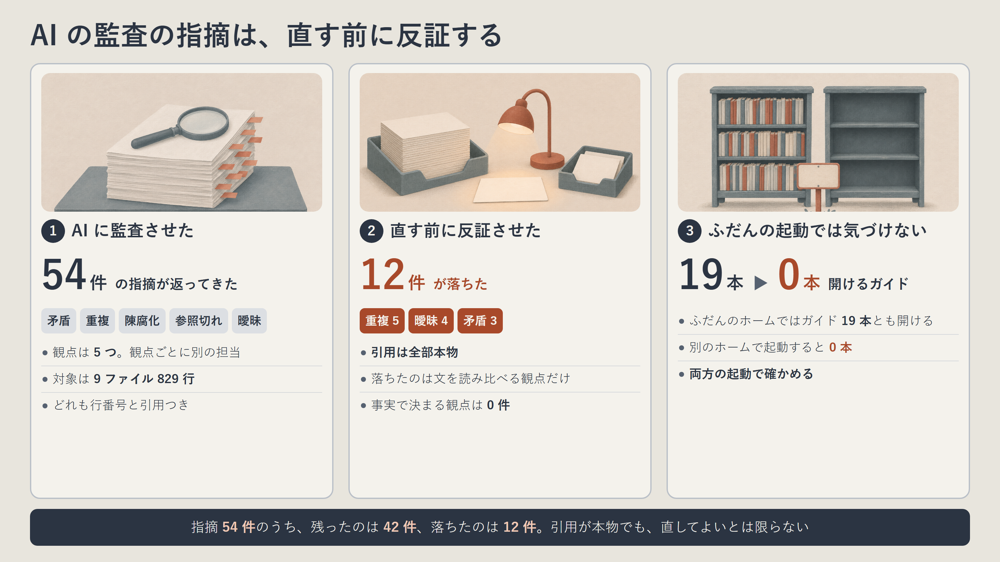
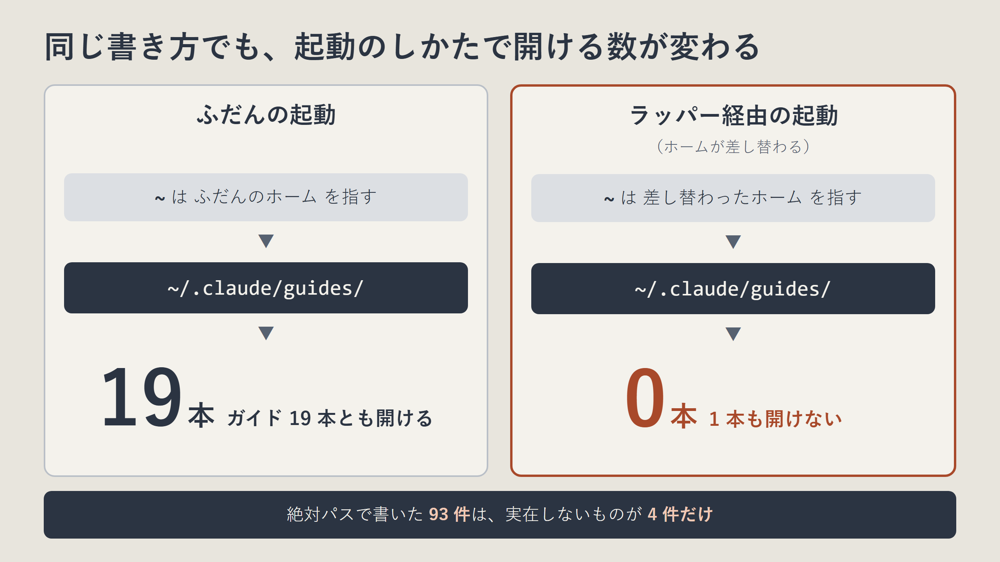

先に、結論を3行で書きます。

- AI に CLAUDE.md 一式を監査させたら、指摘 54 件のうち 12 件は、別の担当に反証させると落ちました。
- 落ちた 12 件は、どれも引用は本物でした。困ることが起きないか、前に自分で決めた形どおりだっただけです。
- ふだんの起動では全部開けるガイド 19 本が、別のホームで起動したセッションでは 1 本も開けませんでした。



Claude Code が毎回読み込む指示（CLAUDE.md と、そこから取り込むファイル）が増えてきたので、1 か月ぶりに AI へ監査を頼みました。対象は 9 ファイル、829 行です。

返ってきた指摘は 54 件。行番号と引用が付いていて、どれももっともらしく見えました。

そのまま直していたら、12 件は直さなくてよいものを直していました。2026-11-12、Claude Code 2.1.316、自分の環境 1 つでの 1 回の実測です。割合を一般化するつもりはありません。

## この監査の手順は、公開しているスキルに入れてあります

自作で [claude-code-context-diet](https://github.com/ishizakahiroshi/claude-code-context-diet) という Claude Code 向けの手順集とスキルを公開しています。Claude Code の常駐 context を実測し、削る価値を判定してから減らす手順集と簡易スキル。効くキーを実測で見極めた実践知。

- 何ができるかの紹介ページ: https://ishizakahiroshi.com/work.html?id=claude-code-context-diet
- リポジトリ（Star をいただけると励みになります）: https://github.com/ishizakahiroshi/claude-code-context-diet

同じ悩みを持っている方は、下記で入ります。Claude Code の中で打つコマンドです。

```
/plugin marketplace add ishizakahiroshi/claude-code-context-diet
/plugin install context-diet@ishizakahiroshi
```

入れたら Claude Code を再起動します。あとは AI に「コンテキスト棚卸して」と頼むと動きます。スラッシュで直接呼ぶなら `/context-diet:context-diet` です。今回の話は、この plugin の 1.3.0 に入れました。

この話には前があります。前回は、手順書を出し直そうとしたら確認用のコマンドまで古くなっていて、公式の `/doctor prompt-audit` を足して 1.2.0 として出しました。

前回の記事: [Claude Code の手順書を出そうとしたら、3週間前に出した版がもう古くなっていた](https://qiita.com/ishizakahiroshi/items/ce0b03506c6455599946)

## 54 件、どれも行番号つきで返ってきた

監査は 5 つの観点に分けました。矛盾、重複、陳腐化、参照切れ、曖昧。観点ごとに別の担当（サブエージェント）を立てて、互いの結果は見せません。

出し方も決めました。指摘には、必ず実ファイルの行番号と原文の短い引用を付ける。読み込まれた本文の印象だけで書かない。

返ってきたのが 54 件です。同じ箇所を複数の観点が別々に指摘しているので、54 か所ではなく、延べ 54 件です。

たとえば「同じ規則が 3 か所に書いてある」「同じファイルの 2 つの節に、ほぼ同じ文がある」。引用を見れば、確かにそう書いてあります。直したくなります。

## 反証させたら、12 件が落ちた

直す前に、観点ごとにもう 1 人ずつ、反証だけをする担当を立てました。頼んだのは 3 つです。

- 引用は実在するか。自分で実ファイルを開き直して確かめる
- 実際に困ることが起きるか
- 前に決めたことの蒸し返しになっていないか

確かめられなければ落とす、とも書きました。結果はこうです。

| 観点 | 出た指摘 | 残った | 落ちた |
|---|---|---|---|
| 矛盾 | 12 | 9 | 3 |
| 重複 | 12 | 7 | 5 |
| 陳腐化 | 7 | 7 | 0 |
| 参照切れ | 11 | 11 | 0 |
| 曖昧 | 12 | 8 | 4 |
| 合計 | 54 | 42 | 12 |

陳腐化と参照切れは、1 件も落ちていません。日付を過ぎているか、ファイルがあるか。事実で決まる観点です。

落ちた 12 件は全部、文と文を読み比べて出す観点から出ていました。ここがいちばん意外でした。

## 落ちた 12 件は、嘘ではなかった

引用をでっち上げた指摘は 0 件です。12 件とも、引用は本物でした。落ちた理由は別のところにあります。

1 つ目。「同じ規則が 3 か所にある」という重複の指摘。開き直すと、3 つは使う場面が別でした。しかも 1 つだけ、逆向きの規則を一緒に持っていました。まとめていたら、その規則が毎回読み込まれる場所から消えていました。

2 つ目。「同じファイルの 2 節にほぼ同じ文がある」という指摘。片方は、1 か月前の監査で自分が決めて足した行そのものでした。片方を「あちらを参照」に縮めると、その節を読んだ場で、どこへ書けばよいかが分からなくなります。

3 つ目。「今は使っていない連絡手順が、長い段落で残っている」という指摘。これは 8 日前に「使えるかどうかは表の 1 列だけで切り替える」と自分で決めた形どおりでした。手順を消すと、再開のたびに書き戻すことになります。

どれも、指摘だけ読むと正しく見えます。前に決めた経緯を知らないと、直してしまいます。

## 反証は、直し方も直してきた

残った 42 件にも、反証の担当は手を入れてきました。

`~/.claude/` で書いた参照が開けない、という指摘（次の節の話です）に、監査の担当は「実体の絶対パスへ一括で書き換える」という直し方を付けていました。反証の担当の返事は「一括で置き換えると 2 か所が切れる」。リンクの先が別のフォルダにあるものが 2 つあったからです。

数字も直りました。開けないガイドは「23 本」と報告されていましたが、数え直すと重複を除いて 19 本でした。

## ふだんの起動では見つからない参照切れ

今回いちばん影響が大きかったのは、参照切れです。

CLAUDE.md には「こういうときは `~/.claude/guides/<名前>.md` を必ず読む」という行がいくつもあります。ふだんの起動では、全部開けます。

ところが、複数の AI CLI を束ねる自作のラッパー経由で起動すると、ホームが別の場所に差し替わります。そのセッションでは `~` が指す先が変わり、ガイド 19 本が 1 本も開けませんでした。



ふだんのホームでは `~/.claude/guides/` に 19 本とも見つかり、差し替わったホームでは同じ書き方で 0 本になります。絶対パスで書いた 93 件は、実在しないものが 4 件だけでした。

開けなかったことは、こちらの画面には出てきません。AI が読まずに進むか、場所を探し回るかを、その場で決めることになります。そして、ふだんの起動で確かめているかぎり、全部開けるので見つかりません。

直し方は、`~/.claude` がどこを指すかを 1 行で書くことにしました。`CLAUDE_CONFIG_DIR` を使っている人や、ホームを差し替える道具を使っている人は、同じことが起きているかもしれません。

## 減らす話では、もうなかった

もう 1 つ。1 か月前（10 月 10 日）にも同じ監査をして、直したばかりでした。それでも 54 件です。残った指摘は、その 1 か月の間に足した節と表に集まっていました（何件がそうだったかは数えていません）。

期日つきの決まりも残っていました。「◯日までは CI の結果を待たず、手元の検査で代える」。期日を 11 日過ぎていて、もう動いている CI を見ない指示になっていました。

そして、直し終わったあとの CLAUDE.md は、14,151 字から 15,145 字に増えました。減っていません。足したのは、読み替えの 1 行や、どちらを優先するかの 1 行です。

## 学んだこと

- AI の監査の指摘は、直す前に別の担当に反証させる。引用が本物でも、直してよいとは限らない
- 落ちやすいのは、文を読み比べる観点（重複、曖昧、矛盾）。事実で決まる観点（陳腐化、参照切れ）は落ちなかった
- 参照切れは、ふだんの起動と、実際に使う起動のしかたの両方で確かめる
- 監査の成果は字数ではなく、食い違いと古い記述が減ったかで見る

## claude-code-context-diet はこんなときに刺さります

- `/context` を開いたら、何もしていないのに 80k tokens 使っていた人
- CLAUDE.md や `@import`、memory の間に、矛盾や古い記述が溜まっていそうな人
- `settings.json` のどのキーが本当に効くのかを、実測の数字で知りたい人
- AI に監査させた指摘を、直す前に反証する手順まで欲しい人（plugin 1.3.0 で追加）

いずれかに心当たりがあれば、上の 2 コマンドで試せます。導入に設定ファイルの編集は要りません。

- 紹介ページ: https://ishizakahiroshi.com/work.html?id=claude-code-context-diet
- リポジトリ（Issue / PR 歓迎）: https://github.com/ishizakahiroshi/claude-code-context-diet

Star をいただけると開発の励みになります。使ってみて「ここが不便」があれば、Issue でも X の DM でも大歓迎です。

## あわせて読みたい

- [Claude Code の /doctor prompt-audit で指示ファイルを監査したら、読み込まれていない CLAUDE.md が出てきた](https://qiita.com/ishizakahiroshi/items/7cc143942aab2b98e741)（同じ指示ファイルを、公式の監査にかけた回です）
- [Claude Code の常駐 context を 14% 削った話。disabledTools は存在しなかった](https://zenn.dev/ishizakahiroshi/articles/20260622-claude-code-context-diet)（このスキルの最初の回です。数字とキー名は 2026 年 6 月時点のものです）

## おわりに

今回の 2 割という数字は、1 回、1 つの環境の話です。次に監査したら、もっと少ないかもしれないし、多いかもしれません。

ただ、指摘をもらったら直す前に 1 回開き直す、は続けます。来月もたぶん、また何か足しているので。

---

※ ヘッダー画像とインフォグラフィックの絵は AI（画像生成）で作成しています。

書いた人: ishizakahiroshi
群馬の北部で、保護猫2匹と暮らす、在宅エンジニア（何でも屋）
https://ishizakahiroshi.com/
https://github.com/ishizakahiroshi
X（業務委託・各種相談はこちら）：
https://x.com/ishizakahiroshi

バックエンド・インフラ・AI連携まわりで、業務委託のご相談を受け付けています。フルリモートです。スポットや週2〜3時間からでも歓迎で、いろんな案件に携われたらうれしいです。こんな相談、歓迎です。
