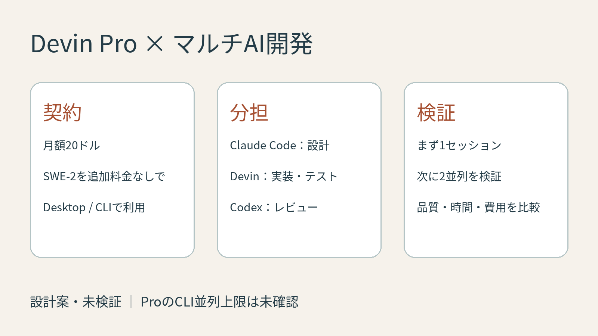
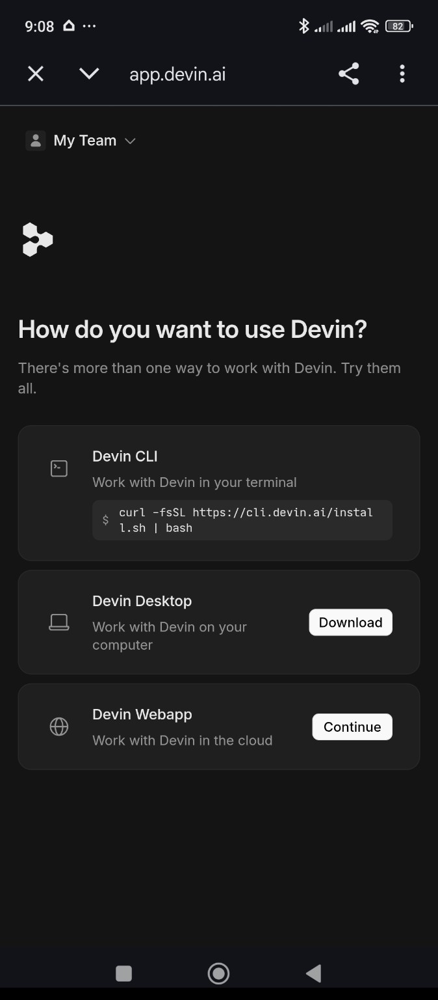
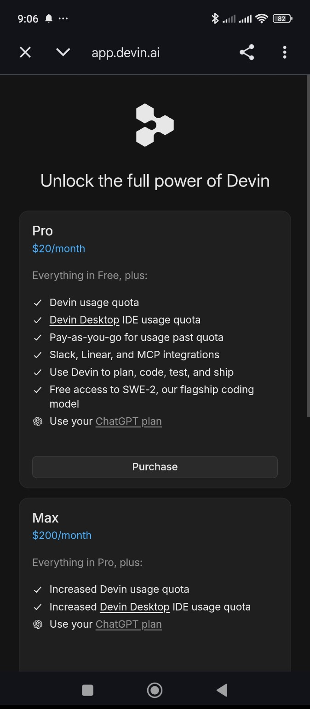
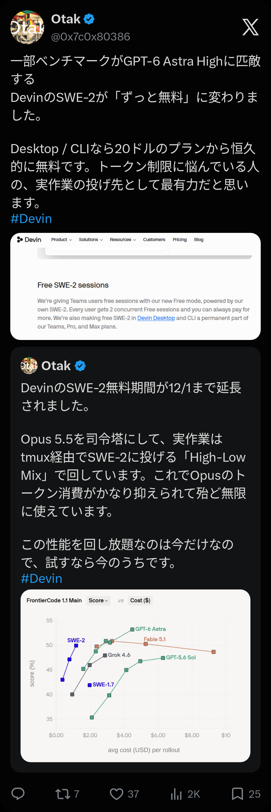
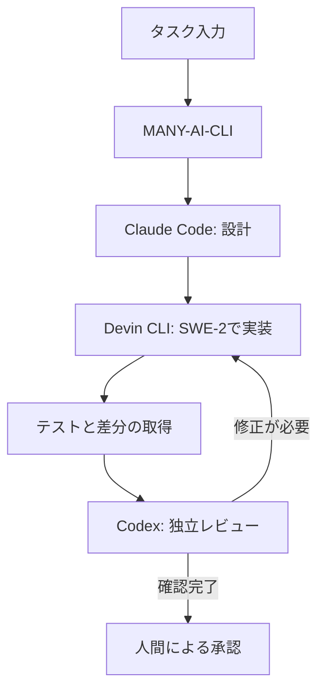

先に、結論を3行で書きます。

- Devin Proを契約しました。Desktop・CLIのSWE-2が追加料金なしで利用できるという公式発表がきっかけです。
- Claude CodeやCodexとDevin CLIをMANY-AI-CLIでつなぎ、設計・実装・レビューを分担する構成を考えています。
- 並列実行上限や品質は未検証です。まず1並列から始め、追加課金を防ぐ設定と作業環境の分離を確認します。



時間に合わせて、読み方を選べます。

- 少し忙しい人向け：[5分で読める要約版（個人サイト）](https://ishizakahiroshi.com/articles/2026/2026-11-14_devin-pro-multi-ai/)
- もっと深掘りしたい人は、このまま本文へどうぞ。

## まずCLIを使うところから

Devin Proを契約したので、Devin CLIを既存のマルチAI開発環境に組み込む方法を考えています。

本記事は実装済みの連携機能の紹介ではなく、2026年11月14日時点の設計案です。CLIの実行オプションや利用上限は実機で確認してから実装します。

契約後の案内画面に表示されているインストールコマンドは次のものです。

```bash
curl -fsSL https://cli.devin.ai/install.sh | bash
```



シェルスクリプトを直接実行するため、実際には内容を確認してから実行するのがよいと思います。

```bash
curl -fsSL https://cli.devin.ai/install.sh -o /tmp/devin-install.sh
less /tmp/devin-install.sh
bash /tmp/devin-install.sh
devin --help
```

WindowsではまずWSLなどの対応環境を確認します。インストール後はCLIのヘルプと公式ドキュメントで認証方法、モデル選択、非対話実行、出力形式を調べます。

https://docs.devin.ai/

## SWE-2の無料化で何が変わるのか

Cognitionの公式発表では、Devin DesktopとCLIのSWE-2をPro・Max・Teamsの恒久的な無料特典にすると説明しています。

https://devin.ai/blog/devins-new-teams-plan



ここで、契約と実行環境を区別しておきます。

| 項目 | 内容 |
| --- | --- |
| Pro | 月額20ドル |
| Max | 月額200ドル |
| Desktop・CLIのSWE-2 | 対象プランで追加のモデル利用料金なし |
| Teamsのクラウド無料セッション | 1ユーザーあたり2並列 |
| ProのCLI並列上限 | 未確認 |
| クラウド利用・他モデル | 別の利用枠や従量課金の可能性あり |

無料という言葉だけでクラウドの実行費用までゼロと考えないようにします。また、恒久無料という発表は将来の料金体系が絶対に変わらないという保証ではありません。

## High-Low Mixを自分の環境に取り入れたい

きっかけはOtakさんのX投稿でした。Opus 5.5を司令塔にして、tmux経由でSWE-2に実作業を任せる運用を紹介されています。

https://x.com/0x7c0x80386/status/2121243659710701726



自分も引用ポストで「これは飛びつきたい」と書いて、そのまま契約しました。

https://x.com/ishizakahiroshi/status/2121386995494908175

今月からChatGPTをPlusプランに変更しているので、利用枠を温存しながら開発を進める仕組みを作りたいところです。

MANY-AI-CLIにDevin CLIを追加して、以下のような分担を試したいと思っています。



役割は固定しすぎないようにします。難しい実装はClaude CodeやCodexに戻すこともあります。SWE-2の性能を実測してから、どこまで委譲するか決めたいです。

## CLIの違いをアダプターで吸収する

各CLIを呼び出す処理を共通化できれば、モデルやサービスが増えても、タスク管理側を大きく変えずに済みます。

以下は新規に追加する場合の概念的な構成です。既存のMANY-AI-CLIの実際のディレクトリ構成ではありません。

```text
orchestrator/
  providers/
    claude.ts
    codex.ts
    devin.ts
  scheduler.ts
  worktree.ts
  result.ts
  config.yaml
```

例えば、実行結果を次のような共通インターフェースにそろえます。

```typescript
interface Task {
  id: string;
  prompt: string;
  cwd: string;
  timeoutMs: number;
}

interface AgentResult {
  exitCode: number | null;
  stdout: string;
  stderr: string;
  timedOut: boolean;
}

interface AgentExecutor {
  execute(task: Task): Promise<AgentResult>;
}
```

実行コマンドは文字列としてシェルに渡すのではなく、引数配列で起動します。プロンプトに引用符や改行が含まれるためです。

```typescript
import { spawn } from 'node:child_process';

function startAgent(
  executable: string,
  args: string[],
  cwd: string,
) {
  return spawn(executable, args, {
    cwd,
    shell: false,
    stdio: ['ignore', 'pipe', 'pipe'],
  });
}
```

これは起動部分だけの例です。Devinのモデル指定や非対話モードの引数は、インストールしたバージョンのヘルプで確認してから設定します。未確認のオプションを本番のアダプターに決め打ちしません。

実際の実装では、標準出力と標準エラーの上限、終了コード、タイムアウト、子プロセスの終了処理も必要です。対話型の認証や承認待ちで止まった場合に、成功扱いしないようにします。

## 並列実行はworktreeで分離する

複数のAIが同じ作業ディレクトリで同時にファイルを書き換えると、変更が混ざります。そこで、タスクごとにGit worktreeを用意する構成を考えています。

```bash
# テスト用リポジトリで実行する例
git worktree add -b ai/task-a ../task-a HEAD
git worktree add -b ai/task-b ../task-b HEAD
```

タスクAは`../task-a`、タスクBは`../task-b`で実行します。両方の変更を同じブランチに直接書かせません。

worktreeはファイルの分離には有効ですが、同じファイルに対する変更を統合するときの競合までは防げません。タスク分解の段階で編集対象を分け、依存関係がある作業は順番に実行します。

また、worktreeはセキュリティ上のサンドボックスではありません。AIに渡す認証情報やアクセス権は別途制限します。

## 無料枠を前提にしたキューを作る

設定の案は次のような形です。

```yaml
providers:
  devin:
    enabled: true
    model: swe-2
    max_concurrency: 1
    queue: true
    auto_paid_fallback: false
    max_retries: 2
```

これはMANY-AI-CLI側に追加したい設定例であり、Devin公式の設定ファイルではありません。

`max_concurrency`は最初は1にします。動作確認と利用条件の確認ができたら2へ変更します。公式の並列上限が2だと決めつけているわけではありません。

`auto_paid_fallback`は、無料モデルが使えない場合に有料モデルへ自動切り替えしないための設定です。実際の課金防止には、Devin側のモデル選択と従量課金設定も確認する必要があります。この設定だけで課金が止まるわけではありません。

レート制限や認証エラーが出たらキューを止める。リトライは回数を制限する。タイムアウトしたプロセスは終了を確認してから次のタスクを開始する。

このあたりを先に作っておけば、セッション数を増やすときも扱いやすそうです。

## 何を測れば費用対効果が分かるか

実験は同じ初期コミットから開始し、同じ仕様とテストを使って比較する予定です。

| 検証項目 | 測るもの |
| --- | --- |
| 実装品質 | 受け入れテストの合格、仕様との一致 |
| 変更範囲 | 不要なファイル変更、差分の大きさ |
| 実行時間 | 開始からテスト完了までの時間 |
| 手戻り | 修正指示の回数、レビューに要した時間 |
| 並列性能 | 1並列と2並列の総完了時間、失敗率 |
| 費用 | 月額料金、追加請求、他AIの利用量 |

最初は小さなバグ修正やテスト追加を対象にします。難しい設計変更まで一気に任せると、何が原因で失敗したか分かりにくくなります。

AIの終了コードが0でも、実装が正しいとは限りません。差分、テスト結果、受け入れ条件を独立して確認します。

最終的には、人間が確認した変更だけをDraft PRにします。GitHubへの書き込み権限は専用のbotに限定し、マージは人間の承認後に行う運用を維持します。

## まず1タスク、次に2並列

SWE-2がどの程度使えるかは、まだ自分の環境で試していません。ベンチマークの成績と、実際のリポジトリで期待どおりの変更を作れるかは別の話です。

まずはCLIを導入し、非対話実行が可能か確認します。次にMANY-AI-CLIへアダプターを追加し、1タスクを最後まで回します。それができたら2並列で比較します。

月額20ドルの追加で、高性能なAIの利用枠をどれくらい温存できるのか。実装ができたら、結果を改めて記事にしたいと思います。

---

※ ヘッダー画像は AI（画像生成）で作成しています。

書いた人: ishizakahiroshi
群馬の北部で、保護猫2匹と暮らす、在宅エンジニア（何でも屋）
https://ishizakahiroshi.com/
https://github.com/ishizakahiroshi
X（業務委託・各種相談はこちら）：
https://x.com/ishizakahiroshi

バックエンド・インフラ・AI連携まわりで、業務委託のご相談を受け付けています。フルリモートです。スポットや週2〜3時間からでも歓迎で、いろんな案件に携われたらうれしいです。こんな相談、歓迎です。
