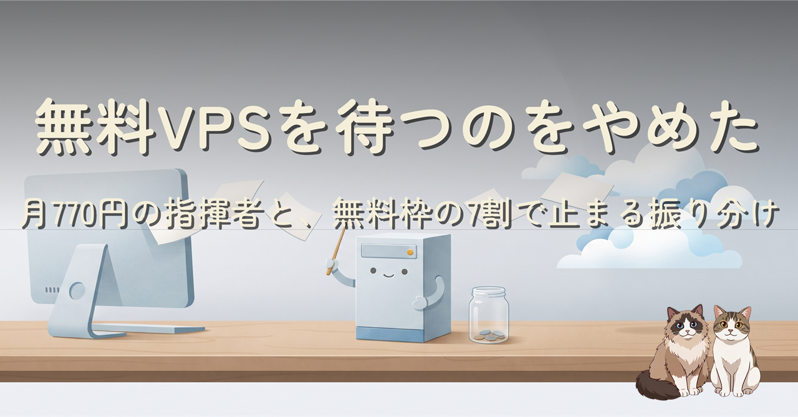
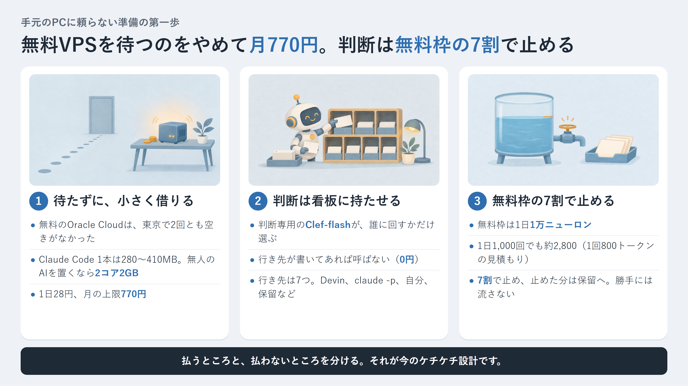
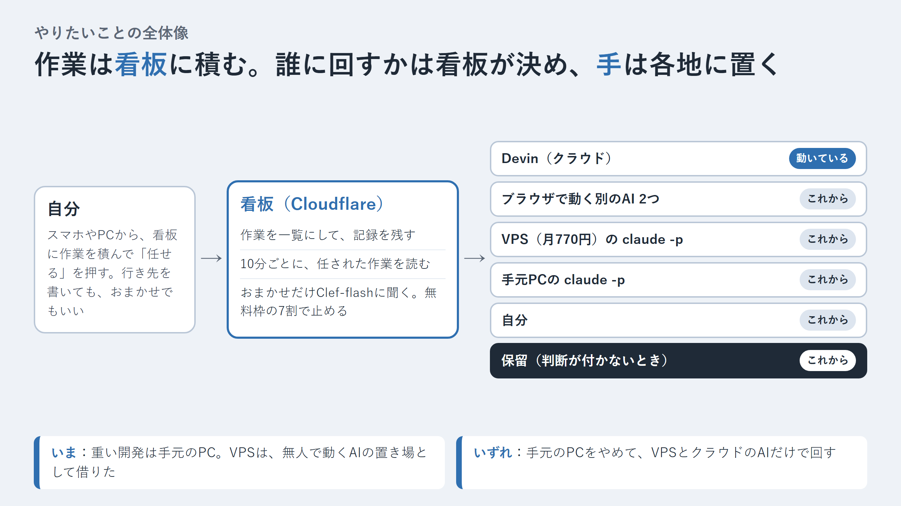
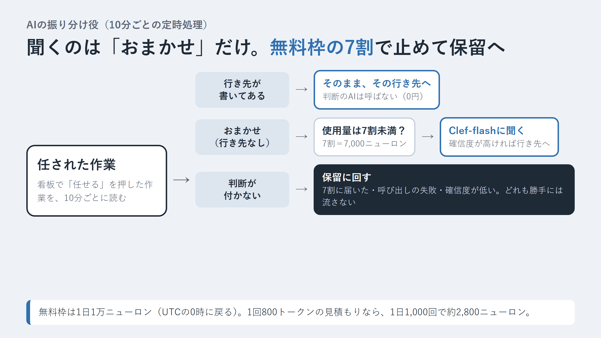

先に、結論を3行で書きます。

- 最終的には手元のPCをやめて、VPSとクラウドのAIだけで開発を回すつもりです。その一歩目として、月770円のVPSを借りました（無料のOracle Cloudは空き待ちでやめました）。
- 作業を誰に回すかは、作業を並べる看板（Cloudflare上）が10分ごとに決めます。判断は判断専用のモデル「Clef-flash」に任せ、行き先が書いてある作業では呼ばないので0円です。
- 呼んだ量を数えて、無料枠（1日1万ニューロン）の7割で止めます。止めた分は「保留」に回すので、課金も、作業が勝手に流れることも起きません。



時間に合わせて、読み方を選べます。

- 少し忙しい人向け：[5分で読める要約版（個人サイト）](https://ishizakahiroshi.com/articles/2026/2026-11-14_kechikechi-cloud-conductor/)
- もっと深掘りしたい人は、このまま本文へどうぞ。

この記事は、AIに作業を振り分ける仕組みを、なるべくお金をかけずに組むための設計メモです。やったことは次の3つです。

1. 無料のVPSをやめて、2コア2GBのVPSを月770円で借りた
2. 振り分けには文章を書くAIを使わず、判断専用のモデルに「誰に回すか」だけを選ばせる
3. その判断を Cloudflare Workers AI の無料枠の7割で止める

振り分けの仕組みは、自作の看板 [many-iris](https://github.com/ishizakahiroshi/many-iris)（AIの作業と自分の進み具合を一か所で見渡す進捗ボード）に足していきます。行き先の指定と振り分けは、まだ計画の段階です。

## やりたいことの全体像



自分が看板に作業を積み、看板が誰に回すかを決め、行き先のAIや自分が作業する、という流れです。いま動いているのは Devin への引き渡しだけで、ほかはこれからです。

- **看板（Cloudflare 上の many-iris）**: 作業の一覧と記録。10分ごとの cron が「任せる」を押された作業を読み、誰に回すかを決める
- **手（行き先）**: クラウドの Devin、ブラウザで動く別のAI 2つ、VPS の claude -p、手元PCの claude -p、自分。判断が付かないものは保留
- **VPS（今回借りたもの）**: 無人で動くAIの置き場。重い開発は、しばらく手元のPCで続ける
- **いずれ**: 手元のPCをやめて、VPS とクラウドだけで回す

最初は VPS の上のAIに振り分けを考えさせるつもりでしたが、判断は看板の cron に持たせました。判断と手を分けたので、VPS が止まっても振り分けは止まりません。

### では、VPS は最初から要ったのか

今日の時点では、VPS が無くても看板と Devin の組み合わせは回ります。どちらもクラウドにあるからです。それでも先に借りたのは、最終的に手元の PC をやめるつもりだからです。手元をやめると、無人で動くAIの置き場がクラウドの中に要ります。

クラウドのAIにも作業用の仮想環境（Devin や Claude Code のクラウド版など）はありますが、あれはそのAIの会社ごと、作業ごとに用意される場所で、自分の道具や設定を置いたまま使い続ける「自分の机」にはなりません。手元の PC の代わりになるのは自分で持ち続けられる机のほうなので、VPS にしました。

逆に、看板を VPS に置かず Cloudflare に置いているのは、認証まわりを自分で守り続けたくないからです。看板は外から開くページで、AIが書き込む入口（MCP）もあります。VPS に置くと、ログインの仕組み・鍵の扱い・サーバーの穴をずっと自分で見張ることになります。Cloudflare なら入口のログインは Cloudflare Access に任せられ、サーバーの更新も Cloudflare 側が持ちます。見張る範囲を小さくするための選択です。

| 段階 | 手元の PC | VPS | 振り分け |
|---|---|---|---|
| いま | 重い開発 | まだ何も動かしていない置き場 | Cloudflare の看板 |
| 次 | claude -p が看板から取りにいく | claude -p が看板から取りにいく | Cloudflare の看板 |
| いずれ | やめる | 無人のAIと開発の本体 | Cloudflare の看板 |
## 無料VPSをやめた理由

最初は Oracle Cloud の Always Free で、看板を見張る小さなサーバーを立てるつもりでした。

- Arm（A1）の無料枠は、今は **2 OCPU・12GB**（AIが最初「4コア24GB」と案内したのは誤りでした）
- 東京リージョンで2回作ろうとして、2回とも空きなし
- 7日間、CPU（95パーセンタイル）とネットワークの使用率が20%未満だと「使われていない」と見なす決まりがある（A1はメモリも対象）。見張り役だけの軽い使い方は当たりそう

出典: [Oracle Cloud の Always Free の説明](https://docs.oracle.com/en-us/iaas/Content/FreeTier/freetier_topic-Always_Free_Resources.htm)

空きを待つより、安く借りるほうが早いと判断しました。

## 何GB要るかは測って決める

役割を分けました。重い開発は手元のPC、VPSは無人で動くAIを1本置くだけ。複数のセッションは並べません。

| 測ったもの | 値 |
|---|---|
| 手元でClaude Codeを1本動かしたときのメモリ | 280〜410MB |
| VPSで初期設定とClaude Codeの導入を終えた後（動かしていない状態） | 使用 約459MB / 残り 約1,177MB |

選んだのは KAGOYA CLOUD VPS の **2コア・2GB・200GB**、1日28円、月の上限770円（税込の目安）です。

出典: [KAGOYA CLOUD VPS の料金](https://www.kagoya.jp/cloud/vps/)

## VPS の初期設定（Ubuntu 26.04）

やったことは最小限です。

- SSHの待受番号を既定から変える
- パスワードでのログインと、root でのログインを止める
- 自動のセキュリティ更新を有効にする

SSHの設定は、本体の `sshd_config` を書き換えず、`sshd_config.d` に1枚足しました。

```text:/etc/ssh/sshd_config.d/10-local.conf
Port <変更後の番号>
PasswordAuthentication no
KbdInteractiveAuthentication no
PermitRootLogin no
```

Ubuntu 26.04 は SSH を `ssh.socket` で待ち受けている（待受は socket 側が持っている）ので、待受番号を変えたら systemd に読み直させてから socket ごと再起動します。

```bash
sudo sshd -t                      # 書式の確認
sudo systemctl daemon-reload
sudo systemctl restart ssh.socket
```

接続できるのを**別の端末から**確かめてから、今のセッションを閉じます。

## 管理画面の「不正なリクエストです」は、タブの開きすぎだった

KAGOYAの作成画面で、作成ボタンを押すたびに「不正なリクエストです」が出ました。ブラウザの操作はAI（Claude Code）に任せていました。

AIは最初、備考欄の文字のせいだと言い、次にユーザーデータ（起動時に流す設定）のせいだと言いました。どちらを直しても変わりません。

通信の中身を覗く仕掛けを入れると、応答は**トークンのエラー**でした。


原因は、AIが同じ管理画面を複数のタブで開き、別のタブで読み込み直していたことです。画面が持っている確認用のトークン（CSRFトークン）が無効になっていました。タブを1つにして読み込み直したら、すぐ通りました。

- SPA の管理画面を自動操作するときは、**タブを1つに絞る**
- 同じエラーが2回続いたら、推測で入力を変える前に**通信を見る**

ほかに踏んだもの:

- PowerShell から `ssh-keygen -N '""'` と渡したら、空ではなく `""` という2文字が合言葉になった（`$PSNativeCommandArgumentPassing='Standard'` にして付け直した）
- Windows の OpenSSH は、ほかの利用者が読める鍵ファイルを受け付けない。`icacls` で継承を切り、自分・Administrators・SYSTEM だけにした

## サブスクとAPIキーの線引き

Anthropic の利用規約には、APIキーを使う場合などを除き、ボットやスクリプトのような自動の手段でサービスに入らないこと、という決まりがあります。

出典: [Anthropic Consumer Terms](https://www.anthropic.com/legal/consumer-terms)

なので、こう分けました。

| 使い方 | 認証 |
|---|---|
| 自分が画面の前で操作する | Pro/Max のサブスク |
| VPSで無人で回す（claude -p など） | APIキー（使う上限を決めたもの） |

注意点が1つあります。環境変数に `ANTHROPIC_API_KEY` があると、ログインしていてもAPIキーのほうが使われます。`-p` では確認なしで使われます。

出典: [Claude Code の環境変数](https://code.claude.com/docs/en/env-vars)

## 振り分けに文章を書くAIは要らない

やりたいことは「この作業を誰に回すか」を選ぶだけです。それなら、選択肢を渡すと確率で答える判断専用のモデルで足ります。

- 候補は TypeSafe の Jev と、Cloudflare の Clef
- Clef は Workers AI のモデルなので、看板の Worker から `env.AI.run()` で呼べる。外の鍵を増やさない
- 上位の Clef と軽い Clef-flash がある

出典: [Clef の発表](https://developers.cloudflare.com/changelog/post/2026-10-09-clef-omni-workers-ai/)

決めた形はこうです。

- 判断役は Clef-flash
- 判断を動かすのは、看板の Worker にある10分ごとの cron（`*/10 * * * *`）
- 行き先は7つ: Devin / ブラウザで動く別のクラウドのAI 2つ / VPSの claude -p / 手元PCの claude -p / 自分 / 保留
- 手元のPCは、看板へ自分宛ての作業を取りにいく

Devin への引き渡しは、もう動いています。看板で「任せる」と、cron が Devin のセッションを起こし、Devin が受け取り、結果を書き戻して完了まで一周しました。

## 1日1,000回判断したらいくらか



前提の数字です。

出典: [Workers AI の料金](https://developers.cloudflare.com/workers-ai/platform/pricing/)

- Workers AI は1日1万ニューロンまで無料（UTCの0時に戻る）。無料プランでは、超えると呼び出しが失敗するだけで課金されない
- Clef-flash は入力100万トークンあたり3,455ニューロン（0.038ドル）。出力は数えない
- Clef は入力100万トークンあたり21,818ニューロン（0.240ドル）

1回800トークンと見積もった場合:

| モデル | 1日1,000回 | 無料枠との関係 |
|---|---|---|
| Clef-flash | 約2,800ニューロン | 無料枠の3割弱 |
| Clef | 約17,500ニューロン | 超えた分が1日約0.08ドル（有料プランが前提） |

800トークンはまだ見積もりです。実際の値は動かしてから測ります。

## 無料枠の7割で止めるガード

振り分けの流れは次のとおりです（計画中）。

```text
cron（10分ごと）
  └ 引き渡し待ちの作業を読む
      ├ 行き先が書いてある → Clef を呼ばない（0円）
      └ 行き先が無い（おまかせ）
          ├ 今日の推定使用量 ≥ 7,000ニューロン → 保留
          ├ Clef-flash に choice で聞く
          │   ├ 確信度 < 下限 → 保留
          │   ├ 呼び出し失敗・形が違う → 保留
          │   └ それ以外 → その行き先を書く
          └ 行き先が devin のときだけ Devin を起こす
```

- 推定使用量は、看板の Durable Object に UTC の日ごとに記録する。1回分は「入力トークン数 × 3,455 ÷ 1,000,000」
- 判断が付かないときは、全部「保留」に倒す。作業が勝手に誰かへ流れる方向には倒さない
- 行き先の付いた作業は、その行き先の担当しか受け取れないようにする（違う相手が拾う事故を、仕組みで防ぐ）

無料枠はアカウント全体で1つなので、ほかの用途で先に使われると、7割より前に失敗が始まります。そのときも保留に倒れるだけです。

## many-iris はこんなときに刺さります

- AIに任せた作業と、自分の作業の進み具合を、一か所で見たい人
- 画面で「任せる」を押すと、AIが受け取って結果を書き戻す流れを作りたい人
- Cloudflare Workers の上で、看板を自分のドメインに置きたい人
- 行き先の指定と、無料枠で止まる振り分けは、これから足すところです

置き方は README にあります。Cloudflare のアカウントと、Cloudflare で管理しているドメインが要ります。

- リポジトリ（Issue / PR 歓迎）: https://github.com/ishizakahiroshi/many-iris

Star をいただけると開発の励みになります。

## まとめ

- 無料のVPSは待たない。無人のAIを1本置くなら2コア2GBで足りる（測ってから決める）
- 誰に回すかは看板が決める。文章を書くAIではなく、判断専用のモデルに選ばせる
- 判断は行き先が無いときだけ呼び、無料枠の7割で止めて保留に倒す

行き先の指定から実装していきます。

関連記事:

- [「これは飛びつきたい」ChatGPTをPlusに戻した私がDevin Proを即契約した話](https://qiita.com/ishizakahiroshi/items/72ab801a5f2a8c941b61)（今回の振り分け先の1つ、Devin の話です）
- [「30分外出するから進めて」で見えた壁。スマホのChatGPTとローカルAIをつなぐ実験](https://qiita.com/ishizakahiroshi/items/8bfb324e9d8869303fe6)（別のAIに仕事を渡して、受け取りまで確かめる難しさを書きました）

---

※ ヘッダー画像とインフォグラフィックの絵は AI（画像生成）で作成しています。

※ 本文の挿絵も AI（画像生成）で作成しています。

書いた人: ishizakahiroshi
群馬の北部で、保護猫2匹と暮らす、在宅エンジニア（何でも屋）
https://ishizakahiroshi.com/
https://github.com/ishizakahiroshi
X（業務委託・各種相談はこちら）：
https://x.com/ishizakahiroshi

バックエンド・インフラ・AI連携まわりで、業務委託のご相談を受け付けています。フルリモートです。スポットや週2〜3時間からでも歓迎で、いろんな案件に携われたらうれしいです。こんな相談、歓迎です。
