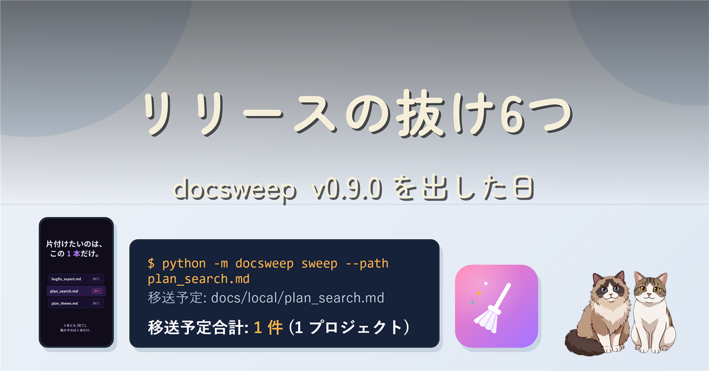
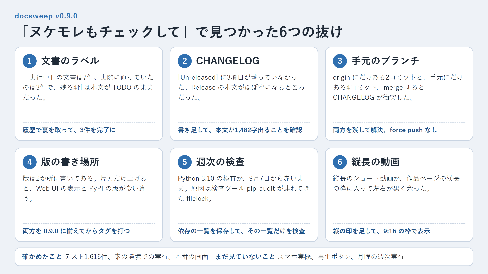
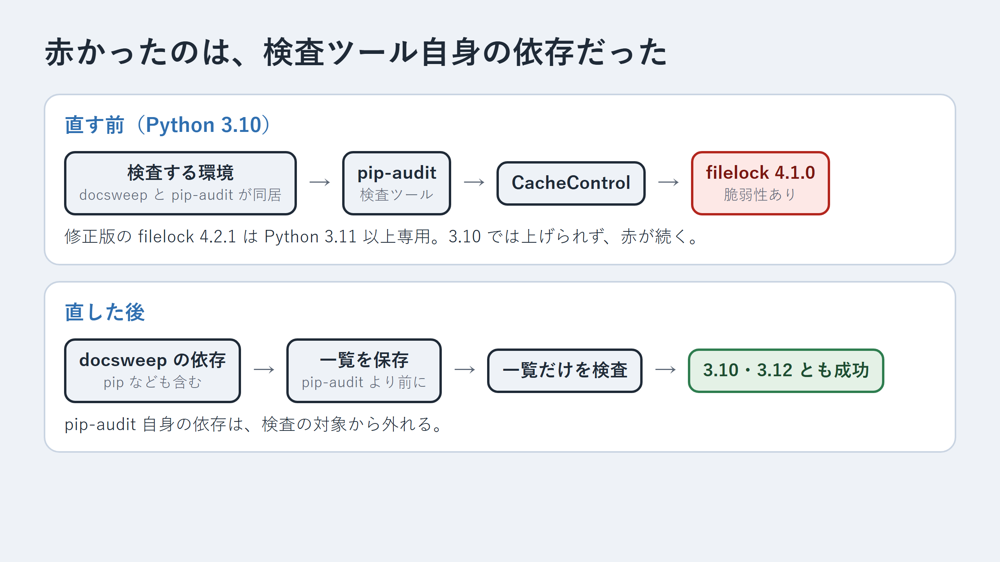
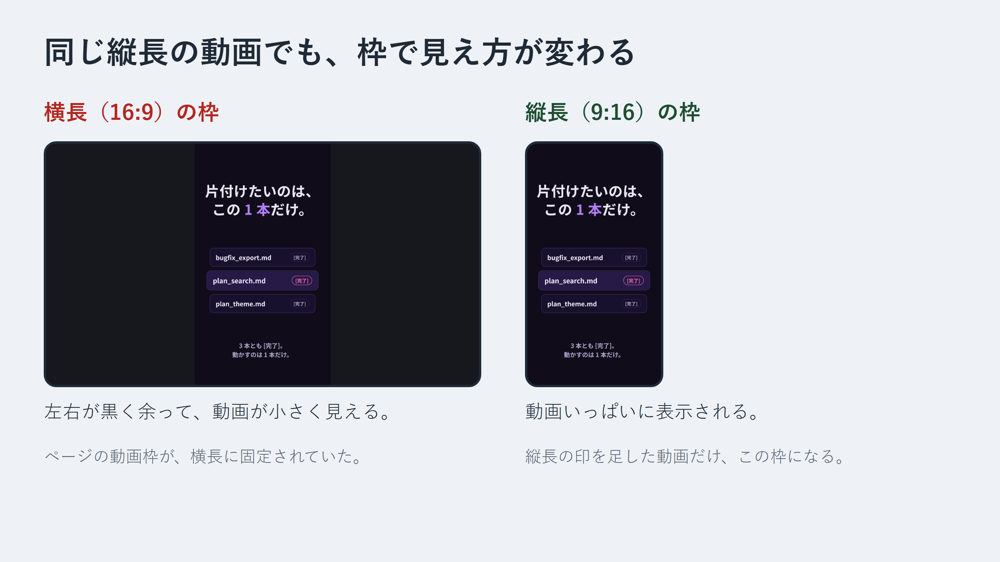

先に、結論を3行で書きます。

- docsweep v0.9.0 を出しました。片付ける文書を、選んだ1本だけに絞れる `sweep --path` が入っています。
- AI に「ヌケモレもチェックして」と頼んで進めたら、公開の前後で6つの抜けが出てきました。文書のラベル、CHANGELOG、手元のブランチ、版の書き場所、週次の検査、縦長動画の枠です。
- 直すたびに、テストやログ、本番の画面で確かめてから書きました。まだ見ていないのは、スマホ実機と、動画の再生ボタンです。



時間に合わせて、読み方を選べます。

- 少し忙しい人向け：[5分で読める要約版（個人サイト）](https://ishizakahiroshi.com/articles/2026/2026-11-15_docsweep-v0-9-0-release-gaps/)
- もっと深掘りしたい人は、このまま本文へどうぞ。

10月28日の v0.8.0 から2週間あまりたって、手元の develop には直した分が6コミット溜まっていました。次の版を出そうと、AI（Claude Code）に「release md 作ってほしい。ヌケモレもチェックしてね」と頼みました。release md は、そのリリース1回分の指定と手順と記録を1枚にまとめた作業メモです。

この記事は、そのとき出てきた抜けを、確かめたコマンドと一緒に並べたものです。

自作で [docsweep](https://github.com/ishizakahiroshi/docsweep) という CLI を作っています。AI が量産する作業ログの Markdown を、腐らせず自動で片付けます。

- 何ができるかの紹介ページ: https://ishizakahiroshi.com/work.html?id=docsweep
- 使い方と設計の詳しい説明: https://ishizakahiroshi.com/articles/docsweep/usage.html
- リポジトリ（Star をいただけると励みになります）: https://github.com/ishizakahiroshi/docsweep

同じ悩みを持っている方は、下記で入ります。

```bash
pip install docsweep
python -m docsweep triage
```

docsweep は PATH にコマンドを通さない使い方を標準にしているので、`python -m docsweep` の形で呼びます。

前回の記事: [作業メモを archive へ移すと参照が古いパスのまま残る問題を、docsweep v0.7.0 で移す前に止めて移した後に確かめる形にした](https://qiita.com/ishizakahiroshi/items/a51889e04e459ac3044e)

## 1. 文書のラベルは、履歴で裏を取ってから信じる

release md を作る前に、作業文書の状態を一覧にしました。H1 のラベルが `[実行中]` の bugfix が7件。履歴と CHANGELOG に突き合わせると、3件はすでに develop に入っていて、残る4件は本文が TODO のままでした。

あるコミットが、前の版に入っているかは、次で確かめられます。

```bash
git merge-base --is-ancestor <コミット> v0.8.0 && echo "in v0.8.0"
```

apply の連続実行が遅い件は、10月17日のコミットで直っていて v0.8.0 に入っていました。CHANGELOG にも書いてあります。ラベルだけが `[実行中]` のまま残っていました。ラベルだけを見て決めていたら、今回のリリースに入るものを取り違えたはずです。

3件は `docsweep apply --action relabel --to done --path <文書>` で完了にして、本文が TODO の4件は今回に入れないと決めました。

## 2. CHANGELOG の [Unreleased] を、git log と突き合わせる

`[Unreleased]` に書いてあったのは apply の dry-run の修正1件だけでした。

```bash
git log --oneline v0.8.0..HEAD
```

これを読むと、`sweep --path`、`provenance start` の警告、closeout-check が PHP の `No syntax errors` を失敗と読んでいた件の3つが、書かれていませんでした。

GitHub Release の本文は、今回から CHANGELOG のその版の節で作る形に変えたところでした。前の版は、比較リンクの1行だけで終わっていたからです。ここが空だと、本文もほとんど空になります。書き足してから、手元で本文を出して確かめました。

```bash
python scripts/release_notes.py v0.9.0
```

1,482字の本文が出ました。

## 3. push の前に fetch して、手元と origin のずれを見る

```bash
git fetch origin
git rev-list --left-right --count origin/develop...develop
```

結果は `2 4`。origin/develop に手元に無い2コミット（brief のスコア修正）、手元にだけある4コミットがありました。

`git merge-tree --write-tree develop origin/develop` では、衝突なしと出ていました。ただ、その結果は、そのとき commit してあった内容までの話です。CHANGELOG の追記を commit してから merge すると、同じ `[Unreleased]` の節で衝突しました。両方の項目を残して解決し、force push はしていません。

## 4. 版を書く場所を、全部洗う

版は `pyproject.toml` と `docsweep/__init__.py` の2か所に書いてあります。タグから導く作りではないので、洗い出してから両方を 0.9.0 にしました。

```bash
grep -rn "0\.8\.0" --include=*.py --include=*.toml .
```

ずれると、Web UI に出る版と PyPI の版が食い違います。

## 出したあとは、素の環境で動かす

タグを push すると、PyPI と GitHub Release の両方が通りました。そのあと、新しい venv に PyPI から入れました。extras は付けていません。

```bash
python -m venv v
./v/bin/python -m pip install docsweep==0.9.0
./v/bin/python -m docsweep --version
```

`--version` が返るだけでは、使う人の最初の一歩を見たことになりません。目玉の `sweep --path` を、2文書だけの合成した queue で動かしました。

- `--path` なし：候補は2本とも
- `--path` で1本を指定：候補はその1本だけ
- 存在しない path：拒否して、ファイルは動かない

## 5. 2か月以上赤かった週次の検査は、検査ツール自身が原因だった



図は、赤くなっていた3.10の検査で、脆弱性が出ていたパッケージの出どころです。docsweep の依存ではなく、検査に使う pip-audit が連れてきた filelock でした。

Dependency audit という週次の検査が、Python 3.10 の job だけ、9月7日から赤いままでした。以前は setuptools が原因で、これは直してありました。今回残っていたのは filelock 4.1.0 の脆弱性です。

filelock は、pip-audit が CacheControl を通して連れてきたものです。修正版の 4.2.1 は `requires_python` が 3.11 以上で、3.10 では上げられません。直す手段が無いまま赤が続く作りでした。

直し方は、pip-audit を入れる前に、docsweep 自身が入れた依存の一覧を保存して、その一覧だけを検査することです。

```yaml
# 直す前
- name: Install pip-audit
  run: python -m pip install pip-audit
- name: Audit installed runtime dependencies
  run: pip-audit --strict

# 直した後
- name: Record installed runtime dependencies
  run: python -m pip freeze --all --exclude-editable > "${{ runner.temp }}/runtime-requirements.txt"
- name: Install pip-audit
  run: python -m pip install pip-audit
- name: Audit installed runtime dependencies
  run: pip-audit --strict --no-deps -r "${{ runner.temp }}/runtime-requirements.txt"
```

`--all` を付けているので、pip と setuptools と wheel は、これまでどおり対象です。外れたのは、検査ツール自身の依存だけです。

develop と main で `workflow_dispatch` から手動実行して、3.10 と 3.12 のどちらも成功しました。ログには `No known vulnerabilities found` が出ていて、脆弱な固定入力が失敗するかを確かめる手順も通っています。次の月曜の週次実行でも緑になるかは、まだ見ていません。

## 6. 縦長の動画は、公開してから作品ページで見る

リリースの紹介に、縦長（1080×1920、20秒）のショート動画を作って、YouTube に公開しました。個人サイトの作品ページに載せて見たら、動画が横長（16:9）の枠の中に小さく入って、左右が黒く余っていました。開いて見て出た感想は「ショート動画なのに なんか YouTube の幅になっちゃって いまいちだね」でした。原因は、ページの動画枠が横長に固定されていたことです。



図は、同じ縦長の動画を、横長の枠に入れたときと、縦長の枠に入れたときの違いです。

直し方は、作品情報の動画に `aspect: vertical` という印を足せるようにすることでした。

```yaml
video:
  provider: youtube
  id: "<動画の id>"
  durationSeconds: 20
  aspect: vertical
```

サイトの側では、この値だけを受け取って、印のある動画に `is-vertical` のクラスを付けます。

```css
.work-video.is-vertical { max-width: 340px; }
.work-video.is-vertical .work-video-player { aspect-ratio: 9 / 16; }
```

画面幅 900px 以上では、動画を左、説明を右に並べました。印の無い動画は、これまでどおりです。テストは14件が通りました。直した部分を外すと、足したテスト2件が落ちることも確かめています。

deploy のときは、`pnpm run deploy` が依存の入れ直しを始めて、`node_modules` の削除の確認で止まりました。本体側の `node_modules` が無事なことを確かめてから、ビルドと deploy を直接実行しました。

## まだ見ていないものは、見ていないと書く

見ていないものが、まだ3つあります。スマホ実機での表示、再生ボタンを押して実際に再生されること、次の月曜の週次実行です。

本番の画面は、この PC の Chrome を画面なしで起動して撮りました。ただ、この方法は幅を500px未満に縮められず、スマホの幅は撮れません。

手元でしか動かない検査もありました。構造の検査は、この PC に必要なツールが入っていなくて動きませんでした。同じ検査が CI にあるので、そちらで通ったことを確かめました。

## 抜けは、見つけるたびに、確かめ方を決め直した

今回、抜けのたびに「何で確かめれば、見たことになるか」を決め直しました。

- 文書のラベルは、履歴と CHANGELOG で裏を取ってから信じる
- 手元の結果は、あとから足した変更を含まない。push の前にもう一度 fetch して見る
- 公開は、素の環境で動かすまでを1セットにする
- 公開した後の本番の画面も、点検の範囲に入れる

## docsweep はこんなときに刺さります

- AI が作った plan や bugfix の Markdown が溜まって、どれが終わったのか分からなくなっている人
- 古くなった作業文書を「要判断」の印で洗い出したい人
- 複数プロジェクトの作業文書を、1画面で見たい人
- 文書を移すとき、選んだ1本だけに絞りたい人（v0.9.0 の `sweep --path`）

いずれかに心当たりがあれば、`pip install docsweep` で試せます。最初は `python -m docsweep triage` で、今の文書の状態を見るところからどうぞ。

- 紹介ページ（スクショと機能一覧）: https://ishizakahiroshi.com/work.html?id=docsweep
- 使い方と設計の解説: https://ishizakahiroshi.com/articles/docsweep/usage.html
- リポジトリ（Issue / PR 歓迎）: https://github.com/ishizakahiroshi/docsweep
- PyPI: https://pypi.org/project/docsweep/

Star をいただけると開発の励みになります。使ってみて「ここが不便」があれば、Issue でも X の DM でも大歓迎です。

## あわせて読みたい

- [手元の pytest が緑でもリリースしてはいけない。タグを打つまでに踏んだ4つの穴（CI / CSP / 依存上限 / wheel）](https://qiita.com/ishizakahiroshi/items/9653a0a9273abd99a699)：同じ docsweep の v0.4.0 を出す前に見つかった抜けの話です。
- [直した直後に「完了」にしない。作業メモに3日の卒業期限を持たせた設計](https://note.com/ishizakahiroshi/n/n7db5a19e45c6)：作業メモのラベルと実際の状態がずれる問題を扱った話です。

## おわりに

次の月曜の週次実行を見て、赤い検査が緑に変わったかを確かめます。スマホでも、一度ちゃんと開いて見ます。

---

書いた人: ishizakahiroshi
群馬の北部で、保護猫2匹と暮らす、在宅エンジニア（何でも屋）
https://ishizakahiroshi.com/
https://github.com/ishizakahiroshi
X（業務委託・各種相談はこちら）：
https://x.com/ishizakahiroshi

バックエンド・インフラ・AI連携まわりで、業務委託のご相談を受け付けています。フルリモートです。スポットや週2〜3時間からでも歓迎で、いろんな案件に携われたらうれしいです。こんな相談、歓迎です。
