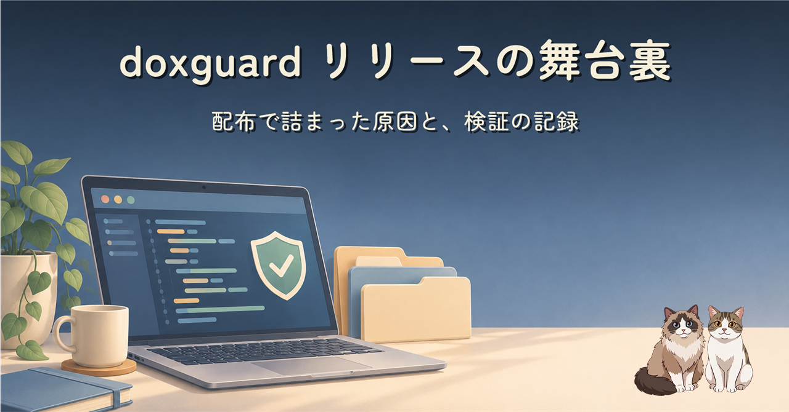
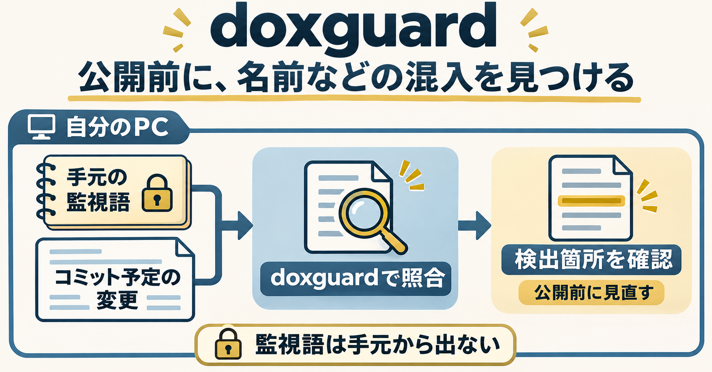
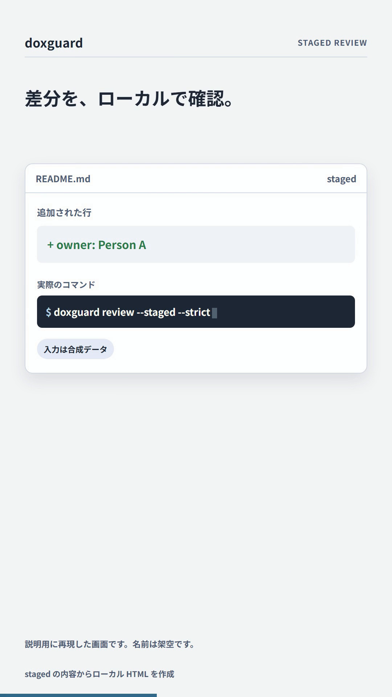
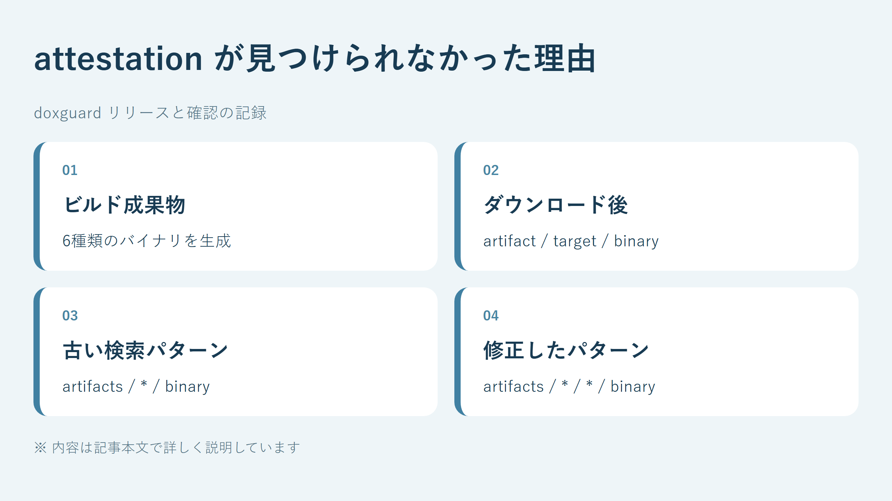
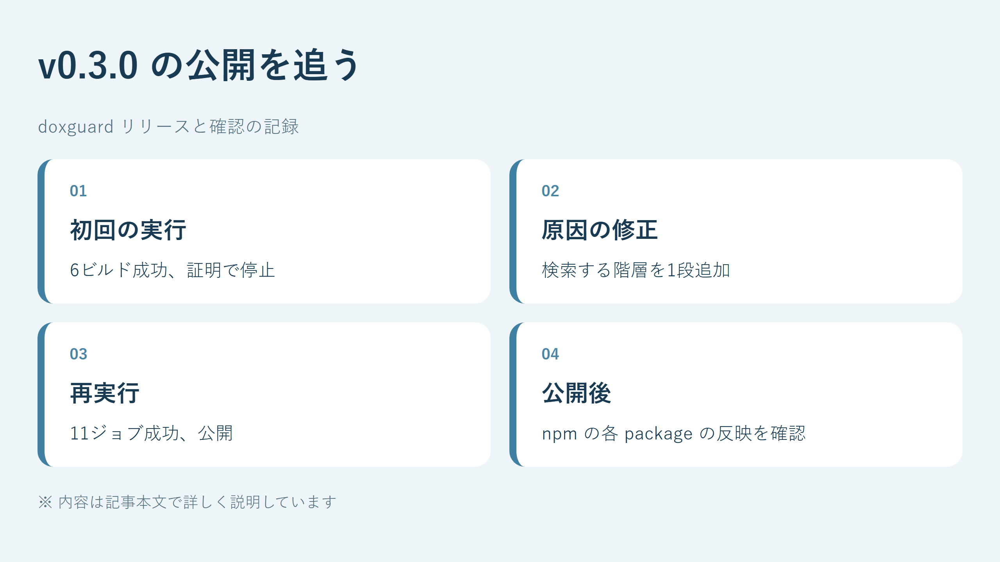
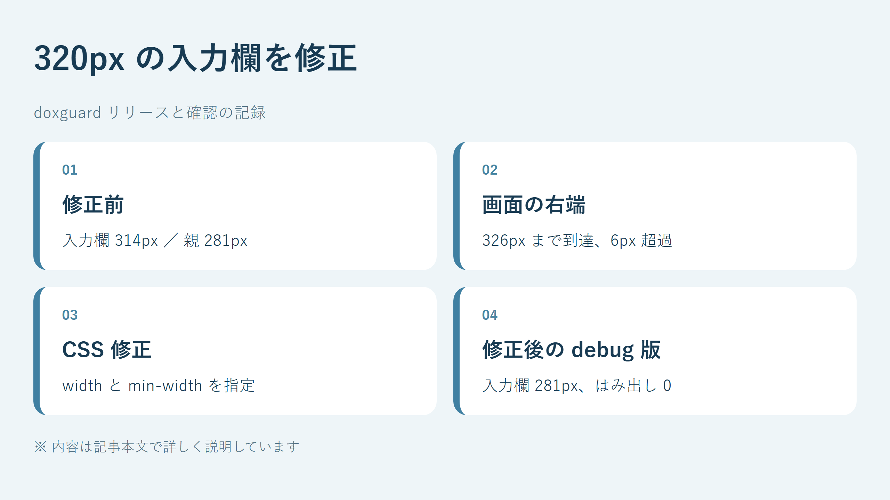
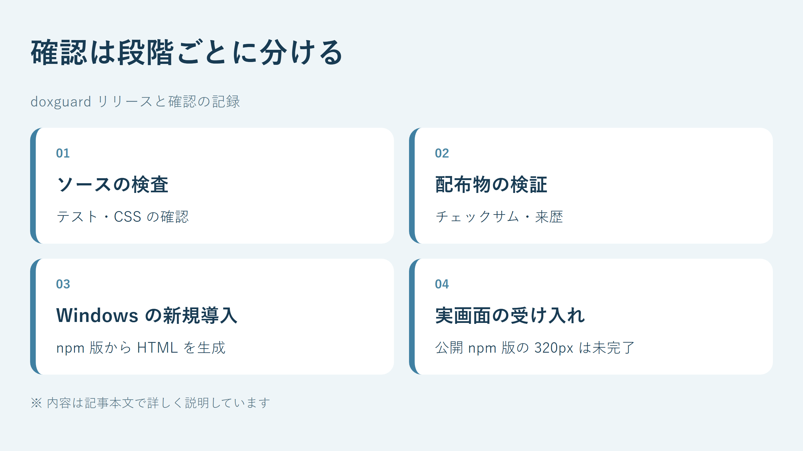

先に、結論を3行で書きます。

- v0.3.0では6本のビルドが成功した後、attestationの対象ファイルを見つけられず、最初のリリース処理が止まりました。
- artifactの実際の配置に合わせて検索パターンと回帰テストを直し、v0.3.0は再実行後に公開できました。
- 別の更新であるv0.3.1は公開済みですが、npm版HTMLの320px実画面確認は未完了です。

手元の監視語とコミット予定の変更を照合し、公開前に検出箇所を確認します。監視語は自分のPC内で扱います。

動画で知りたい方は、この下の紹介動画へ。文章で知りたい方は、動画の下から本文へ進めます。

## 20秒の紹介動画

https://www.youtube.com/watch?v=0-PqYgbWrqc

doxguardの用途を短く紹介する20秒の動画です。動画と画面例には合成データを使い、Person Aは架空の名前です。

この画面は動画の内容を示す静止画です。

この記事では、二つの問題を分けて記録します。前半はGitHub Actionsの成果物配置とattestation、後半は公開したHTMLレポートのスマートフォン幅表示と、リリース後の検証範囲です。

対象は[doxguardの公開リポジトリ](https://github.com/ishizakahiroshi/doxguard)です。作品の概要は[紹介ページ](https://ishizakahiroshi.com/work.html?id=doxguard)、導入方法は[使い方ガイド](https://ishizakahiroshi.github.io/doxguard/)と[最新README](https://github.com/ishizakahiroshi/doxguard#readme)にあります。ガイドは以前の版をもとにしているため、現在のインストール手順はREADMEを優先してください。

## まず、doxguardは何をするツールか

doxguardは、公開リポジトリに個人に結び付く情報が混ざるのを、コミット前や公開前に見つけるためのRust製CLIです。開発中に出力したログ、設定例、ドキュメントなどには、本人の名前、勤務先、非公開のメールアドレス、ローカルパスといった情報が意図せず残ることがあります。

APIキーやトークンを探す検査だけでは、その人にとって非公開にしたい名前や文字列まで指定できません。doxguardでは、利用者が自分の監視語リストをリポジトリの外に用意し、手元の変更と照合します。監視語の内容はローカルで読み込み、外部へ送信しません。CIでは通常、privateな監視語を使わず、構造パターンを対象にします。

スキャンは読み取り専用で、対象ファイルを自動修正したり削除したりしません。検出結果は人が文脈を見て判断します。監視語に登録していない情報をすべて発見できるわけではないため、他のセキュリティ検査や公開前の確認も必要です。

v0.3.0では、ステージ済みの変更について、検出値、場所、前後の文脈などをローカルのHTMLレポートで確認する`review`が加わりました。検出値を含むレポートは非公開として扱い、Gitに含めたり外部に送ったりしないことが前提です。今回の記事は、この機能を含むv0.3.0の配布と、そのHTML表示を修正したv0.3.1のリリースで起きたことを扱います。

## インストールして、最初の確認をする

ここではnpmを使う手順を紹介します。Node.jsとnpmが使える環境で、次を実行します。Windows、macOS、Linux向けの配布がありますが、今回v0.3.1の新規導入とHTML生成を実機で確認したのはWindows x64です。その他の環境の確認状況は、この記事のリリース記録と[最新README](https://github.com/ishizakahiroshi/doxguard#readme)を参照してください。

    npm install --global doxguard
    doxguard --version

続いて、確認したいGitリポジトリのフォルダーへ移動し、初期化します。

    doxguard init

監視語リストはリポジトリの外に置きます。1行に1語ずつ記載し、初期化で作られたローカル設定の参照先と、実際に置いたファイル名を合わせてください。内容には本人が非公開にしたい文字列を登録します。監視語ファイルそのものや実際の保存先を公開リポジトリへ書き込まないようにします。

生成された設定が参照する`DOXGUARD_WATCHLIST_DIR`を、監視語ファイルを置いたディレクトリに設定します。以下の`<watchlist-directory>`は実際の保存先へ置き換えてください。

WindowsのPowerShellでは次の形です。

    $env:DOXGUARD_WATCHLIST_DIR = "<watchlist-directory>"

macOS・Linuxのシェルでは次の形です。

    export DOXGUARD_WATCHLIST_DIR="<watchlist-directory>"

ここで設定した値は現在のシェルで使うものです。別の端末を開く場合は、その環境でも設定を有効にしてください。監視語の参照先が未設定・読み取り不能なら、検査はエラーで停止します。

HTMLで確認するには、まず`.gitignore`に`/.doxguard/reports/`を追加します。確認したい変更をステージした後、次を実行します。

    doxguard review --staged --strict

表示されたパスのHTMLを手元のブラウザーで開き、検出の場所と前後の文章を確認します。レポートは自動では開きません。検出や未検査の範囲があって終了コード1となっても、HTMLが生成されている場合があります。出力内容を確認してください。

必要な修正を行ったら再度ステージし、次の検査を行います。

    doxguard scan --staged --block --strict

導入後にnpm側のdoxguardを更新したときは、`doxguard install-hooks`でGit内にキャッシュされたフック用バイナリも更新します。詳しい設定とLinuxのnpm 10での注意点は[READMEの導入手順](https://github.com/ishizakahiroshi/doxguard#install)にあります。

機能の概要と関連ページは[doxguardの作品詳細ページ](https://ishizakahiroshi.com/work.html?id=doxguard)からも確認できます。

## 1. v0.3.0はビルド後のattestationで止まった

v0.3.0の最初のRelease workflowでは、Windows、macOS、Linux向けの6バイナリをビルドできました。しかし、その後の来歴証明を作るジョブが対象ファイルを1件も見つけられずに失敗しました。Releaseとnpm公開のジョブは実行されず、この試行では何も公開されていません。GitHub Releaseとnpmの最新版がv0.2.1のままであることも確認しました。

問題はバイナリそのものでも署名処理でもなく、成果物をダウンロードした後のディレクトリ階層でした。workflowでは`actions/download-artifact`に`merge-multiple: false`を指定しています。この設定ではartifactごとのフォルダーが作られ、その中にOS・CPUのslug、その下に実行ファイルが置かれます。実際の配置は次の形です。

    artifacts/<artifact>/<target>/doxguard
    artifacts/<artifact>/<target>/doxguard.exe

ところが失敗時の`subject-path`はartifactフォルダーの直下に実行ファイルがある前提で、ディレクトリ階層を1段しか指定していませんでした。

    artifacts/*/doxguard
    artifacts/*/doxguard.exe

そのため6個すべてのビルドが終わっても、attestationジョブのglobには一致するファイルがなく、リリース全体がそこで停止しました。「ビルド成功」と「リリース成功」は同じ意味ではありません。後続ジョブに必要な成果物を見つけられるかも、独立した失敗点になります。

## 2. 実際の配置にglobを合わせ、回帰テストを追加

修正では、実際のディレクトリ階層に合わせてglobを2段にしました。

    artifacts/*/*/doxguard
    artifacts/*/*/doxguard.exe

修正と同時に`tests/release_layout.rs`へ`attestation_subjects_match_the_downloaded_artifact_layout`を追加しました。workflowに2階層のUnix・Windows用パターンがあること、一階層の古いパターンが残っていないことを確認するテストです。外部のGitHub Actionsをテスト内で動かすものではありませんが、今回と同じ「設定のglobだけが古い階層を前提に戻る」変更を検出できます。

初回run後、GitHub Releaseとnpmのどちらにもv0.3.0の公開物がなく、両方の最新がv0.2.1のままであることを確認しました。その状態でv0.3.0タグを修正commitへ付け直し、リリース処理を再実行しました。2回目はRelease workflowの11ジョブがすべて成功し、6つのアーカイブ、`SHA256SUMS.txt`、`SOURCE_COMMIT.txt`と、npmの本体・6つのplatform packageが公開されました。

公開物の確認では、6アーカイブのチェックサムを照合し、6バイナリそれぞれのattestationも検証しました。npmの7パッケージがv0.3.0になったことと、Windowsの新しい環境でインストールしてコマンドが動き、合成データからHTMLレポートを生成することも確認しています。

## 3. npmへの反映待ちとLinux npm 10は別の確認事項

v0.3.0の公開が成功した後、npmでは本体パッケージの版が先に見え、OS別のplatform packageが最新として見えるまで少し時間差がありました。反映途中にインストールを試すと、必要なnative packageが見つからないエラーになります。6つのplatform packageが揃った後に再試行すると導入できました。root packageだけを見て完了と判断せず、依存先の公開状況と、少し待った後の導入まで確認する必要がありました。

また、UbuntuのNode.js 22・npm 10.9.8では、`npx doxguard`を実行しても`doxguard: not found`となりました。npm 10でローカルの実行リンクが作られない場合があるためです。READMEに記載した`npm install doxguard`の後に`npm rebuild doxguard`を行う手順では、コマンドが動くことを確認しました。

この二つは、artifactのglobを直したことで解消した問題ではありません。前者は公開直後にpackageごとの反映を待つ必要があったこと、後者は特定のnpm構成での導入方法に注意が要ることです。v0.3.1の狭幅CSS修正とも別件なので、この記事ではそれぞれを別の確認事項として扱います。

## 4. v0.3.1では別の問題を修正

ここからはattestationとは別の話です。v0.3.0をブラウザーで確認した際、HTMLレポートにあるJSONファイル入力欄が幅320pxの画面からはみ出しました。測定では、入力欄が314px、親のツールバーが281pxで、入力欄の右端がviewportの326pxに達していました。320pxより6px外側です。

[修正したCSS](https://github.com/ishizakahiroshi/doxguard/blob/94c4e80582e9b5418d5ccdb862e24d5d651d5a26/src/review.html)について、測定値から、ファイル入力欄が親要素に合わせて縮まらず、最小幅を持ったままになっていると見立てました。`src/review.html`の500px以下のメディアクエリに、次の指定を追加しました。

    .toolbar label input[type=file] {
      width: 100%;
      min-width: 0;
      box-sizing: border-box;
    }

`width: 100%`で親の幅まで広げ、`min-width: 0`で縮小を妨げる最小幅を外し、`box-sizing: border-box`で枠線と内側の余白を含めて幅を計算します。今回の変更はHTMLレポートの表示だけで、監視語の判定、CLIのスキャン、終了コードの意味は変えていません。

修正直後はローカルのdebug buildで320px幅を確認し、ページ幅305px、入力欄281px、横にはみ出す要素が0件でした。その修正を含むv0.3.1を公開した後、Release workflowは11ジョブすべて成功しました。

## 5. v0.3.1で確認したこと、まだ確認できていないこと

公開前のソース確認では`cargo test --all-targets --locked`が198件成功、`node --test tests/review-ui.test.cjs`が4件成功でした。公開後は、6アーカイブのchecksumと各バイナリのattestation、npm本体と6 platform packageがすべてv0.3.1であることを確認しました。npmの空cacheと新しいprefixを使ったWindows x64環境にも導入し、`npm ls --depth=0`と`doxguard --version`がv0.3.1を示し、合成データの`review --staged`からHTMLが生成されるところまで確かめています。

ただし、そこで得たHTMLのCSSに修正ルールが入っていたことを静的に確認しただけでは、画面が320pxで正しく収まることまでは証明できません。npm版が生成したHTMLをChromeで開く最終確認は、検証用ブラウザーがローカルの`file:` URLを開けず、完了していません。HTTPサーバー等へ経路を変えて確認済みに見せることもしていません。

現在の状態は「リリース成功」「配布物・来歴・Windows導入の検証済み」「公開npm版の320px実画面受け入れは未完了」です。テスト、workflow、配布物、導入、実画面は、それぞれ答えている質問が違います。どれか一つの成功を、残りの確認まで済んだという意味に広げないようにしました。

## 確認に使った公開記録

- [v0.3.1 GitHub Release](https://github.com/ishizakahiroshi/doxguard/releases/tag/v0.3.1)
- [v0.3.1のRelease workflow](https://github.com/ishizakahiroshi/doxguard/actions/runs/43687606762)
- [v0.3.0初回の失敗run](https://github.com/ishizakahiroshi/doxguard/actions/runs/43674711568)
- [attestation対象globの修正commit](https://github.com/ishizakahiroshi/doxguard/commit/729ad3d9cf0997cf3c230977fe84357e1ee58778)
- [v0.3.0の成功run](https://github.com/ishizakahiroshi/doxguard/actions/runs/43675439907)
- [v0.3.1のreview.html](https://github.com/ishizakahiroshi/doxguard/blob/94c4e80582e9b5418d5ccdb862e24d5d651d5a26/src/review.html)
- [作品紹介ページ](https://ishizakahiroshi.com/work.html?id=doxguard)
- [使い方ガイド](https://ishizakahiroshi.github.io/doxguard/)
- [最新のREADME](https://github.com/ishizakahiroshi/doxguard#readme)

※ ヘッダー画像・冒頭の説明図・本文の挿絵はAI（画像生成）で作成しています。

## まとめ

今回のリリース作業では、まずartifactの実際の配置とglobの前提が合っていない不具合を直しました。その後、別の版でHTMLレポートの狭幅表示を修正し、配布物、来歴、npm導入を確認しました。リリース自体は成功していますが、公開npm版を幅320pxで見る受け入れ確認はまだ残っています。

同じようなリリースを作るときは、buildログの成功だけで公開完了とせず、後段ジョブが受け取るファイル配置を確かめること、直した配置前提をテストに残すこと、公開後の実機確認を別の完了条件として追うことが役立ちます。

[doxguardのソースコード](https://github.com/ishizakahiroshi/doxguard)

## あわせて読みたい

- [Rust候補を30リポジトリへ導入して、追加検査を15件保留にした理由](https://qiita.com/ishizakahiroshi/items/cdbe8d6a65c4d17e564a)
