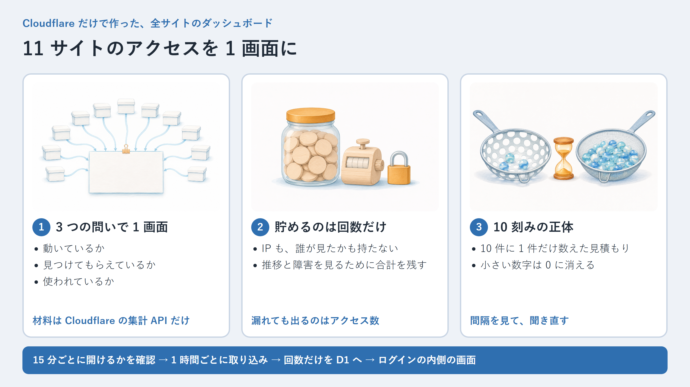
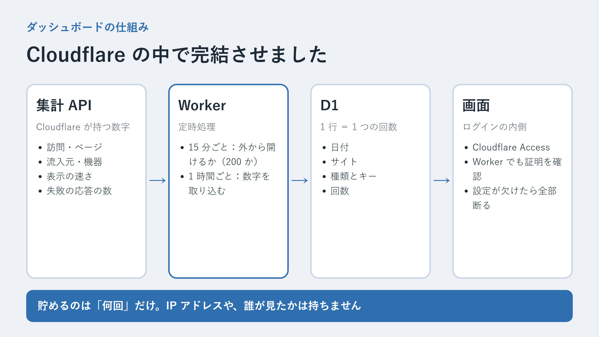
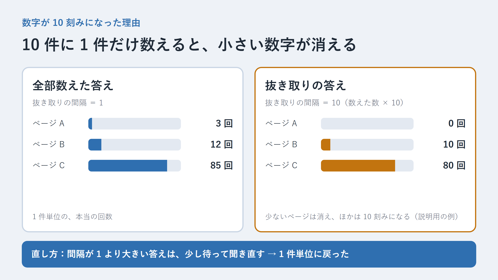

先に、結論を3行で書きます。

- Cloudflare の Web Analytics と GraphQL の集計 API だけで、11 サイトの「動いているか・見つけてもらえているか・使われているか」を 1 画面にまとめました。
- 貯めるのは「何回」という合計の数だけで、利用者ひとりひとりの記録は持ちません。
- 取り込んだ数字が 10 刻みになったのは、Cloudflare が抜き取った記録から見積もった答えを返していたためで、`sampleInterval` を見て聞き直すと 1 件単位に戻りました。



学校さがしの地図や、子ども向けの学習アプリを作っていたら、入口が 10 個になっていました。個人サイトを足すと 11 サイトです。

「で、いま何人来てるの？」と思っても、Cloudflare の画面をサイトごとに開いて回るしかありません。11 回。夕方にそれをやっていて、さすがに嫌になりました。

## 欲しかったのは、3 つの問いに答える画面でした

最初に作ったモックは、サイト名と数字が並ぶだけの表でした。自分で見ても、開く気が起きない。

Web サービスの管理画面に何が要るのかを調べ直して、サイトごとに次の 3 つへ答える形に落ち着きました。

- 動いているか（外から開けるか、失敗の応答が出ていないか）
- 見つけてもらえているか（検索から来ているのか、ほかのサイトから来ているのか）
- 使われているか（どのページが、何で見られているか）

左にサイドバーを置き、「学校をさがす」「まなぶ」「くらし」「個人サイト」のグループで折りたためるようにしました。サイトが増えても、縦に長くなりすぎないように。モックは 6 回作り直しています。

## 材料は、Cloudflare に全部ありました

各サイトには、もともと Cloudflare の Web Analytics（Cookie を使わない計測）が入っています。Google アナリティクスは入れていません。Cookie で利用者を追う仕組みなので、サイトの方針と合わないためです。

調べてみると、欲しかった数字はほぼ全部、Cloudflare の GraphQL の集計 API から取れました。

| 知りたいこと | 使ったデータ |
|---|---|
| 訪問・ページ・流入元・機器・時間帯 | `rumPageloadEventsAdaptiveGroups` |
| 表示の速さ | `rumWebVitalsEventsAdaptiveGroups` |
| 失敗の応答の数 | ゾーンの `httpRequestsAdaptiveGroups` |

1 日分の訪問を、サイト・ページ・国で分けて聞くときの問い合わせはこんな形です（アカウントの値は伏せています）。

```graphql
query {
  viewer {
    accounts(filter: { accountTag: "<account-tag>" }) {
      rumPageloadEventsAdaptiveGroups(
        filter: { AND: [
          { datetime_geq: "2026-01-01T00:00:00Z" },
          { datetime_leq: "2026-01-01T23:59:59Z" },
          { bot: 0 }
        ] }
        limit: 10000
        orderBy: [count_DESC]
      ) {
        count
        avg { sampleInterval }
        sum { visits }
        dimensions { requestHost requestPath countryName }
      }
    }
  }
}
```

`avg { sampleInterval }` は、最初は入れていませんでした。これが後で効いてきます。

仕組みは、Cloudflare の中で完結させました。



15 分おきの定時処理で、各サイトが外から開けるか（200 が返るか）を確かめます。1 時間に 1 回は集計 API から数字を取り込み、Workers のデータベース（D1）に「日付・サイト・種類・キー・回数」の 1 行ずつで貯めます。画面は Cloudflare Access のログインの内側に置き、Worker の側でもログインの証明を確かめて、設定が欠けていたら全部断る作りにしました。

```text
dashboard/
├── worker/       … 定時処理・取り込み・ログインの確認・画面へ渡す API
├── public/       … 画面（HTML・CSS・JS）
├── migrations/   … D1 のテーブル
└── sites.json    … サイトの一覧とグループ
```

集計 API の鍵は、読むことしかできない権限（アカウントの集計の読み取り、ゾーンの集計の読み取り、ゾーンの読み取り）だけで作っています。

## 持たなくていいものは、持たないことにしました

最近は情報漏えいの話をよく聞くので、そもそも数字を貯めずに、画面を開くたびに Cloudflare へ聞けばいいのでは、とも考えました。

試してみると、それだと困ることが 3 つありました。

- 1 回に聞ける期間の幅に上限がある（訪問は 13 週間ほど、応答の数は 4 週間ほど）
- 35 日分をまとめて聞くと、答えが 10 刻みの見積もりになった
- 「外から開けたか」の結果は、こちらで確かめているもので、Cloudflare には無い

なので、合計の数だけは貯めることにしました。入っているのは「この日、このページが何回開かれたか」のような数だけで、IP アドレスも、誰が見たかもありません。丸ごと漏れても、出ていくのは自分のサイトのアクセス数です。

## 機械のアクセスは、Cloudflare の印をすり抜けていました

学習アプリを公開した日の夜、高校版の地図に 3 時間で千数百の訪問がありました。

喜びかけて、中身を見て手が止まりました。ほぼ全部が海外から、地図のページだけ、1 回の訪問で 1 ページ。問い合わせでは `bot: 0`（機械を除く）で絞っているのに、残っていました。

そこで、時間帯の数字から次の形を「機械らしいアクセス」と推定して、印を付けることにしました。

- 1 時間の海外からの訪問が 100 以上
- その日の 1 時間あたりの中央値の 10 倍以上
- 1 回の訪問で見たページが 1.2 以下

あくまで特徴からの推定なので、画面にもそう書いています。数字から除くかどうかは、ボタンで切り替えます。

## 動き出したら、数字が全部 10 の倍数でした

鍵を入れて最初の集計が回り、外からの確認は 15 サイトの行すべてで 200、いちばん遅くても 0.43 秒でした。ここまでは順調。

ところが訪問のほうは、きょうの分は入るのに、前の日の分が 0 だったり、流入元だけ 0 だったり。取り込むたびに、どこかが欠けます。

取り込みのたびに「何件返ってきたか」を残すようにしたら、訪問の合計が問い合わせごとに食い違っていました。ページ別では 114、流入元別でも 114、時間帯別だけ 0。

そして、入った数字を並べてみて気づきました。90、50、30、10。全部 10 の倍数です。

なんでだ、と思いながら同じ問い合わせを手で投げると、こちらは 1 件単位で返ってきます。違いは `sampleInterval` でした。取り込みのほうには 10 が返っていました。



Cloudflare の集計は、量や問い合わせによって、抜き取った記録から見積もった数を返すことがあります。抜き取る割合はこちらからは選べません（https://developers.cloudflare.com/analytics/graphql-api/sampling/ ）。`sampleInterval` が 10 なら「10 件に 1 件だけ数えて、10 倍した数」です。

1 日に何億件もあるサイトなら、誤差は気になりません。1 日 100 件前後のサイトだと話が違います。3 回しか開かれていないページは 0 になり、12 回のページは 10 か 20 になります。前の日の訪問が丸ごと 0 になったのも、これでした。

## 直し方は、粗い答えなら少し待って聞き直す、でした

やったことは単純です。

- 問い合わせを 1 種類ずつに分けて、間を 1.5 秒あける
- 答えと一緒に `avg { sampleInterval }` を取る
- 1 より大きければ 5 秒待って聞き直す（2 回まで。1 回の定時処理で使う追加の問い合わせは 8 回まで）
- 種類ごとの訪問の合計が食い違ったら、その日は保存せず、前の数字を残す
- うまくいかなかった日は、1 時間待たずに 15 分後、その日だけやり直す

判定はこれだけです。

```ts
const interval = groups.reduce(
  (max, g) => Math.max(max, g.avg?.sampleInterval ?? 1),
  1,
);
if (interval > 1) {
  // 抜き取りの答えなので、少し待って聞き直す
}
```

入れて 15 分後のやり直しで、ある日の分は訪問 80、ページを開いた回数 134 と、手で聞いた数字にぴったり揃いました。もう 1 日は、ページ別の問い合わせだけ 2 回聞き直しても粗いままで、保存を見送りました。その 15 分後のやり直しでは 5 種類とも抜き取りなしで返ってきて、訪問 114、ページを開いた回数 187。こちらも手で聞いた数字と同じです。

保存を見送る守りを先に入れておいたのが、ここで効きました。粗い数字で前の数字を上書きせずに済んでいます。

なぜ取り込みのほうにだけ抜き取りの答えが返るのかは、正直まだ分かっていません。分からないまま、聞き直しで吸収している状態です。

## 足していったら、ちょっといい感じになりました

数字が取れるようになってから、サイトごとの画面に少しずつ足しました。

- 1 回の訪問で見たページの数
- 表示の速さ（ページの主な中身が出るまでの時間。4 回に 3 回はこの時間以内、という値）
- よく見られているページの上位 10（貯めるのは 1 日に上位 50 ページまで）
- スマホ・パソコン・タブレットの割合
- 流入元のアドレス

表示の速さを並べたら、ある学習アプリだけ 8 秒を超えていました。測れた回数が 2 回なので、まだ参考程度ですが、こういうのが一目で分かるのは気持ちがいいです。

流入元のアドレスは、思ったより取れませんでした。Google も note も、ブラウザの決まりで「サイト名」しか送ってこないので、どの記事から来たかまでは分かりません。アドレスまで届くのは、一部の検索サービスくらいでした。

滞在時間は、Cloudflare には項目そのものがありません。ここは測らないことにしています。

## あわせて読みたい

- [Cloudflareのサービス全体地図2026。Workers・Pages・D1から新CLI「cf」まで、個人サイト3つの実構成で読み解く](https://qiita.com/ishizakahiroshi/items/5b83591f7e6e90ca53b6)（今回使った Workers・D1・Access の位置づけを、全体の地図で書いています）
- [無料VPSを待つのをやめて月770円。AIの振り分け役は Cloudflare の無料枠の7割で止める、ケチケチ設計](https://qiita.com/ishizakahiroshi/items/86662cb04a5607eb2f7e)（今回も無料枠の中で回すために、問い合わせの回数を数えながら作りました）

## おわりに

数字が 10 刻みに見えたとき、最初は自分の足し算を疑いました。答えのほうが「だいたい」だった、というのは盲点でした。

しばらくは朝いちばんにこの画面を開いて、どのサイトが伸びているのかを眺めてみます。

---

※ ヘッダー画像とインフォグラフィックの絵は AI（画像生成）で作成しています。

書いた人: ishizakahiroshi
群馬の北部で、保護猫2匹と暮らす、在宅エンジニア（何でも屋）
https://ishizakahiroshi.com/
https://github.com/ishizakahiroshi
X（業務委託・各種相談はこちら）：
https://x.com/ishizakahiroshi

バックエンド・インフラ・AI連携まわりで、業務委託のご相談を受け付けています。フルリモートです。スポットや週2〜3時間からでも歓迎で、いろんな案件に携われたらうれしいです。こんな相談、歓迎です。
