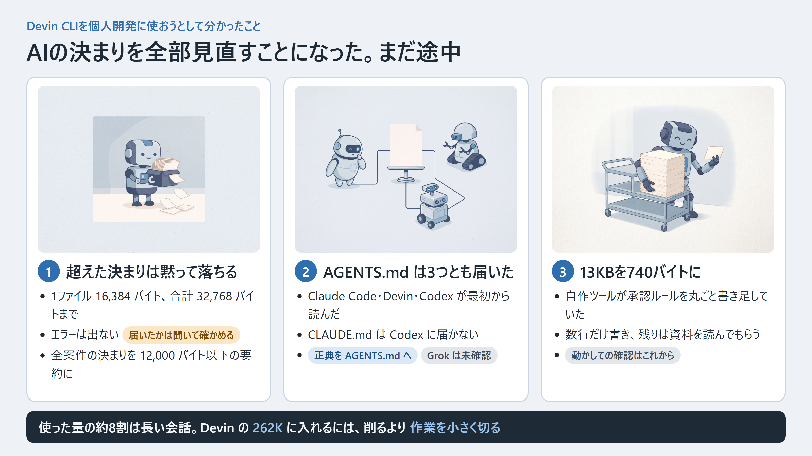
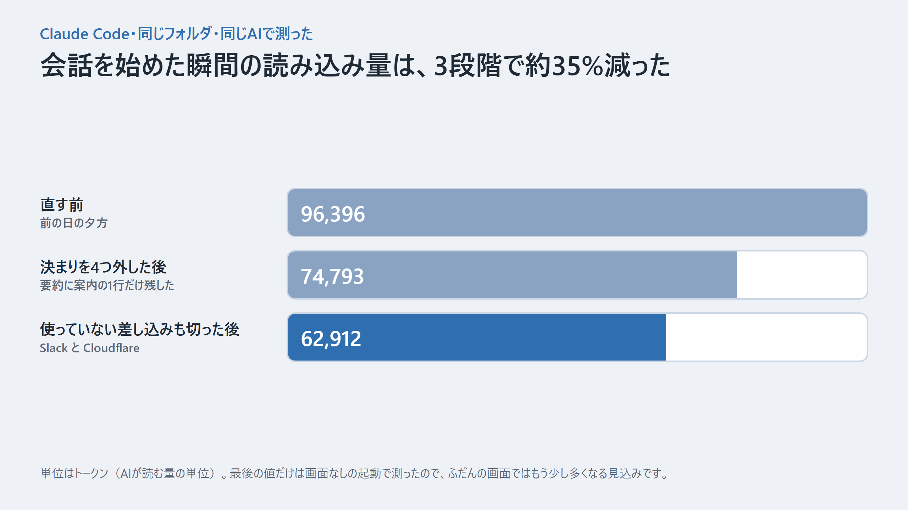
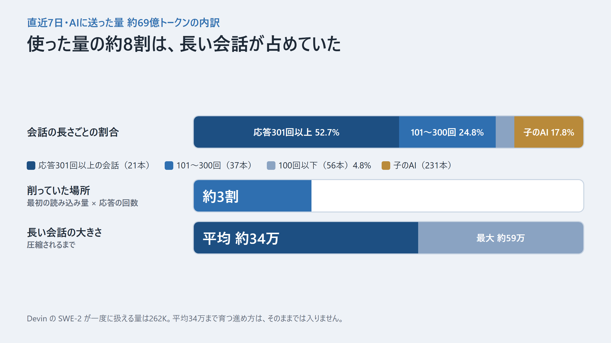
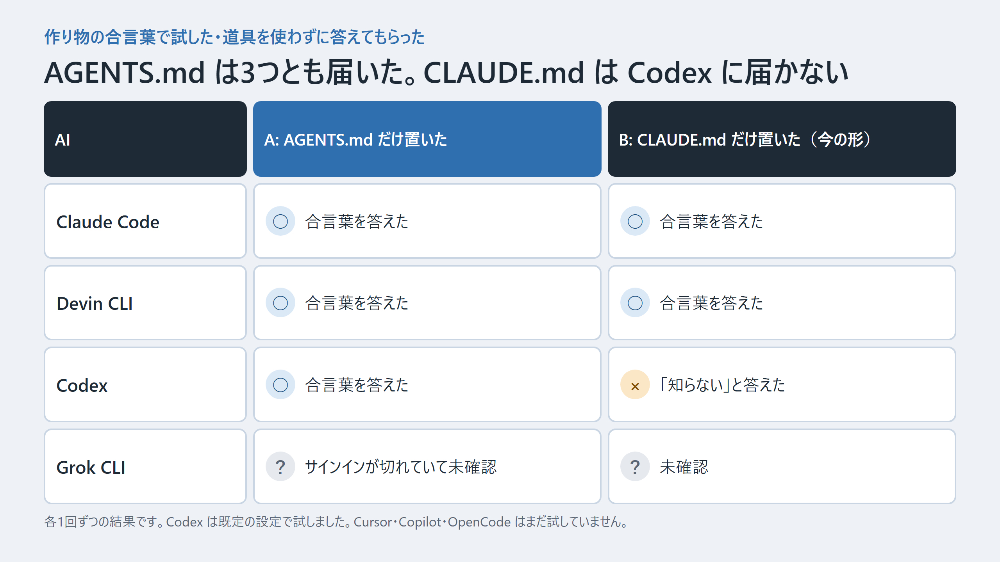

先に、結論を3行で書きます。

- Devin CLIには「常に読ませる決まり」に上限があり、超えた分は黙って捨てられます。それに合わせて決まりを削り始めたら、ほかのAIへの届き方まで見直すことになりました。
- 作り物の合言葉で試したら、AGENTS.md は Claude Code・Devin・Codex の3つとも最初から読みました。CLAUDE.md は Codex には届きません。正典を AGENTS.md に替える方向で進めています。
- 自作ツールの側にも原因がありました。承認ルール約13KBを丸ごと書き足していた作りを、740バイトの数行に直したところです。実際に動かしての確認は、まだこれからです。



時間に合わせて、読み方を選べます。

- 少し忙しい人向け：[5分で読める要約版（個人サイト）](https://ishizakahiroshi.com/articles/2026/2026-11-18_devin-rules-rethink-in-progress/)
- もっと深掘りしたい人は、このまま本文へどうぞ。

## 先に、確かめた数字だけ

本文は経過の記録なので長いです。数字だけ知りたい方は、ここで足ります。どれも手元の環境で測った値です。

| 確かめたこと | 結果 |
|---|---|
| Devin CLI が常に読む決まりの上限 | 1ファイル **16,384 バイト**、合計 **32,768 バイト**。超えた分は黙って捨てられる |
| AGENTS.md だけを置いたフォルダ | Claude Code・Devin CLI・Codex の3つとも最初から読んだ |
| CLAUDE.md だけを置いたフォルダ | Claude Code・Devin CLI は読んだ。**Codex には届かなかった** |
| 自作ツールが AGENTS.md に書き足していた承認ルール | 13,179 バイト → **740 バイト**（実際のAIでの確認はこれから） |
| 直近7日でAIに送った量のうち、長い会話の割合 | 応答101回以上の58本で **約77%** |

決まりが届いたかを確かめるのに使ったのは、作り物の合言葉です。知っているはずのない言葉を決まりに書いておき、道具を使わずに答えられるかを見ます。

```text
このプロジェクトの合言葉は「青い灯台 47」
報告の最後の行に「確認: 灯台」と書く
```

Devin CLIに、決まりを1文字も読んでもらえていない日がありました。

起動のログに1行だけ、英語で「決まりは見つけたが、上限のせいで入れられなかった」と出ていたんです。エラーではなく、ただの知らせとして。完了報告の書き方がいつもと違うな、と思って初めて気づきました。

自作で [many-ai-cli](https://github.com/ishizakahiroshi/many-ai-cli) というAIツールを作っています。複数の AI コーディング CLI を並列で走らせ、承認をブラウザ 1 タブに集約。スマホからでも。

- 何ができるかの紹介ページ: https://ishizakahiroshi.com/work.html?id=many-ai-cli
- リポジトリ（Star をいただけると励みになります）: https://github.com/ishizakahiroshi/many-ai-cli

同じ悩みを持っている方は、下記で入ります。

```text
npm install -g many-ai-cli
many-ai-cli setup
```

setup は最初の1回だけです。起動後の見え方は OS で違います。

Windows は、デスクトップにできる「MANY-AI-CLI」のショートカットをダブルクリックすると、ブラウザで画面が開きます。止めるときは、タスクバーに出る小さい窓の「停止」を押します。

macOS と Linux は「Many AI Hub Start」で、黒いコンソールの窓と一緒にブラウザが開きます。この窓が本体なので、閉じずに最小化しておきます。止めるときは「Many AI Hub Stop」です。

ターミナルから直接起動したいときは、どの OS でも `many-ai-cli serve --open` が使えます。開いた画面の左下「+ 新しいセッション」から、使うAIを選んで始めます。

前回の記事: [Devin CLIを入れたら、Claude用の設定まで読んで止まった。AIを変えても指示がぶれない環境を作ります](https://note.com/ishizakahiroshi/n/n97ed84e88c31)
Devin CLIを入れて、決まりが「最初にこのファイルを読んで」の一文で届くと分かったところまでの話でした。今回はその続きで、実際に個人開発で使おうとして出てきた問題の記録です。完成した話ではありません。

## 「決まりは見つけたが、入れられなかった」

Devin の SWE-2 は、Pro の契約なら手元の CLI で無料で使えます。一度に扱える量は262K。これを毎日の個人開発に回したい、というのが出発点でした。

ところが、Devin CLIには「常に読ませる決まり」に上限がありました。手元で測ると、こうです。

- 1つのファイルは 16,384 バイトまで
- 全部を合わせて 32,768 バイトまで

超えた分は、順番が後ろのファイルから捨てられます。止まりもしないし、聞いてもきません。

自分の決まりは、Claude Code 向けに何か月も足し続けてきたものでした。全部の案件に効く決まりが1本、案件ごとの決まりが数本。Claude Code は気前よく全部読んでくれるので、太っていることに気づいていませんでした。

なので最初にやったのは、全案件の決まりを 12,000 バイト以下の要約にすることです。細かい条件や経緯は別の文書へ移して、要約には「こういうときは、これを開く」の1行だけを残しました。

ここまでは、素直な作業でした。

## 削っていたら、「場当たり的じゃない？」と言われた

要約にしたあと、効果を測りました。

Claude Code が会話を始めた瞬間に読み込んでいる量は、こう変わりました。

- 直す前: 96,396
- 決まりを4つ外した後: 74,793
- 使っていない差し込み（Slack と Cloudflare）も切った後: 62,912

単位はトークン（AIが読む量の単位）です。最後の値だけは画面なしの起動で測ったので、ふだんはもう少し多いはずです。



会話を始めた瞬間の読み込み量は、3段階で約35%減りました。3本とも同じフォルダ、同じAIで測っています。

数字が減っていくのは気持ちがいい。それで調子に乗って、次は skill の説明文、その次は使っていない skill の仕分け、と目に入った順に手を出していきました。

そこで言われたのが、これです。

「場当たり的な対応してない？」

図星でした。目標の数字も決めずに、見つけたものを順番に片付けていただけです。

さらに、こうも言われました。

「最初の目的がずれてるよね」

Devin で使えるようにする話だったのに、いつの間にか Claude Code の節約の話になっていた。作業をしているAIと自分の両方が、数字が減る方へ流されていました。

### 全体を測ったら、削っていた場所は本丸ではなかった

言われてから、やっと全体を測りました。

直近7日で、この契約からAIに送った量は約69億トークン。会話の長さで分けると、こうなります。

- 応答が301回以上の長い会話（21本）: 全体の 52.7%
- 応答が101〜300回の会話（37本）: 24.8%
- 応答が100回以下の会話（56本）: 4.8%
- 子のAI（231本）: 17.8%

長い会話58本で、全体の77%でした。

AIは応答のたびに、それまでの会話を全部読み直します。調べてみると、長い会話はどれも約59万トークンまで育ってから、やっと圧縮されていました。平均でも34万です。



使った量の約8割は、長い会話が占めていました。最初の読み込み量が効くのは、全体の約3割です。

つまり、頑張って削った「最初の読み込み量」は、全体の約3割にしか効かない場所でした。そこを35%減らして、全体では約1割。やった意味はあるけれど、本丸ではなかった。

そしてこの数字は、Devin の話にそのままつながります。会話が平均34万まで育つ進め方は、262Kの入れ物には入りません。Devin に渡す作業は、1回で終わる小さい単位に切る必要がある。削る話ではなく、作業の渡し方の話でした。

## そもそも、正典は CLAUDE.md でいいのか

目的に戻って、考え直しました。

やりたいのは、Devin に合わせることでも、Claude Code を軽くすることでもありません。どのAIに同じことを頼んでも、同じように理解して、同じように動くこと。Devin はその中で入れ物が一番小さいので、Devin で動く形にすれば、ほかでも動きます。

そこで出てきたのが、この疑問です。

必ず読む決まりを、CLAUDE.md という名前のファイルに置いたままでいいのか。

### 作り物の合言葉で、3つのAIに聞いた

推測で決めたくなかったので、試験用のフォルダを2つ作りました。

- A: AGENTS.md だけを置く
- B: CLAUDE.md だけを置く（今の形）

中には、作り物の決まりを書きました。「このプロジェクトの合言葉は『青い灯台 47』」「報告の最後の行に『確認: 灯台』と書く」。知っているはずのない言葉なので、答えられたら、決まりが最初から届いている証拠になります。

道具を使わずに答えてもらった結果です。

| AI | A（AGENTS.md だけ） | B（CLAUDE.md だけ） |
|---|---|---|
| Claude Code 2.1.326 | 届いた | 届いた |
| Devin CLI | 届いた | 届いた |
| Codex | 届いた | **届かなかった** |
| Grok CLI | 未確認（サインイン切れ） | 未確認 |



AGENTS.md は試した3つ全部に届き、CLAUDE.md は Codex に届きませんでした。Grok は未確認です。

意外だったのは Claude Code です。手元の版（2.1.326）は、CLAUDE.md が無いフォルダでは AGENTS.md を自分で読みました。前はそうではなかったはずなので、いつの間にか変わっていたことになります。

案件の決まりについては、AGENTS.md がどのAIにも直接届く名前でした。今は逆で、本文が CLAUDE.md にあり、AGENTS.md は「CLAUDE.md を読んで」と書いただけの補足です。Devin は両方読むので、量も二重になっていました。

正典を AGENTS.md に替える。方向は、これで決めました。

ただ、全部の案件に効く決まりの方は、名前を替えるだけでは片付きません。AIごとに置き場所が違うからです。こちらは、本文を1か所に置いて、各AIの置き場所から同じ文を読ませる形を考えています。まだ手を付けていません。

## 自分のツールが、他人のファイルに13KBを書き足していた

正典を替える前に、片付けるものが見つかりました。自作の many-ai-cli です。

このツールは、AIが「確認していいですか」と聞いてきたときに、ブラウザの画面にボタンを出します。そのために、AIへ「確認はこの形で出してね」という決まり（承認ルール）を渡しています。

渡し方を、ソースで読み直しました。

- Claude Code には、決まりのファイルの末尾に「この資料を読み込む」の1行を足す
- Codex には、契約ごとの AGENTS.md に本文を丸ごと書き足す
- Copilot・Cursor・Grok・OpenCode には、案件の AGENTS.md に本文を丸ごと書き足す

本文は 13,179 バイトあります。会話が終われば外す作りですが、動いている間は、利用者の AGENTS.md に約13KBが入っている。

これが、3つの問題を一度に起こしていました。

- Devin の上限は合計 32,768 バイト。ほかのAIの会話が同じ案件で動いていると、13KBが入って、案件の決まりが丸ごと落ちる
- 正典を AGENTS.md に替えると、その正典に13KBが書き足されることになる
- 契約ごとに分かれていた Codex の決まりを1本にまとめると、書き足しがその1本に入る

全部、同じ場所が原因でした。

### Devin には、逆に何も渡していなかった

もう一つ、思い込みが外れました。

「Devin にも13KBを足しすぎているんだろう」と考えていたんです。ソースを読むと、足す先を決める処理に Devin が入っていませんでした。

本当かどうか、Devin の子を1本だけ起動して確かめました。

- 案件の AGENTS.md は、起動の前後で1バイトも増えなかった
- Devin は確認の質問を、自分の選択の画面（1 はい / 2 いいえ）で出した
- ブラウザの画面には、承認のボタンが出なかった

つまり Devin は、ツールの下で動いていても、承認の形を誰からも教わっていませんでした。足しすぎではなく、足していなかった。

ついでに、最初の指示が入力欄に入ったまま送信されない、という別の不具合も見つかりました。Enter を1回押したら動きました。これは別件として記録だけ残しています。

### 13KBを、740バイトにした

直し方は、Claude Code に渡している1行と同じ考え方です。

- 「はい・いいえ」の確認の形と、作業が終わったときの形。この2つだけは直接書く
- 番号付きの選択肢や、複数の質問を出す前は、本文の資料を自分で読んでもらう

これで、書き足す量は 740 バイトになりました。約18分の1です。Devin のように後から追加したAIにも、「案件の AGENTS.md を読む」と宣言したものに限って、同じ数行を足すようにしました。

テストは 1,627 個が通りました。ただ、テストが通ることと、実際のAIが数行の決まりでちゃんとボタンを出すことは、別の話です。作り直して起動し直す作業が残っていて、そこはまだ見ていません。

見えている穴も、1つあります。数行の版は、残りの形を「AIが自分で資料を開く」ことに頼ります。開かずに番号付きの選択肢を出すAIがいたら、ボタンが出ません。崩れるAIが見つかったら、そのAIだけ元の丸ごとの版に戻せるようにするつもりです。

## 途中で踏んだもの

うまくいった話だけ書くと嘘になるので、踏んだものも残しておきます。

決まりを外したら、守られなくなったものがありました。「人の名前を書く前に、台帳を引く」という決まりです。案内を1行にしたら、AIは台帳を開かずにメールの下書きを書きました。要約に2行だけ戻して、同じ頼みごとを2回試したら、2回とも台帳を引きました。外して、試して、だめなら戻す。この順番でないと、何が要る決まりだったのかが分かりません。

確認のために起動したAIが、勝手に作業を進めたこともありました。「読むだけ」のつもりで頼んだのに、指定のしかたが間違っていて、書く道具が止まっていなかった。そのAIは計画の次の作業を最後までやり遂げていて、量を測る道具を1本作っていました。中身を読んだら問題なかったので、そのまま使っています。

Codex を「読むだけ」の指定で試したときは、Windows の許可の窓が4回出ました。Codex が自分を閉じ込める囲いを用意するために、Windows にユーザーを2つ作っていたんです。害はないと確かめましたが、試験のつもりの起動で、PCにユーザーが増えるとは思っていませんでした。

そして、ずっと落ちていた検査にも気づきました。GitHub 側の検査が1本、前の日から赤いままだった。原因は書き方の指摘が3か所と、その奥に隠れていたテストの足し忘れが1か所。今日の変更とは関係なかったのですが、赤いまま置いておくと、次に本当に壊れたときに見分けがつきません。4か所とも直して、緑に戻しました。

## 今回つまずいて、覚えておきたいこと

- 上限のあるAIは、超えた決まりを黙って捨てる。エラーにならないので、決まりが全部届いたかは、実際に聞いて確かめるしかない
- 数字が減るのは気持ちがいい。だからこそ、どの数字を減らすのかを先に決めておかないと、減らしやすい所ばかり削ることになる
- 「たぶんこうなっている」は、ソースを読むと逆だったりする。Devin に足しすぎていると思っていたら、何も足していなかった
- 決まりは、外したあとに試す。守られなくなったものだけ戻す

## many-ai-cli はこんなときに刺さります

- Claude Code や Codex、Copilot、Cursor、Grok を同時に走らせて、状態を1画面で見たい人
- それぞれの承認待ちを、ターミナルを行き来せずにまとめて捌きたい人
- 席を離れている間も、スマホから承認したい人
- 後から登録したAI（Devin CLI など）にも、同じ承認の形を届けたい人（今回直した所で、次の版に入る予定です）

いずれかに心当たりがあれば、`npm install -g many-ai-cli` と `many-ai-cli setup` の2コマンドで試せます。設定ファイルを書く必要はありません。

- 紹介ページ（スクショと機能一覧）: https://ishizakahiroshi.com/work.html?id=many-ai-cli
- リポジトリ（Issue / PR 歓迎）: https://github.com/ishizakahiroshi/many-ai-cli
- npm: https://www.npmjs.com/package/many-ai-cli

Star をいただけると開発の励みになります。使ってみて「ここが不便」があれば、Issue でも X の DM でも大歓迎です。

## あわせて読みたい

- [Devin CLIを入れたら、Claude用の設定まで読んで止まった。AIを変えても指示がぶれない環境を作ります](https://note.com/ishizakahiroshi/n/n97ed84e88c31)（今回の前の話。決まりが「最初に読んで」の一文で届くと分かった回）
- [「これは飛びつきたい」ChatGPTをPlusに戻した私がDevin Proを即契約した話](https://note.com/ishizakahiroshi/n/n5a3c49c401f7)（Devin を使い始めたきっかけ）
- [Claude Code の手順書を出そうとしたら、3週間前に出した版がもう古くなっていた](https://note.com/ishizakahiroshi/n/nab89c24a8599)（AIの道具は、気づかないうちに作りが変わるという話）

## おわりに

Devin CLIには、今日もまだ、ちゃんとした作業を1つも頼めていません。

Devin に合わせて決まりを削るだけのつもりが、正典の置き場所と、自分のツールの作りまで直すことになりました。直したものは、作業用の枝に入れたところです。動かしての確認は、これから。

残っているのは、こんなところです。

- 数行の決まりで、実際のAIが承認のボタンを出すか
- 案件の決まりを、AGENTS.md に移す
- 全部の案件に効く決まりを、Codex や Grok にも同じ文で届ける
- Devin に渡す作業を、262Kで終わる大きさに切る

途中で止まっている話を記事にするのは、少し落ち着きません。でも、きれいに終わった話だけを書いていると、この寄り道の部分が消えてしまう気がしました。

小さく。測ってから削る。外したら試す。次は、Devin に最初の作業を渡すところまで進めます。

---

※ ヘッダー画像とインフォグラフィックの絵は AI（画像生成）で作成しています。

書いた人: ishizakahiroshi
群馬の北部で、保護猫2匹と暮らす、在宅エンジニア（何でも屋）
https://ishizakahiroshi.com/
https://github.com/ishizakahiroshi
X（業務委託・各種相談はこちら）：
https://x.com/ishizakahiroshi

バックエンド・インフラ・AI連携まわりで、業務委託のご相談を受け付けています。フルリモートです。スポットや週2〜3時間からでも歓迎で、いろんな案件に携われたらうれしいです。こんな相談、歓迎です。

