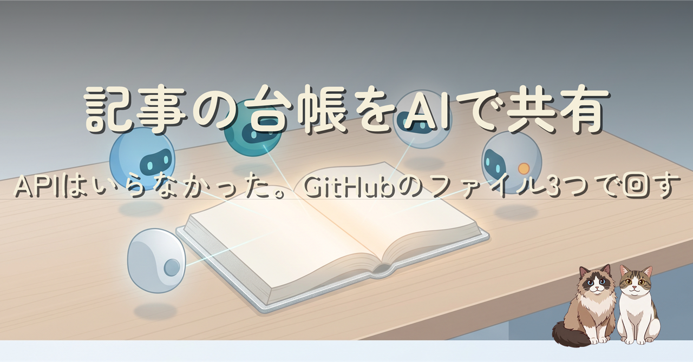
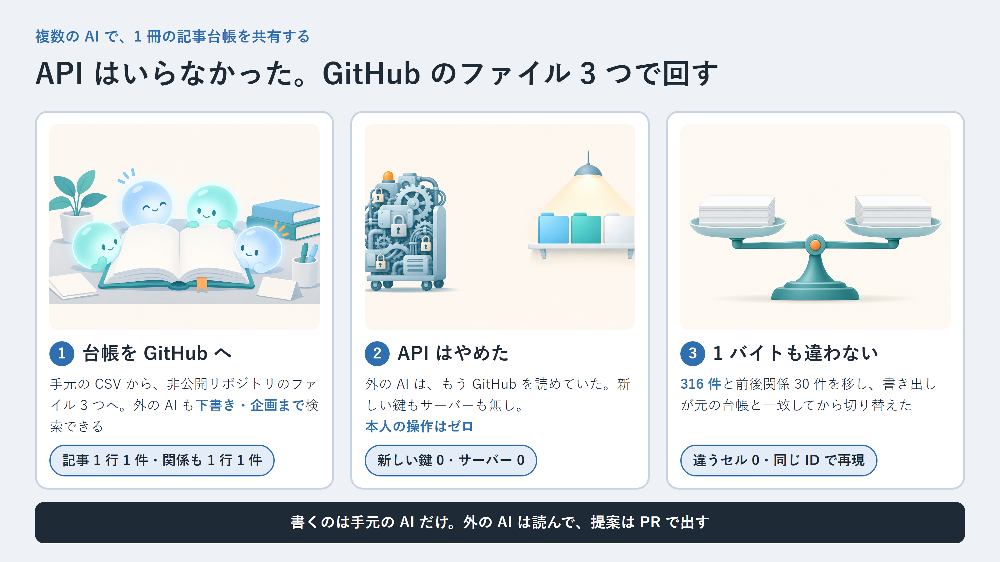
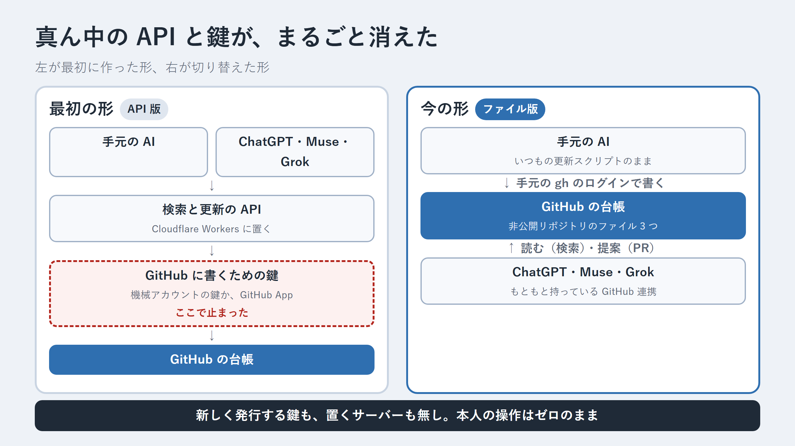
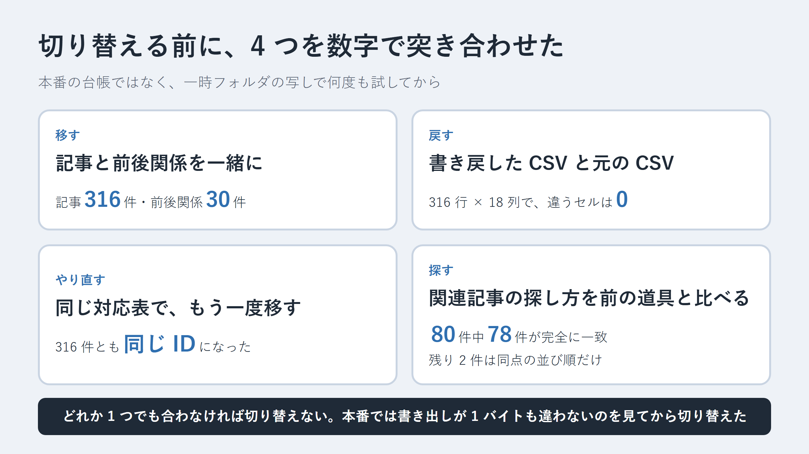

先に、結論を3行で書きます。

- 記事の台帳（公開済み・下書き・企画）を、手元の CSV から GitHub の非公開リポジトリのファイル 3 つへ移し、ChatGPT などほかの AI も同じ台帳を検索できるようにしました。
- 最初は検索と更新の API を作りましたが、外の AI はもう GitHub を読めると気づき、API ごとやめました。本人の操作はゼロのままです。
- 316 件を移し、書き出した CSV が元の台帳と 1 バイトも違わないことを確かめてから切り替えました。



記事を書く AI が、いつの間にか 4 つになっていました。手元の Claude Code、スマホから頼む ChatGPT、それに Muse と Grok です。

書く手が増えると、困ることが出てきます。「その話、先週もう下書きしてたよ」に、AI が気づけない。台帳は手元の PC にしか無かったからです。

この話には前があります。前回は、スマホで頼んでも PC で書いても、同じ文体の記事になる仕組みを作りました。

前回の記事: [スマホで頼んでも、PCで書いても、同じ文体の記事になる。AIに記事を書かせる仕組みを、友人に渡せる形でまとめました](https://note.com/ishizakahiroshi/n/n84fc8985b788)

文体はそろいました。今回は、記事同士の関係です。

## 台帳は、手元の PC にしかありませんでした

記事の進み具合は、1 行 1 記事の CSV で管理していました。列は 18 本。公開 URL、X の告知、タグ、続きものの前回などです。

手元の AI はこれを読めます。でも ChatGPT は読めません。代わりに、個人サイトに置いている「公開済みの記事一覧」を見ていました。つまり、下書きと企画は見えない。

もう 1 つ、数えてみて驚いたことがあります。

- 台帳の行: 316
- そのうち、フォルダ名（記事を指す名前）が空の行: 80

4 本に 1 本は、名前で指せませんでした。これでは「この記事の続き」と記録しようにも、相手を特定できません。全記事に、変わらない ID を付けるところから始めることにしました。

## 最初は、ちゃんとした API を作りました

設計はそれなりに真面目でした。

- 検索用と更新用で鍵を分ける（公開済みだけ見える鍵、下書きまで見える鍵、書ける鍵）
- 更新は「操作」単位で送り、同じ操作を 2 回送っても二重にならない
- 2 つの AI が同時に書いたら、後から来た方が読み直して当て直す

置き場は Cloudflare Workers。正本は GitHub に置き、ブランチの先頭を強制せずに進めることで、横入りを検出します。テストも書いて、全部通っていました。

ここまでは順調でした。

## 鍵の壁で、全部止まりました

API が GitHub に書くには、鍵が要ります。外部 AI 用の機械アカウントの鍵を、そのリポジトリだけに絞って使う予定でした。

ところが GitHub の説明を読むと、細かく絞れる新しい形式の鍵は、他人の持ち物のリポジトリには使えないと書いてあります。共同作業者として招待されていても、です。

https://docs.github.com/en/authentication/keeping-your-account-and-data-secure/managing-your-personal-access-tokens

じゃあ GitHub App ならどうか。非公開の App は、持ち主のアカウントにしか入れられません。自分のアカウントで App を作り、権限を選び、鍵を発行して……と、手順が 7 つ並びました。

「いや、これちょっと待ってよ。めんどくせえな」

自分で言いました。目的に対して、いちばん簡単なやり方でいいはずです。



左が最初に作った形、右が最後に落ち着いた形です。真ん中にあった API と鍵が、まるごと消えています。

## 外の AI は、もう GitHub を読めていた

考え直して、当たり前のことに気づきました。ChatGPT も Muse も Grok も、GitHub 連携をもう持っています。

だったら、台帳を GitHub のファイルとして置けば足ります。

- 書くのは手元の AI だけ。いつもの更新用スクリプトの呼び方は変えず、中で GitHub の正本を更新し、手元の CSV はそこから書き出す
- 外の AI は、GitHub 連携で台帳を検索して、該当の行だけ読む
- 外の AI が「これは前回の続き」と登録したいときは、提案のファイルを PR で出し、手元の AI が確かめて反映する

鍵は手元の gh のログインをそのまま使います。新しく発行するものはありません。

## 置き場所で、もう一度だけ考え直しました

最初は、普段使っている作業用リポジトリの中に置くつもりでした。そこで数字を見ます。

- 作業用リポジトリの main への commit: 直近 14 日で 124 件
- 台帳の書き込み: 3 日で 30 回ほど

台帳を書くたびに commit が 1 つ増えます。同じ main に push しているほかの AI のセッションが、1 日に何度も「先に取り込んで」と弾かれる計算です。これは地味に効く。

台帳だけの非公開リポジトリを新しく作りました。外の AI から見た手間は同じで、作業用のリポジトリとはぶつかりません。

## 切り替えは「1 バイトも違わない」を確かめてから

移行は一発勝負にしたくなかったので、先に一時フォルダで何度も試しました。

- 316 件を移し、関係（続きものの前回）30 件も一緒に移す
- 書き戻した CSV と元の CSV を、316 行 × 18 列で比べて差 0
- 同じ対応表で再実行しても、316 件とも同じ ID

関連記事を探す処理も、前の道具と並べて比べました。直近 40 本 × 2 媒体の 80 件で、78 件が完全に一致。残り 2 件は、点数も日付も同じ記事どうしの並び順だけでした。



移す・戻す・やり直す・探すの 4 つを、全部数字で突き合わせました。どれか 1 つでも合わなければ、切り替えない約束です。

本番の切り替えでは、台帳の書き込みを止める鍵を握ったまま移行し、書き出した CSV が元の台帳と 1 バイトも違わないのを見てから、切り替えの印を置きました。戻すときは、その印のファイルを消すだけです。

## やりたい人向け: いちばん簡単なやり方

同じことをやりたい人向けに、最小の形を書いておきます。API もサーバーも要りません。

```text
your-article-ledger/      ← 非公開リポジトリ
├── README.md             ← AI 向けの読み方・提案の出し方
├── data/
│   ├── articles.jsonl    ← 1 行 1 記事
│   └── relations.jsonl   ← 1 行 1 関係
└── proposals/            ← 外の AI が出す提案の置き場
```

記事は 1 行 1 件の JSON にします。1 行ずつなので、AI が言葉で検索すると該当の行だけが出ます。

```json
{"id":"art-20261119-xxxxxxxxxxxx","status":"draft","date":"2026-11-19","title":"記事のタイトル","tags":"生成AI|個人開発","note":"","qiita":""}
```

関係も 1 行 1 件です。種類は 4 つだけにしました。

```json
{"id":"rel-20261119-xxxxxxxxxxxx","type":"sequel","from":"art-20261119-xxxxxxxxxxxx","to":"art-20261109-xxxxxxxxxxxx","reason":"前回の仕組みの続き"}
```

- `sequel`: 続編（前回は 1 本だけ）
- `sibling`: 同じ題材の別の切り口
- `merge`: 下書きどうしを 1 本にまとめるべき
- `standalone`: 候補を見たうえで、関係なしと判断した

あとは 3 つ決めるだけです。

1. **書く人を 1 人に決める**。手元の AI だけが書き、外の AI は提案だけにすると、壊れません
2. **AI 向けの決まりを 1 枚書く**。「全部を読み込まず検索する」「続編か曖昧なときだけ人に聞く」など。版を付けておくと、変わったときだけ読み直してもらえます
3. **ID は最初に全部へ振る**。名前は変わるし、空のこともあります

## これからやりたいこと

まだ途中です。正直に書いておきます。

- 外の AI が、実際に台帳を読めるか。連携は全リポジトリが対象なので読める見込みですが、次に ChatGPT で書くときに確かめます
- 記事の本文と画像は Google ドライブにあります。ドライブのフォルダと記事 ID を結ぶ部品は作りましたが、フォルダの ID を取る経路がまだありません
- スマホから「これ記事にしたい」と言ったら、企画として台帳に入る。そこまで行けば、ネタ帳と台帳が 1 つになります

そもそもこの記事は、作り始める前の計画に「実装が終わったら、この仕組み自体を記事にする」と書いてあったものです。作った仕組みの話を、その仕組みを使って書いている。ちょっと妙な気分です。

## あわせて読みたい

- [Claude の GitHub 連携で「再接続」が無限ループした。原因は GitHub App の入れ忘れだった](https://note.com/ishizakahiroshi/n/n6e4e10b31933)（今回、GitHub App を検討してやめた話の前段。App の入れ方で一度つまずいています）

## おわりに

作ったものを捨てるのは、少し悔しいです。API のテストは全部通っていました。

でも、使う側の手順が 1 つも増えない方を選べたので、よしとします。次は、スマホから企画を入れるところを小さく作ってみます。

---

※ ヘッダー画像とインフォグラフィックの絵は AI（画像生成）で作成しています。

書いた人: ishizakahiroshi
群馬の北部で、保護猫2匹と暮らす、在宅エンジニア（何でも屋）
https://ishizakahiroshi.com/
https://github.com/ishizakahiroshi
X（業務委託・各種相談はこちら）：
https://x.com/ishizakahiroshi

バックエンド・インフラ・AI連携まわりで、業務委託のご相談を受け付けています。フルリモートです。スポットや週2〜3時間からでも歓迎で、いろんな案件に携われたらうれしいです。こんな相談、歓迎です。
