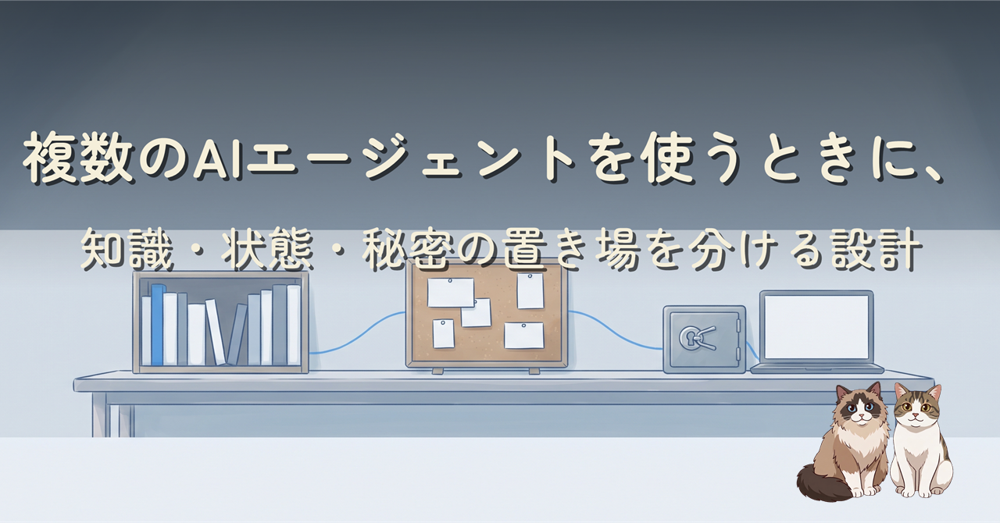
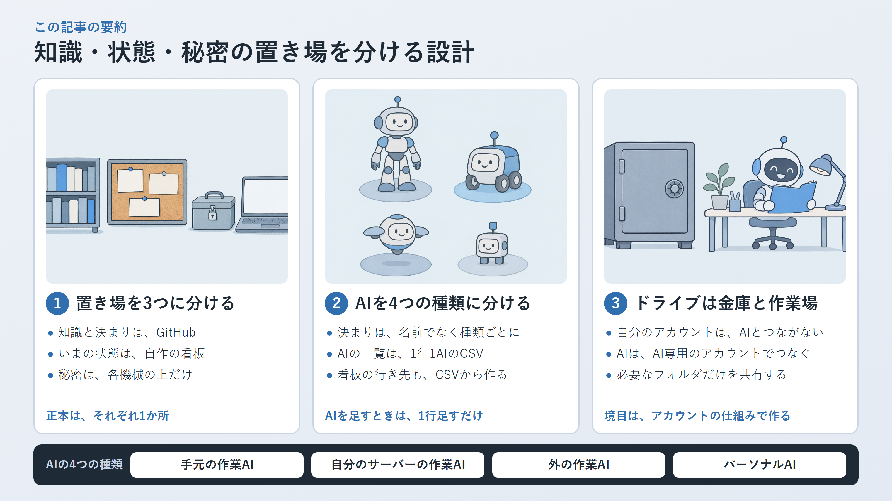
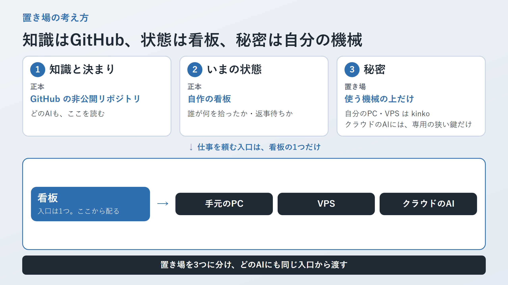
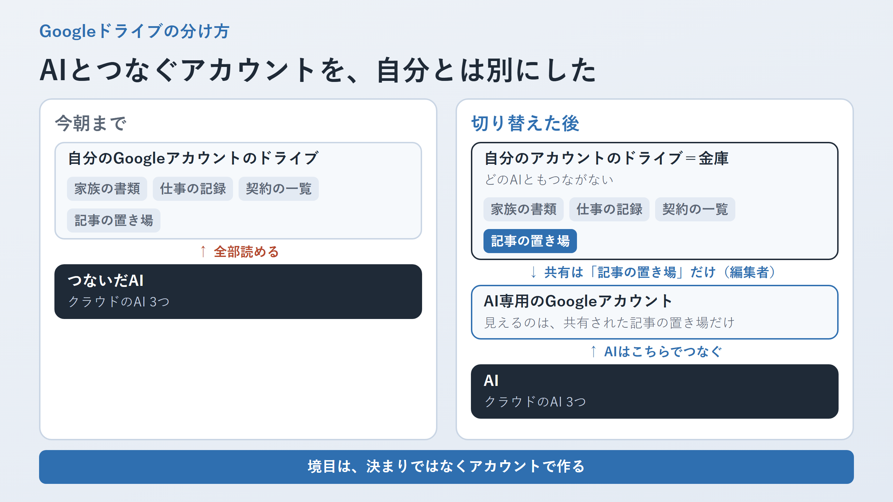

先に、結論を3行で書きます。

- AI に渡すものを「知識と決まり」「いまの状態」「秘密」の 3 つに分け、正本をそれぞれ GitHub・自作の看板・各機械に置きました。
- AI は 4 つの種類に分け、決まりは AI の名前ではなく種類ごとに書きます。AI の一覧は 1 行 1 AI の CSV にして、看板の行き先もそこから作ります。
- Google ドライブは、自分のアカウントを AI とつながない金庫にし、AI は AI 専用のアカウントでつないで、必要なフォルダだけを共有します。



時間に合わせて、読み方を選べます。

- 少し忙しい人向け：[5分で読める要約版（個人サイト）](https://ishizakahiroshi.com/articles/2026/2026-11-21_ai-ledger-design/)
- もっと深掘りしたい人は、このまま本文へどうぞ。

Claude Code、Codex、Devin、Muse、ChatGPT、VPS の claude -p。個人で使う AI が 6 つを超えたあたりで、どの AI に何を見せてよいのか、自分でも分からなくなりました。

この記事は、その整理の設計判断をまとめたものです。体験の側（何が起きて、なぜ気づいたか）は note に書いています。

## 何が起きていたか

整理する前は、こうなっていました。

- どの AI が使えるかの台帳が、手元の PC 用・クラウドの AI 用・看板用の 3 か所にあり、同じ AI の可否が台帳ごとに食い違っていた
- 看板の行き先に、拾い手のいない AI が並んでいて、選ぶと仕事が誰にも拾われずに止まった
- GitHub で AI が書くときの名義が、AI の種類によって本人だったり AI 用のアカウントだったりした
- 記事を書かせるために自分の Google アカウントのドライブを AI につないでいて、クラウドの AI 3 つが家族や仕事のファイルまで読める状態だった（5 日前の調べで、確認用のファイルの中身が AI の答えと一致していた）

1 か所ずつ直しても、別の台帳とずれる。なので、置き場の考え方から決め直しました。

## AI を 4 つの種類に分ける

AI の名前ごとに決まりを書くと、AI が増えるたびに決まりも増えます。分ける軸を 2 つにしました。

- どこで動くか（自分の機械か、相手の会社の機械か）
- 誰が動かし始めるか（自分が話しかけるか、看板から自分で拾うか）

| 種類 | どこで動く | 誰が動かす | 例 | 見せてよい範囲 |
|---|---|---|---|---|
| 手元の作業 AI | 自分の PC | 話しかける | Claude Code・Codex・Grok CLI・Devin CLI | 家族・仕事も可 |
| 自分のサーバーの作業 AI | 自分の VPS・PC | 看板から拾う | VPS の claude -p・Devin | 個人まで |
| 外の作業 AI | 相手の会社 | 仕事を渡すと進める | Devin Cloud | 個人まで |
| パーソナル AI | 相手の会社 | 話しかける | ChatGPT・Muse | 個人まで |

秘密の渡し方も、承認の要るところも、この種類で決まります。新しい AI を足すときは、どの種類かを決めて台帳に 1 行足すだけにしました。

## 置き場を 3 つに分ける



| 何を | 正本 | 理由 |
|---|---|---|
| 知識と決まり（考え方・AI への決まり・名義・記事の書き方） | GitHub の非公開リポジトリ | 履歴が残る。PR がそのまま承認になる。手元・VPS・クラウドの AI のどれもつながる |
| いまの状態（誰が何を拾ったか・返事待ちか・会話） | 自作の看板（Cloudflare Workers + Durable Objects） | 秒単位で変わるものを commit で追うのは重い |
| 秘密（鍵・token） | 使う機械の上だけ | 1 か所に集めると、漏れたときに全部が同時に危なくなる |

看板は知識の写しを持たず、配る口にとどめます。写しを持つと正本が 2 つになり、最初の食い違いに戻るからです。

ほかの候補も比べました。

- Obsidian や Notion を正本にする：人は読み書きしやすいが、クラウドの AI が確実に読めず、承認の仕組みが無い
- 各 AI のメモリ機能に任せる：AI ごとに別の場所へ溜まるので、いまの食い違いそのもの
- 看板のデータベースを正本にする：履歴・差分・承認・バックアップを作り直すことになる

## AI の台帳を 1 行 1 AI の CSV にする

台帳は CSV にしました。決まりの文章（なぜそうするか）まで CSV に入れると、セルが長文になって読めなくなるので、文章は種類ごとの md に分けています。

```csv
id,kind,runs_on,starts,status,board_target,github_as,google_as,visibility_max,board_key,daily_cap,cannot
vps-claude,自分のサーバーの作業 AI,VPS,看板から拾う,使える,vps-claude,bot,なし,個人,key-vps-claude,6,持ち主が画面から任せた仕事だけ拾う
local-devin,自分のサーバーの作業 AI,手元 PC,看板から拾う,停止中,,,,個人,,,拾い手が無い
muse,パーソナル AI,相手の会社,話しかける,使える,,bot,bot,個人,key-muse,,依頼文で決まりを読ませる必要がある
```

ポイントは 2 つです。

- **`board_target` が空の AI は、看板の行き先に出さない。** 拾い手のいない相手を選べてしまう問題は、正本に入る前の形式の点検で止められます
- **`board_key` には鍵の名前だけを書く。** 値は書きません。止めるときに、どの鍵を止めればよいかが 1 行で分かります

## Google ドライブは、アカウントで金庫と作業場を分ける



- 自分のアカウントのドライブは金庫と私物にし、どの AI ともつながない
- AI 専用の Google アカウントを作り、VPS とパーソナル AI はそちらでつなぐ
- AI に読ませる・書かせるフォルダは、自分のアカウントから 1 つずつ共有する

境目を決まりではなくアカウントの仕組みで作るのがポイントです。AI がどれだけ広く検索しても、AI 専用のアカウントから自分のアカウントの他のフォルダは見えません。

権限は、記事の置き場を丸ごと「編集者」で共有しました。最初は下書きだけ書き換え可、公開済みは見せない、と考えましたが、続編を書くには前の回も図の元も要ります。事故はドライブの版の履歴とゴミ箱（30 日）で戻せるので、そこに新しい守りは足していません。

AI 専用アカウントの守りは、認証アプリの 2 段階認証を主、SMS を予備にしました。

AI 側の Google の許可（OAuth）は、人が自分の端末のブラウザでログインして「許可」を押し、AI のサービスには許可証だけが渡る形です。パスキーや 2 段階認証が AI の側で要ることはありません。

### 切り替えたあとの確かめ方

つなぎ直した AI に、次の文をそのまま送りました。

```text
Google Drive の接続を確かめたい。ファイルの中身は読まず、名前と結果だけ答えてください。
1. いま Google Drive の接続に使っている Google アカウントのメールアドレスを教えて。
2. 「<共有したフォルダ名>」が見えるか。見えるなら、その直下のフォルダ名だけを並べて。
3. 次の名前で検索して、見つかったかどうかだけ答えて（開かないで）。<共有していないフォルダ名 3 つ>
4. 共有したフォルダに「_bot-write-test.txt」を作り、中身は「test」の 1 行だけにして。
```

期待する答えは、1 が AI 専用のアカウント、2 が見える、3 が 3 つとも見つからない、4 が書ける、です。4 つとも期待どおりでした。試しのファイルは、手元に同期されたのを確かめてから消しています。

## 秘密は、使う機械の上だけで持つ

決まりは 1 行にしました。

> 秘密は、使う機械の上でだけ、平文のファイルにしない形で持つ。自分の管理でない機械には、取り消せる狭い鍵だけを渡す。

| 置く場所 | 持ち方 |
|---|---|
| 自分の PC・自分の VPS | 自作の kinko（age で暗号化した保管庫から、名前で 1 件ずつ取り出す） |
| パーソナル AI・外の作業 AI | その AI 専用の狭い鍵だけ。保管庫は載せない |
| AI 専用アカウントのドライブ | 秘密は置かない |
| 台帳（GitHub） | どの機械・どの AI に、どの名前の鍵を渡したかだけ |

パーソナル AI の仮想環境に kinko を載せる案も考えましたが、やめました。開けるには合言葉ごと渡すことになり、保管庫の全部をその AI が開けられるからです。kinko が防げるのは「ファイルを丸ごと読んでしまう事故」で、合言葉を持った相手は防げません。

kinko はまだ試作版なので、移すときは非常口を用意します。

- 平文の控えと保管庫の合言葉は USB に置く
- 移してから 2 週間は、いまのやり方と並行で持つ
- 困らなければ平文を消す

1Password も比べました。端末をまたいで使えるのが強みですが、この設計では秘密をスマホに置かないので、その強みがほとんど使われません。スマホから秘密そのものを使いたくなったら考え直します。

自作で [kinko](https://github.com/ishizakahiroshi/kinko) という秘密管理の CLI を作っています。秘密は暗号化して、必要なひとつだけ。

- リポジトリ（Star をいただけると励みになります）：https://github.com/ishizakahiroshi/kinko

```sh
go install github.com/ishizakahiroshi/kinko@latest
kinko init                          # 保管庫を作る（パスワードは表示されない）
kinko add example-service/api-token # 秘密を足す。値を省くと対話入力
kinko get example-service/api-token # 1 件だけ取り出す
```

いまは試作版で、Windows Hello などの端末の解除は実機で確かめていません。

## 公開リポジトリで、公開しないものを扱う

もう 1 つ決まりにしたのが、公開リポジトリの中の非公開の扱いです。

- 公開リポジトリの `docs/local/` は git に入れない秘匿フォルダにする。中身は本人の Google ドライブの同期フォルダで、リポジトリからは上がらない
- 公開リポジトリの Issue・PR には、公開してよい言葉だけを書く。依頼の背景や環境の話は、非公開の側（非公開リポジトリの Issue か `docs/local`）に置く
- つなぐときは、非公開の側からだけ公開の側を指す。公開の PR から非公開の側は指さない

公開の PR に番号を書くだけでも、非公開の場所があることや、その量が伝わってしまうからです。

## 人が触るところは、端末を選ばない

iPad、Android のスマホ、古い iPhone、PC。頼む端末はその日によって違います。人が触る画面は、どの端末のブラウザからでも同じ操作で済むこと、を決まりにしました。初回の接続や許可のような 1 回きりの操作も含めます。

たとえば VPS を AI 専用の Google につなぐとき、普通の手順は「PC で rclone を動かして許可を受ける」形になりがちです。そこで、許可は看板（自分のドメインを持っている）で受け、VPS には 1 時間で切れる短い許可証だけを渡す形を設計中です。

## まだやっていないこと

- GitHub 側の AI 用アカウントの形（Organization と GitHub App にするか）
- 手元の秘密を kinko へ移すこと
- VPS を AI 専用の Google につなぐ仕組み

置き場の考え方は決まったので、残りはこの形に沿って 1 つずつ埋めていきます。

## kinko はこんなときに刺さります

- AI に設定ファイルを読ませると、関係ない鍵まで画面やログに出てしまうのが怖い人
- 平文の `.env` をやめたいけれど、大きな秘密管理サービスを入れるほどではない人
- 鍵を名前で 1 件ずつ取り出し、子プロセスの環境変数へだけ渡したい人

心当たりがあれば、`go install github.com/ishizakahiroshi/kinko@latest` と `kinko init` の 2 コマンドで試せます。

- リポジトリ：https://github.com/ishizakahiroshi/kinko

---

※ ヘッダー画像とインフォグラフィックの絵は AI（画像生成）で作成しています。

書いた人: ishizakahiroshi
群馬の北部で、保護猫2匹と暮らす、在宅エンジニア（何でも屋）
https://ishizakahiroshi.com/
https://github.com/ishizakahiroshi
X（業務委託・各種相談はこちら）：
https://x.com/ishizakahiroshi

バックエンド・インフラ・AI連携まわりで、業務委託のご相談を受け付けています。フルリモートです。スポットや週2〜3時間からでも歓迎で、いろんな案件に携われたらうれしいです。こんな相談、歓迎です。
