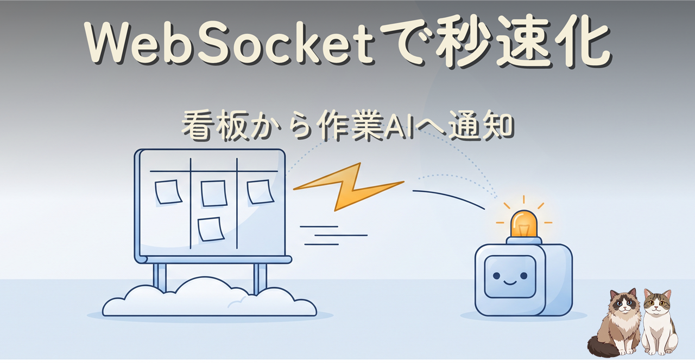
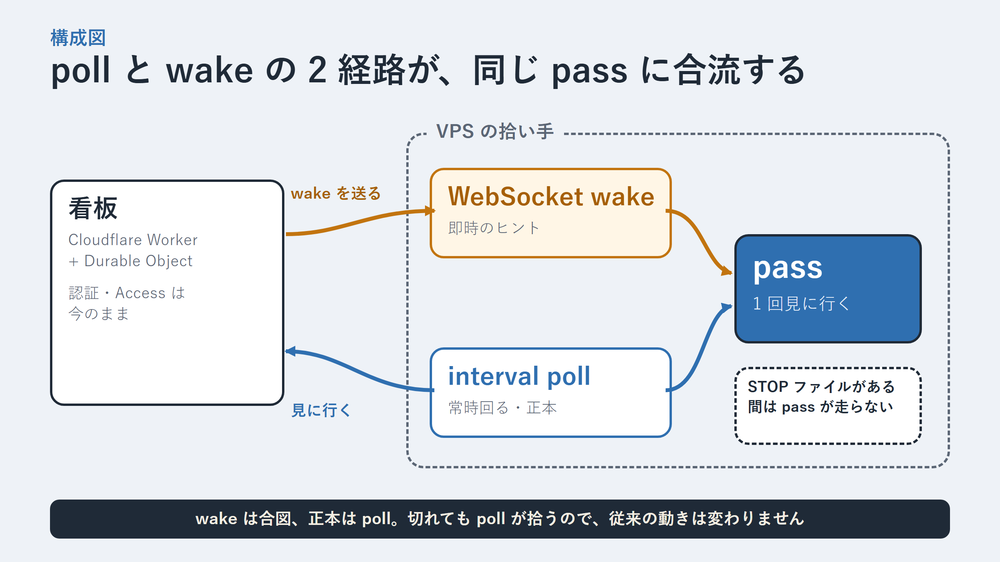

先に、結論を3行で書きます。

- 作業看板の「任せる」を押してから拾い手が動き始めるまでを、平均で約30秒から1秒未満にしました。
- 既存の認証・ポーリング・運用は変えず、認証済みの同じパスに GET と Upgrade を足して、WebSocket の通知経路だけ増やしました。
- 通知はヒントで、正本は従来のポーリングのままです。本番の計測で、自分の pass が自分の watcher を起こす再帰が見つかり、dedupe で止めました。

時間に合わせて、読み方を選べます。

- 少し忙しい人向け：[5分で読める要約版（個人サイト）](https://ishizakahiroshi.com/articles/2026/2026-11-21_board-websocket-wake/)
- もっと深掘りしたい人は、このまま本文へどうぞ。

個人で回している作業看板システム（自作の [many-iris](https://github.com/ishizakahiroshi/many-iris)）に、「仕事を任せる」ボタンがあります。押すと、VPS に住んでいる作業 AI（拾い手）がその仕事を取りに来る。

従来の拾い手は cron で 1 分ごとに看板を見に行くだけでした。つまり「任せる」を押してから動き始めるまで、平均で約 30 秒、最悪 60 秒待ちます。待ち合わせ型の仕組みとしては別に壊れていないのですが、押した直後にすぐ動き始めると気持ちがいい。WebSocket 通知を足して即時化しました。実測で「押す → 拾い開始」が 1 秒未満になりました。

この記事の本題はその速度ではなく、**既存の認証・ポーリング・運用を 1 行も変えずに通知経路だけ足す方法**です。あと、本番で計測して初めて見えた「自分が自分を叩き起こす」バグの話も少し。

## 縛り: 見る窓は足す、経路は変えない

先に壊したくないものを並べます。

- 看板の認証は Bearer トークン（writer key）一本。別の認証経路を増やしたくない
- 看板の前段には Cloudflare Access があって、API パスだけバイパスしている
- ポーリングは消さない。通知は「ヒント」であって正本ではない。切れても従来どおり拾えること
- 鍵ファイル・日次実行上限・STOP ファイル・二重起動防止の lock は全部そのまま

ここで「新しく `/watch` エンドポイントを生やす」と普通は書きますが、それをやると Access のバイパス設定と認証まわりを新パスにも揃える必要が出ます。経路を変えない方針なので、別の手を考えました。

## 解決: API と同じパスに GET+Upgrade を乗せる

看板は `@cloudflare/workers-oauth-provider` で守られていて、設定上の `apiRoute` は `/board/mcp` です。ライブラリのルート照合を読むと、パス apiRoute は**配下のパスも同じ保護リソースとして照合**します（`/board/mcp` に加えて `/board/mcp/xxx` も、同じ Bearer 検証と同じ actor 解決を通る）。

つまり新パスを作らなくても、**MCP の URL に GET + `Upgrade: websocket` を投げれば、既存の認証・Access バイパス・鍵監査がそのまま効く WebSocket 経路**が作れます。ハンドラの分岐はこれだけです。

```ts
// apiRoute "/board/mcp" の apiHandler 内（認証は provider 側で済んでいる）
if (request.method === "GET" &&
    (request.headers.get("upgrade") ?? "").toLowerCase() === "websocket") {
  const headers = new Headers(request.headers);
  headers.set("x-watch-actor", actor); // ctx.props.actor。クライアントが送っても上書き
  return boardStub(env).fetch(new Request(url.origin + url.pathname, { headers, method: "GET" }));
}
```

別名として `/board/mcp/watch` も同じ分岐で受けていますが、本命は `/board/mcp` 本体への upgrade です。POST と同じパスなので、前段の設定差異（Access のパス一致が prefix か完全一致か、といった環境差）にほぼ無関係に動きます。

## Durable Object 側: hibernation 前提で actor を持つ

看板本体は Durable Object（SQLite 永続化）1 個です。WebSocket は [Hibernation WebSocket API](https://developers.cloudflare.com/durable-objects/best-practices/websockets/) で受けます。idle 中は DO がメモリから落ちても接続は生きるので、常時接続を無料枠の節度で持てます。

hibernation の要点は「メモリを信じない」こと。watch しているのが誰かはインスタンス変数ではなく、ソケットの attachment に入れます。

```ts
// 受付
this.ctx.acceptWebSocket(pair[1]);
pair[1].serializeAttachment({ actor }); // 冬眠しても戻る

// 通知時は getWebSockets() + deserializeAttachment() で都度引く
```

鳴らす先の判定も「差分で送る」のではなく、**その時点で仕事が待っている actor を毎回 SQLite に聞く**方式にしました。

```ts
watchTargets(): string[] {
  // handoff_state='requested' の handoff_to ＋ 待機中の会話ターンの宛先
}
```

送る契機は「仕事が生まれた変異のあと」。設計上の面倒を避けるため、変異か読み取りかを区別せず、**tool 呼び出し・画面書き込み・dispatcher の経路決定のあとに全部 poke**しています。watcher がゼロなら早期 return、いても SELECT 2 本だけなので安い。

## picker 側: wake は合図、正本は poll

拾い手側は `--watch` モードを足しました。やっていることは薄いです。

- WebSocket で `/board/mcp` に upgrade、鍵は Authorization ヘッダのみ（URL に載せない）
- `{"type":"wake"}` が来たら即「1 回見に行く」（既存の pass をそのまま呼ぶ。通知専用の拾い方は作らない）
- pass 実行中の wake は 1 回に合体（キューが雪崩れない）
- 切断したら backoff で張り直す。その間も、そもそも常時、従来の interval poll が回っている
- STOP ファイルがある間は wake・poll どちらの pass も走らない（cron 版と同じ停止作法）

Node の組み込み WebSocket（undici）は `new WebSocket(url, { headers })` で upgrade のヘッダを付けられます。対象環境は Node 22 で、実機でコンストラクタの受理を確認してから採用しました（Node 18 ではグローバルに無いので、その場合は `--watch` が起動時に分かるエラーを出す）。



## 本番で計測して初めて見えたバグ

ここが一番面白かったところです。本番に上げて実測したら、wake が 1 回のはずなのに **300ms で 4 回**連鎖しました。

原因は自分で書いた「tool 呼び出しのあとに全部 poke」でした。wake で目覚めた picker の pass は、自分も看板を呼びます（`board_chat_pending`・`board_list`）。その呼び出しがまた poke を評価する。拾えないまま残っている仕事（この計測では writer 起点の handoff で、picker の「owner が任せたものだけ拾う」門でスキップされるもの）があると、**自分の pass が自分の watcher を再度起こすループ**になります。

対処は「その pending のあいだに 1 度送ったら、もう送らない」という dedupe。ソケット attachment に `poked` フラグを持たせて、pending があるのに未送信のときだけ送り、pending が解消したらフラグを戻します。

```ts
for (const w of watchers) {
  const wants = targets.has(w.actor);
  if (wants === w.poked) continue;          // 同じ pending で二度は鳴らさない
  if (wants) {
    try { w.ws.send(message); } catch { /* close */ continue; }
  }
  try { w.ws.serializeAttachment({ actor: w.actor, poked: wants }); } catch {}
}
```

STOP 中・日次上限到達後・「拾えない仕事」が残っている場合でも、無駄な再 wake が呼び出しのたびに走り続ける事故をこれで止めました。試験にも「wake → 追加呼出しでは再送なし → 取り下げ → 再依頼で再 wake」のケースを足しました。

## 実測（本番）

数値は全部、本番の Cloudflare Workers + 実 VPS で測ったものです。

- writer キーで handoff を POST → VPS 常駐の wake pass 開始まで **191ms**
- 他人宛ての handoff では watcher は鳴らない（対象絞り込みを実測）
- 画面の「任せる」を押す → vps-claude が受け付け始めるまで **1 秒未満**（押下 09:23:05 → took 09:23:05.655）
- 拾った実行は 12 秒で完了し、その直後の interval pass は「1 日の上限（6）に達した」と正しく停止

副産物的に 2 つも確かめられました。deploy で DO が再起動してソケットが切れた間、interval poll が 60 秒ごとに走り続けていたこと（フォールバックの本番実証）。それと、STOP・日次上限・lock は watch 経路を足しても何も変わらなかったことです。cron の `--once` も残したままです。

## まとめ

- WebSocket の watch 経路は、**認証したい API と同じパスへの GET+Upgrade** にすると、別エンドポイントの認証・前段設定を新設せずに済む
- Durable Object は hibernation 前提で組む。watcher の属性はソケットの attachment に入れ、メモリを信じない
- 通知はヒント。正本は従来の poll。「通知のあと正本を読みに行く」既存処理をそのまま呼べば、通知系の不整合は起きない
- 「変異のあとに全部 poke + 対象で絞る」は雑で強いが、**呼び出した側の watcher が自分を起こす再帰**にだけ注意（dedupe を入れる）

結果として「任せる → 作業開始」が平均 30 秒から 1 秒未満になりました。やったことは upgrade の分岐 1 箇所、DO のソケット管理、拾い手の `--watch` モードだけ。既存の経路を全部残したまま足したので、戻すときは常駐プロセスを止めて旧版を deploy するだけです。

同じパターン（認証済み API の前に WS を足したい・でも経路は増やしたくない）に当てはまる人の参考になれば。

---

※ ヘッダー画像は AI（画像生成）で作成しています。

書いた人: ishizakahiroshi
群馬の北部で、保護猫2匹と暮らす、在宅エンジニア（何でも屋）
https://ishizakahiroshi.com/
https://github.com/ishizakahiroshi
X（業務委託・各種相談はこちら）：
https://x.com/ishizakahiroshi

バックエンド・インフラ・AI連携まわりで、業務委託のご相談を受け付けています。フルリモートです。スポットや週2〜3時間からでも歓迎で、いろんな案件に携われたらうれしいです。こんな相談、歓迎です。
