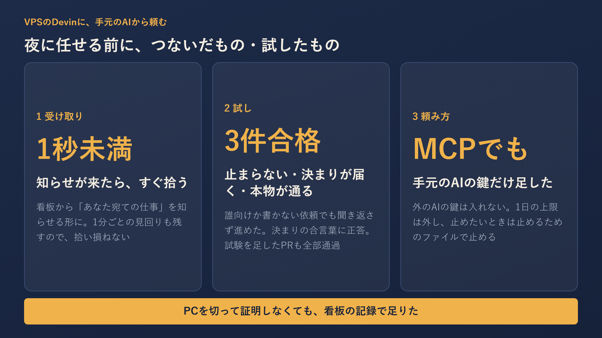
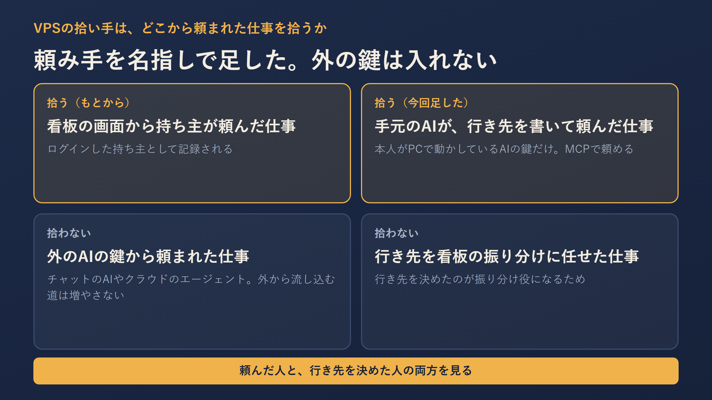
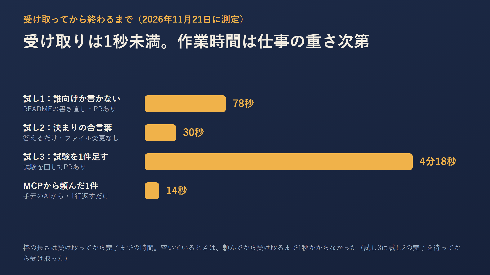

先に、結論を3行で書きます。

- 月770円のVPSに置いたDevinが、看板から仕事を拾い、1秒かからずに受け取って、Draft PRまで出すようになりました。
- 夜に任せる前の試しは3件とも合格で、質問で止まらず、決まりの文書も届いていました。
- 最後の壁は「頼めるのが画面だけ」だったので、手元のAIからMCPでも頼めるようにして、1日の上限も外しました。



## 先に、構成と数字だけ

自宅のPCとは別に、小さなVPSに「拾い手」を2つ置いています。Claude Code（`claude -p`）を動かすものと、Devin CLI（`devin -p`）を動かすものです。どちらも、Cloudflare Workers上の看板（自作のタスクボード）を見て、自分宛ての仕事を拾い、作業して、botの名義でDraft PRを出します。

今回測った数字です。どれも2026年11月21日に手元の環境で測った値です。

| 確かめたこと | 結果 |
|---|---|
| 頼んでから受け取るまで（拾い手が空いているとき） | 1秒未満（WebSocketの知らせ。以前は1分ごとの見回りで平均30秒） |
| 試し1: 「誰向けか」を書かない依頼 | 78秒で完了。聞き返さず「運用する人向け」と決めて進めた |
| 試し2: 決まりの文書にだけ書いた合言葉 | 30秒で正答。起動時に決まりのフォルダの4本を自動で読み込んでいた |
| 試し3: 試験を1件足す | 4分18秒でDraft PR。試験は20件すべて通過 |
| 手元のAIからMCPで頼んだ1件 | 受け取ってから14秒で完了 |

## 拾い手が受け付ける頼み手を、名指しで足す

拾い手は「持ち主が看板の画面から頼んだ仕事だけ拾う」のが既定です。看板は頼んだ人を記録していて、画面から頼むと `page:owner`、MCPで書き手の鍵を使って頼むとその鍵の名前になります。

既定のままだと、手元のAIがMCPで頼んでも拾われません。AIが自分の判断で別のAIに仕事を回す経路を作らないための制限でしたが、手元のAIは本人がPCで動かしているものなので、名指しで足せるようにしました。

```js
// picker.mjs（抜粋）
if (config.ownerOnly) {
  const trusted = new Set([OWNER_ACTOR, ...(config.trustedRequesters ?? [])]);
  if (!trusted.has(handoff.requested_by) || !trusted.has(handoff.to_set_by)) return null;
}
```

- 「頼んだ人」と「行き先を決めた人」の両方が、持ち主か名指しした書き手でなければ拾わない
- 看板の振り分け（おまかせ）に任せた依頼は、行き先を決めたのが振り分け役になるので拾わない。名指しした書き手は、`board_request_handoff` の `to` に行き先を書いて頼む
- 拾い手自身の名前は名指しできない（設定の読み込みで止まる）。自分で自分に仕事を出せないようにするため
- 外のAI（チャットのAIや、クラウドで動くエージェント）の鍵は入れない

VPS側の起動スクリプトには1行足すだけです。

```sh
export PICKER_WRITER="vps-devin"
export PICKER_TRUSTED_REQUESTERS="local-claude,many-ai-cli"
export PICKER_MAX_RUNS_PER_DAY="0"   # 0 = 上限なし
```

頼む側（手元のAI）は、看板のMCPで2回呼ぶだけです。

```json
{"name": "board_upsert_item", "arguments": {"item_id": "demo/task-1", "project": "demo", "kind": "task", "title": "ファイルは変えず、1行だけ返してください", "state": "planned"}}
{"name": "board_request_handoff", "arguments": {"item_id": "demo/task-1", "to": "vps-devin"}}
```



## 1日の上限は「0なら上限なし」にした

拾い手には1日に拾う回数の上限（既定6回）があります。AIが仕事を回しすぎたときの止め役でしたが、止めるにはVPSに止めるためのファイルを1つ置けば済み、成果はDraft PRまでで取り込みは人が決めます。外しても困らないので、`0` を「上限なし」と読むようにしました。

```js
// main.mjs（抜粋）
const value = Number(env.PICKER_MAX_RUNS_PER_DAY ?? "6");
if (value === 0) return Infinity;
```

## 決まりの文書は、仕事のたびに取り直す

Devin CLIは利用者の決まりを `~/.devin/rules/*.md` から読みます。VPSにはこれが無かったので、Devinに届いていたのはリポジトリ側の決まりだけでした。

作業役（Devinを起動するスクリプト）の先頭で、botのGitHubにある決まりの文書を毎回取り直すようにしました。元の文書を手元で直せば、次の仕事からVPSにも届きます。

```js
const rulesDir = join(home, ".devin", "rules");
try {
  mkdirSync(rulesDir, { recursive: true });
  for (const name of ["common.md", "personal.md", "working-with-people.md"]) {
    const text = sh("gh", ["api", "-H", "Accept: application/vnd.github.raw",
      `repos/<owner>/<rules-repo>/contents/${name}`]);
    writeFileSync(join(rulesDir, name), text + "\n", { mode: 0o644 });
  }
} catch (error) {
  // 取れなければ前回の写しで続ける
}
```

- Devinの囲い（`--sandbox`）の設定で、`~/.devin` には書き込めないようにした（自分の決まりを書き換えさせない）
- 3本で約2万バイト。前回調べた上限（1ファイル16,384バイト、合計32,768バイト）に収まる
- 届いたかは、VPSにだけ置いた作り物の合言葉を道具なしで答えられるかで確かめた。Devinの起動記録でも、決まりのフォルダから4本を読み込んでいた

## 受け取りを1秒未満にした「知らせ」

以前は拾い手が1分ごとに看板へ問い合わせていました。看板（Durable Object）側でWebSocketを受け、自分宛ての仕事が出たら `{"type":"wake"}` を送るようにしています。

- 認証は、ツール呼び出しと同じURLへのGET＋Upgradeで、書き手の鍵をAuthorizationヘッダーに載せる。URLには鍵を載せない
- 知らせはあくまで合図。1分ごとの見回りは残しているので、接続が切れても拾い損ねない
- 保留中の仕事がある間は、同じ接続へ知らせを1回しか送らない（拾い手自身の問い合わせで知らせが連鎖したため）



注意点が1つあります。この仕組みは本番で動いていたのに、コードが正本のブランチに入っていませんでした。手元の作業フォルダに未コミットで残っていて、次に正本から配置すると消えるところでした。本番の版と正本がそろっているかは、ときどき確かめたほうがよさそうです。

## まだ分かっていないこと

MCPから頼んだ1件で、Devinが「囲いの中でコマンドの実行がうまくいかず、読み取りの道具でファイルを直接読んだ」と報告しました。同じ設定で再現を試すと、コマンドは普通に動きました。原因は分かっていません。

## まとめ

- 手元のAIからMCPでVPSのDevinに頼むには、拾い手が受け付ける頼み手を名指しで足す。外のAIの鍵は入れない
- 決まりの文書は、仕事のたびに正本から取り直すと写しが古くならない
- 受け取りの速さは、知らせ（WebSocket）と見回り（ポーリング）の併用で、速さと取りこぼしの無さを両立できる
- 本番の版が正本に入っているかは、別に確かめる

コードはGitHubで公開しています。

[many-iris（GitHub）](https://github.com/ishizakahiroshi/many-iris)

前回の記事: [Devin CLIの決まりの上限（16KB/32KB）に合わせて、AGENTS.mdと承認ルールの渡し方を見直している記録](https://qiita.com/ishizakahiroshi/items/cee2a8ea2be18f2ccee3)

---

※ ヘッダー画像は AI（画像生成）で作成しています。

書いた人: ishizakahiroshi
群馬の北部で、保護猫2匹と暮らす、在宅エンジニア（何でも屋）
https://ishizakahiroshi.com/
https://github.com/ishizakahiroshi
X（業務委託・各種相談はこちら）：
https://x.com/ishizakahiroshi

バックエンド・インフラ・AI連携まわりで、業務委託のご相談を受け付けています。フルリモートです。スポットや週2〜3時間からでも歓迎で、いろんな案件に携われたらうれしいです。こんな相談、歓迎です。
