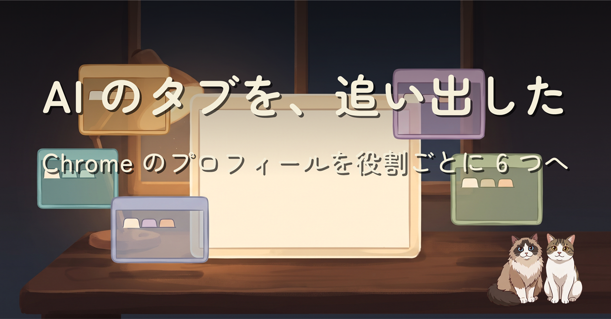
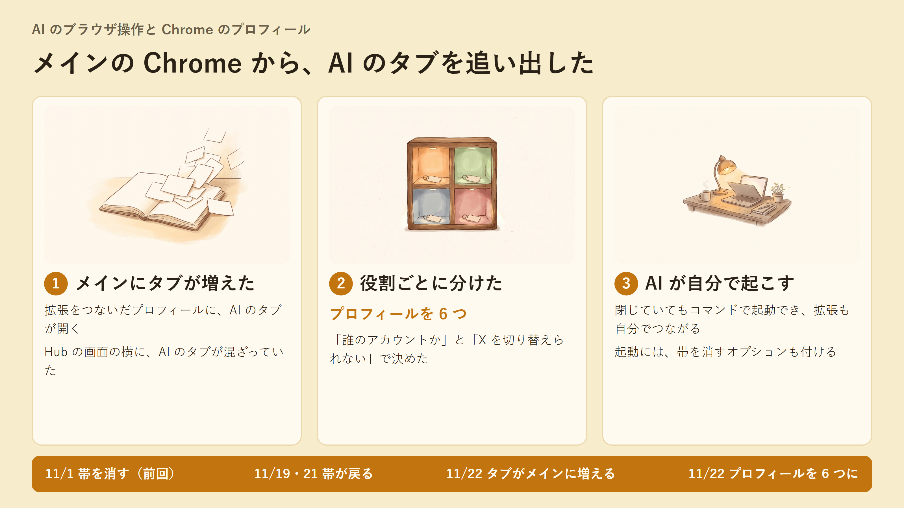
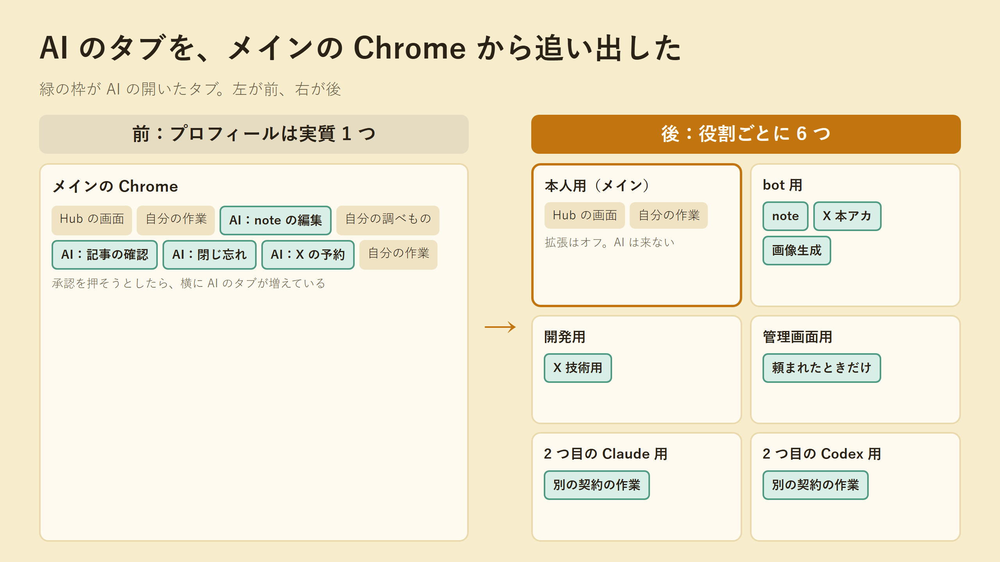
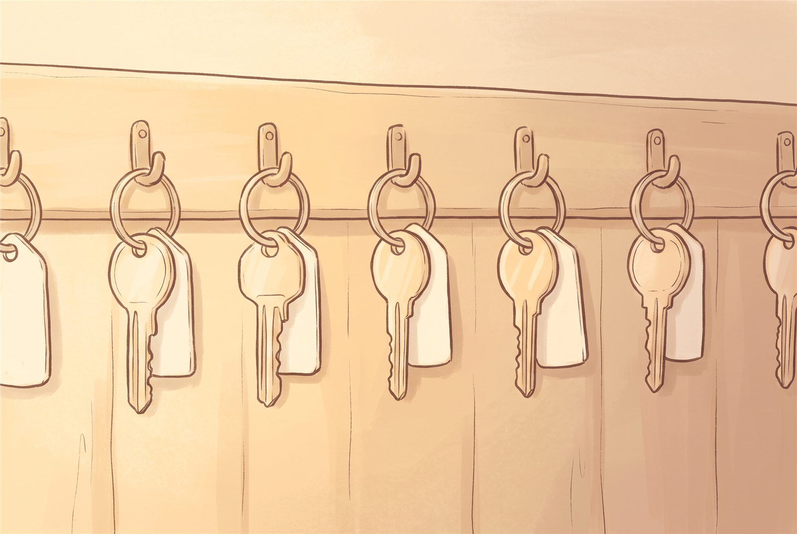
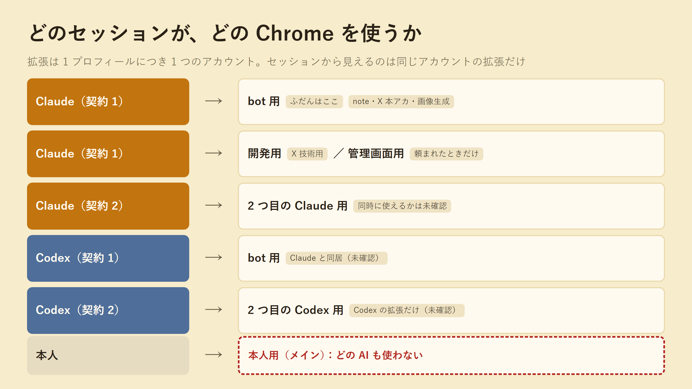

先に、結論を3行で書きます。

- AI にブラウザを操作させると、拡張をつないだ Chrome のプロフィールにタブが開きます。メインにつないでいたので、作業中の画面に AI のタブが増え続けていました。
- Chrome のプロフィールを役割ごとに 6 つに分け、メインからは拡張を外しました。分け方は「誰のアカウントか」と「AI が X のアカウントを切り替えられない」の 2 つで決まりました。
- 閉じているプロフィールは、AI がコマンドで起動でき、拡張も自分でつながりました。起動のときは、前回の記事の「帯を消すオプション」も付けます。どれが何用かは、表（CSV）にしないと自分が混乱します。



時間に合わせて、読み方を選べます。

- 少し忙しい人向け：[5分で読める要約版（個人サイト）](https://ishizakahiroshi.com/articles/2026/2026-11-22_ai-chrome-profile-split/)
- もっと深掘りしたい人は、このまま本文へどうぞ。

## 昼の 12 時前、メインの Chrome に Claude のタブグループが 2 つあった

前回、AI にブラウザを操作させると出る「デバッグを開始しました」の帯を消す話を書きました。今回は、その AI のブラウザ操作で困った、別の話です。

今日の昼前、many-ai-cli の v0.11.1 の記事を出しました。note と Qiita と個人サイトに載せる作業は、ほぼ全部を手元の Claude Code に任せています。下書きの取り込み、表紙の設定、X の予約まで、Claude がブラウザを操作して進めました。

公開が終わったあと、自分の Chrome を見てびっくりしました。many-ai-cli の Hub の画面を開いているタブの横に、緑色の「Claude」のタブグループが 2 つ。中には note の記事のタブが 3 枚。1 つは別のセッションのもので、もう 1 つは、さっき Claude が閉じ忘れた記事のタブでした。

作業の途中で、急にタブが増えることもあります。Hub で承認を押そうとしたら、横に新しいタブが生えている。地味に邪魔です。

## many-ai-cli について

自作で [many-ai-cli](https://github.com/ishizakahiroshi/many-ai-cli) という AI ツール（Web ダッシュボード）を作っています。複数の AI コーディング CLI を並列で走らせ、承認をブラウザ 1 タブに集約。スマホからでも。

- 何ができるかの紹介ページ：[many-ai-cli の紹介（個人サイト）](https://ishizakahiroshi.com/work.html?id=many-ai-cli)
- リポジトリ（Star をいただけると励みになります）：[ishizakahiroshi/many-ai-cli（GitHub）](https://github.com/ishizakahiroshi/many-ai-cli)

同じ悩みを持っている方は、下記で入ります（npm の場合。winget・Homebrew・deb・rpm での入れ方は、[v0.11.1 の記事（note）](https://note.com/ishizakahiroshi/n/n44c645b8c50f) の最後の章に書きました）。

```
pnpm add -g many-ai-cli
many-ai-cli setup
```

入れたら 1 回だけ `many-ai-cli setup` を実行します。Windows はデスクトップの「MANY-AI-CLI」で Hub が立ち上がってブラウザが開き、タスクバーに小さい窓が出ます。macOS と Linux は「Many AI Hub Start」と「Many AI Hub Stop」の 2 つのショートカットで動かします。ターミナルからなら、どの OS でも `many-ai-cli serve --open` で起動、`many-ai-cli stop` で停止です。実機で動作を確かめているのは Windows で、Linux と macOS は、実機での十分な確認はまだできていません。

前回の記事はこちらです。AI にブラウザを操作させると Chrome の上に出る「デバッグを開始しました」の帯を、起動オプションで消す話でした。今回は、その AI のブラウザ操作を、どの Chrome でやらせるかの話です。

- 前回の記事：[ChatGPT・Claude の「ブラウザのデバッグを開始しました」の帯を消す方法【Windows・Chrome】（note）](https://note.com/ishizakahiroshi/n/n722d87ec2415)

## 自分の Chrome なのに、どれがどれか分かっていなかった

まず Claude に「どの Chrome につないでいるの？」と聞きました。返ってきた答えは、半分まちがっていました。

Claude in Chrome から見える Chrome の名前は「Browser 1」「Browser 2」のような番号だけです。プロフィールの名前は出ません。Claude は、つないでいる Chrome を、AI 用に作っていたプロフィールだと思い込んでいました。実際は、Hub の画面を開いている自分のメインのプロフィールでした。

結局、タブを 1 枚開いて、Google のアカウントのページに出るメールと、X の左の欄に出るアカウントを読んで、やっと見分けがつきました。番号では見分けられない。中のログインを見るしかありません。

## 分け方は「誰のアカウントか」で決まった

やりたいことは単純で、メインの Chrome に AI のタブを出さないことです。AI 用のプロフィールを 1 つ作れば終わり、と最初は思っていました。

実際には、途中で何度か分け方を決め直しています。

- 最初の案は、AI 用を 1 つと、X の本アカ用を 1 つ。自動操作では X のアカウントを切り替えられないので、AI に予約させる X のアカウントごとに、プロフィールを分ける必要があります
- 次に、すでにある bot 用の Google のプロフィールに、技術用の X をまとめようとしました。ここは自分のほうで入れ替えて、開発用の Google のプロフィールに技術用の X を置き、bot 用には本アカの X と note と Gemini を置く形にしました。Google と X の名義がそろうので、あとで迷いません
- Cloudflare や Wasabi の管理画面は、AI が毎日つなぐプロフィールには入れたくない。そこで管理画面用のプロフィールを別に作りました。拡張はつないだままにして、「管理画面の作業を頼まれたときだけ選ぶ」「変える前に中身を見せる」を AI の決まりに書いています
- 管理画面用のプロフィールで、メインと同じ Google に Chrome の同期でログインしようとしたら、「切り替えますか？」と止められました。同じ Google で同期できるのは 1 つのプロフィールだけです。管理画面用は、Chrome にはログインせず、サイトの画面からだけログインしています



左が前、右が後です。前はメインの 1 つに、Hub と自分の作業と AI のタブが同居していました。後は、AI のタブは役割ごとのプロフィールに開き、メインには出ません。

使っていなかったプロフィールも 1 つあったので、これは消しました。メインの拡張は、削除ではなく、拡張の一覧のスイッチでオフにしています。戻したくなったら、オンにするだけです。

## Claude 拡張は、同じアカウントのものしか見えない

もう 1 つ引っかかったのが、契約の数です。Claude も Codex も、契約を 2 つずつ使っています。

Chrome の Claude 拡張は、1 つのプロフィールにつき 1 つの Claude のアカウントでログインします。そして AI のセッションから見えるのは、自分と同じアカウントでログインしている拡張だけです。もう 1 つの Claude の契約のセッションからは、こちらのプロフィールがまったく見えません。

なので、もう 1 つの契約用にも、プロフィールを 1 つ作りました。Codex のもう 1 つの契約用にも、Codex の拡張だけを入れたプロフィールを 1 つ。本人用・bot 用・開発用・管理画面用と合わせて、6 つになりました。



ただ、ここには気になる注意書きがあります。many-ai-cli の README に、以前の自分が書いたものです。Claude in Chrome とブラウザをつなぐ登録は Windows のユーザーごとに 1 枠しかなく、最後に有効にした契約の設定だけがブラウザとつながる、という内容です。これが今も正しいなら、2 つの Claude の契約で同時にブラウザを使うことはできません。今日はそこまで試していないので、表には「未確認」と書いてあります。

## 閉じていても、AI が自分で起こせた

拡張がつながるのは、そのプロフィールの Chrome のウィンドウが開いているあいだだけです。使うたびに自分でウィンドウを開くのは面倒だな、と思っていました。

試しに、Claude にコマンドで起動させてみました。

```
chrome.exe --profile-directory="Profile 2" --silent-debugger-extension-api
```

フォルダ名を指定して起動すると、数秒で拡張が自分でつながりました。こちらが押すものは何もありません。しかも、つながった Chrome に振られる ID は、前の日と同じでした。プロフィールごとに ID が変わらないなら、AI は 2 回目から ID だけで見分けられます（これも、まだ 2 回見ただけです）。

ここで、前回の記事の帯の話とつながりました。後ろの `--silent-debugger-extension-api` が、前回ショートカットに足した、帯を出さないためのオプションです。

前回のあと、帯は 2 回戻ってきています。ショートカットを通らない起動（Windows のログイン時の自動起動）では、このオプションが付かないからでした。最後は、Chrome の設定ファイルにある自動起動の項目を止めて落ち着いています。

AI がコマンドで起動するのも、ショートカットを通らない起動です。今日は帯が出ませんでしたが、それは昨夜オプション付きで起動した Chrome がまだ動いていて、あとから開いたプロフィールもその設定を引き継いだからでした。Chrome が全部閉じた状態から AI が起動すると、帯が戻るはずです。なので、起動のコマンドには必ずこのオプションを付ける決まりにしました。

1 つだけ、どうにもならない決まりがあります。Chrome が 2 つ以上つながっていて、まだどれも選んでいないと、ブラウザの道具が「本人に聞いてから選ぶこと」と返してきます。これは道具の側の決まりなので、こちらでは外せません。

そこで、ふだん開いておくのは bot 用の 1 つだけにしました。1 つしかつながっていなければ、聞かれずにそのまま使われます。ほかのプロフィールは、要るときに AI が起動します。聞かれるときも、「bot を使います。いいですか？」の 1 問だけにしてもらう決まりにしました。



左が AI のセッション（契約）、右が Chrome のプロフィールです。メインに向いているのは、一番下の本人の矢印だけです。

## 表にしないと、自分が混乱する

6 つになったあたりで、「これ、表にしないと分からなくなるね」と自分で言っていました。

そこで、プロフィールの対応表を CSV にしました。1 行が 1 つのプロフィールで、列はこうです。

- 役割と、パソコンの中のフォルダ名
- どの AI のセッション（契約）が使うか
- どの拡張を、どのアカウントで入れているか
- 中でログインしている Google・X・note
- ふだん開いておくか、要るときに AI が起動するか
- AI が見分ける方法（Google のメール、X のアカウント）
- 確かめたかどうか

Qiita と Zenn の列も足しましたが、こちらはアカウント名のメモです。記事の公開は GitHub 経由なので、ブラウザのログインは要りません。最終点検で「未ログインです」と言われて、そう書き足しました。

AI 向けの決まりの本体は、全部の AI が読む設定ファイルに置きました。Codex のように、設定ファイルの取り込みをしない AI にも届くよう、「ブラウザを操作する前に読む」の 1 行を足しています。全体の決まりは 12,000 バイトまでという目安があり、足したらちょうど 11,999 バイトでした。次に何か足すときは、先にどこかを削る必要があります。

many-ai-cli の README にも、誰にでも当てはまる部分だけを Tips として足しました。今は開発中の版にだけ入っていて、公開のページに出るのは次のリリースのときです。

## まだ確かめていないこと

- もう 1 つの Claude の契約のプロフィールが、ちゃんとつながるか（こちらのセッションからは見えないので、向こうのセッションで最初に確かめる）
- Codex の 2 つの契約が、それぞれ決めたプロフィールにつながるか
- 2 つの Claude の契約で、同時にブラウザを使えるか（README の注意書きどおりなら使えない）
- AI 用のウィンドウにタブが開いたとき、そのウィンドウが手前に出てきて邪魔にならないか

表の「確かめたかどうか」の列に、この 4 つは「未確認」と書いたままにしてあります。

## many-ai-cli はこんなときに刺さります

- Claude Code・Codex・Copilot・Cursor・Grok を同時に走らせて、状態を 1 画面で見たい人
- 各 CLI の承認待ちを、ターミナルを行き来せずにまとめて捌きたい人
- 席を外しているあいだも、スマホから承認したい人

いずれかに心当たりがあれば、`pnpm add -g many-ai-cli` と `many-ai-cli setup` の 2 つで試せます。

- 紹介ページ（スクショと機能一覧）：[many-ai-cli の紹介（個人サイト）](https://ishizakahiroshi.com/work.html?id=many-ai-cli)
- リポジトリ（Issue / PR 歓迎）：[ishizakahiroshi/many-ai-cli（GitHub）](https://github.com/ishizakahiroshi/many-ai-cli)
## あわせて読みたい

- [many-ai-cli を Go から Rust に入れ替えた7週間と、v0.11.0 が出なかった夜（v0.11.1 リリース）](https://note.com/ishizakahiroshi/n/n44c645b8c50f)
- [同じサイトを3つのアカウントで開くと、タブが全部同じ名前になる。それを直す拡張の v0.2 を出しました](https://note.com/ishizakahiroshi/n/n8ac8e2ad786a)

## おわりに

AI に任せる作業が増えるほど、AI のための「作業机」を分けておく意味が出てくる、と感じています。

今のところ、メインの Chrome には AI のタブが 1 枚も出ていません。それだけで、Hub で承認を押すときの小さなストレスが 1 つ減りました。未確認の 4 つは、次にそのセッションを使うときに 1 つずつ埋めていきます。

---

※ ヘッダー画像とインフォグラフィックの絵は AI（画像生成）で作成しています。

※ 本文の挿絵も AI（画像生成）で作成しています。

書いた人: ishizakahiroshi
群馬の北部で、保護猫2匹と暮らす、在宅エンジニア（何でも屋）
https://ishizakahiroshi.com/
https://github.com/ishizakahiroshi
X（業務委託・各種相談はこちら）：
https://x.com/ishizakahiroshi

バックエンド・インフラ・AI連携まわりで、業務委託のご相談を受け付けています。フルリモートです。スポットや週2〜3時間からでも歓迎で、いろんな案件に携われたらうれしいです。こんな相談、歓迎です。

