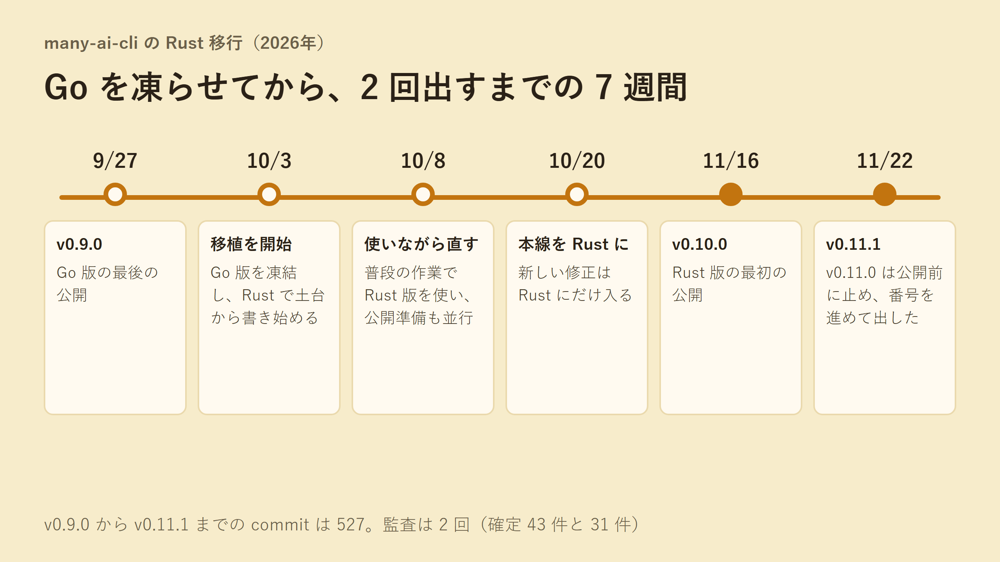
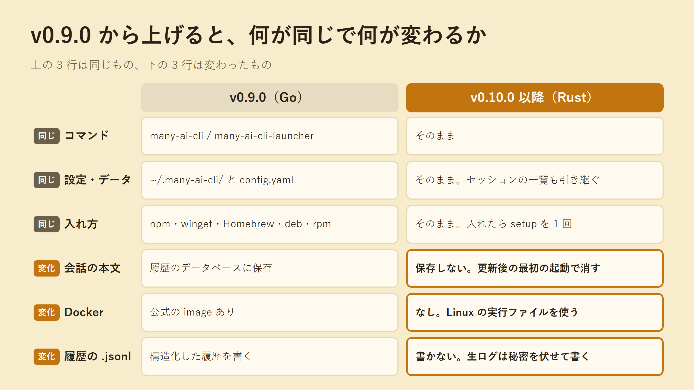

先に、結論を3行で書きます。

- many-ai-cli は v0.10.0 で中身を Go から Rust に作り替え、v0.11.1 で新しい機能を足しました。コマンド名・設定・データの置き場は前と同じです。
- 移したのは、Go・Rust・Java・TypeScript で試して Rust がいちばん速かったからです。Go との部分の比べでは、時間が約2割、メモリが約半分減りました。ただし製品全体が速くなったかは、まだ測れていません。
- 昨夜のリリースは、普段の確認を Windows だけに絞っていたせいで macOS と Linux が止まり、v0.11.0 は出さずに v0.11.1 で出し直しました。


## 昨夜、v0.11.0 は出なかった

夜の 22 時に v0.11.0 のタグを打ちました。20 分たっても終わらない。画面を見に行くと、ビルド 4 本のうち 3 本が赤くなっていました。

止まっていたのは macOS 2 本と Linux 1 本です。公開は 4 本がそろってから始まる作りなので、外にはまだ何も出ていませんでした。原因を 2 つ直して、23 時すぎに v0.11.1 のタグを打ち直し、日付が変わるころに npm まで出し終えました。winget は Microsoft の承認を待って、深夜 1 時すぎに通っています。

many-ai-cli の記事を書くのは、9 月 27 日の v0.9.0 以来です。その 2 か月のあいだに、中身がまるごと入れ替わりました。Go で書いていた本体を、Rust で書き直しています。11 月 16 日の v0.10.0 が Rust 版の最初の公開で、今回の v0.11.1 が 2 回目です。

初めての方向けに、何のツールかを先に書いておきます。Claude Code や Codex のような AI のコーディング用の CLI を、何本も同時に動かしていると、それぞれのターミナルで「このコマンドを実行していいか」の承認待ちが起きます。many-ai-cli は、その承認と進み具合を、ブラウザの 1 画面にまとめて扱うための道具です。手元の PC で小さなサーバー（Hub）が動き、画面はブラウザで開きます。同じ Wi-Fi のスマホからも承認できます。

今回は、この 2 か月で何をしたかを、全部書いておこうと思います。なぜ Rust にしたのか、どう移したのか、使う人から見て何が変わって何が変わっていないのか。それと昨夜、どこで止まったのか。長いので、気になる章から読んでもらえれば十分です。

## many-ai-cli について

自作で [many-ai-cli](https://github.com/ishizakahiroshi/many-ai-cli) という AI ツール（Web ダッシュボード）を作っています。複数の AI コーディング CLI を並列で走らせ、承認をブラウザ 1 タブに集約。スマホからでも。

- 何ができるかの紹介ページ：[many-ai-cli の紹介（個人サイト）](https://ishizakahiroshi.com/work.html?id=many-ai-cli)
- リポジトリ（Star をいただけると励みになります）：[ishizakahiroshi/many-ai-cli（GitHub）](https://github.com/ishizakahiroshi/many-ai-cli)

同じ悩みを持っている方は、下記で入ります（npm の場合。winget・Homebrew・deb・rpm での入れ方は最後の章に書きました）。

```
pnpm add -g many-ai-cli
many-ai-cli setup
```

入れたら 1 回だけ `many-ai-cli setup` を実行します。起動用のショートカットができます。

起動後の見え方は OS で違います。Windows はデスクトップの「MANY-AI-CLI」で Hub が立ち上がってブラウザが開き、タスクバーに小さい窓が出ます。止めるのはその窓の「停止」です。macOS と Linux は「Many AI Hub Start」と「Many AI Hub Stop」の 2 つのショートカットで動かします。ターミナルからなら、どの OS でも `many-ai-cli serve --open` で起動、`many-ai-cli stop` で停止です。

ブラウザの画面が開いたら、左下の「＋ 新しいセッション」から、使う AI CLI を選んで起動します。

実機で動作を確かめているのは Windows です。Linux と macOS は、README にも書いているとおり、実機での十分な確認はまだできていません。

前回の記事はこちらです。v0.9.0（Go 版の最後の版）の機能と導入をまとめています。

- 前回の記事：[many-ai-cli v0.9.0 の機能と導入（note）](https://note.com/ishizakahiroshi/n/n29cba4314e81)

## Rust に移したのは、測ってみたからだった

移す前に、Go のほかに Rust・Java・TypeScript でも同じ処理を試して比べました。いちばん速かったのが Rust です。それで Rust にしました。

ただ、4 つの言語の比べの数字は、今回の記事のために記録を探しても見つけきれませんでした。ここでは、手元にきちんと残っている Go と Rust の比べのほうを書きます。

1 つ目は計測です。10 月 3 日に、Hub の中でいちばん忙しく動く部分の 1 つを、Go と Rust の両方で書いて比べました。AI CLI の画面に流れてくる文字を、あとで画面を開き直したときに見せるため、末尾の一定量だけ取っておく入れ物（バッファ）です。同じ入力を同じ回数（41 万 3,740 回）流し込んで、10 組ずつ測りました。

結果はこうでした。数字は各版の中央値で、減った割合は組ごとに比べた中央値です。

| 指標 | Go | Rust | 減った割合 |
|---|---|---|---|
| 処理時間 | 22.44 秒 | 17.69 秒 | 20.9% |
| CPU 時間 | 22.34 秒 | 17.64 秒 | 21.1% |
| 常駐メモリ（Working Set） | 26.99 MiB | 13.60 MiB | 49.6% |
| そのプロセスだけが持つメモリ（Private Bytes） | 33.21 MiB | 10.35 MiB | 68.9% |


棒は、左が Go、右が Rust です。時間と CPU はおよそ 2 割、メモリはおよそ半分になりました。

ただ、これは部分の比べです。計測の資料自身が「many-ai-cli 全体の CPU・メモリが何%減るかは、この結果だけでは決まらない」と書いています。バッファの伸ばし方やメモリの割り当て方も 2 つの実装で違うので、言語だけの差とも言い切れません。資料の結論の欄に書いてあるのも「Rust 化を検討するための材料が得られた」までです。

2 つ目は、Go 側の検査が赤のまま残っていたことです。Go まわりの脆弱性を調べる検査（govulncheck）が、10 月 9 日から 10 件の指摘で赤でした。Go 版を凍結すると決めた資料は 10 月 3 日付けなので、順番としては「凍結を決めたあとに赤くなり、凍結しているので Go 側は直さなかった」です。赤かったから移した、という話ではありません。

4 つの言語の中で Rust が速かったこと。部分の比べでも、時間とメモリがはっきり減ったこと。この 2 つで、Go 版は凍結して、全部を Rust で書き直す形に決めています。

## Go を凍らせて、全部を移した 7 週間

移し方で最初に決めたのは、Go 版を凍らせることでした。基準にする Go の commit を 1 つ固定して、その時点の機能を全部 Rust へ移す。移している途中で Go 側を直したり、Rust から Go の処理を呼んだりはしない。画面（ブラウザ側の TypeScript）は書き直さず、そのまま使う。

凍らせた Go のソースは、今もリポジトリの `go/` に残っています。ビルドはしません。Rust のテストが「前と同じ答えを返すか」を確かめるときの、固定の見本として読むだけです。

次に、守るものを 4 つに絞りました。

- 日常の操作：承認・入力・監視・終了のやり方が変わらない
- 作業とデータ：今あるセッション・設定・履歴のデータを失わない
- 実行の境界：プロセス・認証・ファイルを触れる範囲を広げない
- 配布と切り替え：入れる・起動する・更新する・戻す、が最後まで成り立つ

全部の挙動を 1 つずつ比べるのは無理なので、この 4 つから外れるものだけは必ず止める、という線の引き方です。

作業の分担は、最初はこうでした。実装は外部の AI（dots と呼んでいる担当）、その成果の独立したレビューは Codex、実機で触って確かめるのは自分。途中からは、手元の Claude Code や Codex が直接直す場面も増えています。



上の図が、日付で見た流れです。

Rust の最初の commit は 10 月 3 日です。共通の型・設定・プロセスまわりの土台から入りました。10 月 8 日に、進め方の選択肢の中から「1 週間使いながら、公開の準備も並行する」を選んでいます。全部移し終わってから使い始めるのではなく、自分の普段の作業で Rust 版を使って、出てきた不具合をその場で直す、というやり方です。10 月 20 日には、開発の本線（develop）を Rust 版に切り替えました。この日から、新しい修正は Rust にだけ入ります。

そこから 11 月 16 日の v0.10.0 まで、使いながら直す期間が続きました。

数字で見ると、こうなります。

- v0.9.0 から v0.11.1 までの commit：527
- Rust のソース：550 ファイル、約 24.6 万行
- 凍結した Go のソース：646 ファイル、約 16.6 万行

行数はどちらもテストと空行を含めた数です。Rust はテストを同じファイルに書くことが多く、Go はテスト用のファイルを分けているので、そのまま比べても意味は薄いです。少なくとも「Rust にしたら短くなった」わけではありません。

CI（自動の確認）の回し方も、途中で決め直しました。日常の修正では Windows の確認だけを回し、Linux・Intel の macOS・Apple シリコンの macOS を含む 4 つの OS の確認は、リリースの直前に手で回す、という分け方です。この分け方が、昨夜のリリースで裏目に出ます。それは 6 つ目の章で書きます。

もう 1 つ、v0.10.0 の前にアプリ全体の監査を 2 回やりました。AI に全体を読ませて問題を挙げさせ、裏が取れて確定したものについて、直すかどうかを自分で選ぶ形です。1 回目で確定したのが 43 件、2 回目が 31 件でした。v0.10.0 の CHANGELOG は Security の欄だけで 53 項目あり、この 2 回の監査の修正もそこに入っています。

## 使う人から見て、何が同じで何が変わったか

中身を全部入れ替えたので、いちばん気をつけたのは「入れ替えたことに気づかずに使えるか」でした。v0.9.0 から v0.10.0 に上げたときに、同じもの、変わるもの、戻し方を、この章にまとめます。



図は、左が v0.9.0、右が v0.10.0 以降です。上の段が同じもの、下の段が変わったものです。

### 同じもの

- コマンド名（`many-ai-cli` と `many-ai-cli-launcher`）
- 設定ファイルの場所（`~/.many-ai-cli/config.yaml`）
- データの置き場（`~/.many-ai-cli/`）
- セッションの一覧（更新しても引き継ぎます。保持期間より古いものは、v0.9.0 と同じく起動のたびに消えます）
- 入れ方（npm・winget・Homebrew・deb・rpm のどれも同じ）

npm で入れている人は、`pnpm add -g many-ai-cli@<版>` で上げて、新しい版から `many-ai-cli setup` をもう一度実行すれば、ショートカットが新しい実行ファイルを指すようになります。

### 変わったもの

いちばん大きいのは、過去の会話の本文を引き継がないことです。v0.10.0 からは、会話の本文を履歴のデータベースに保存しなくなりました。更新したあとの最初の起動で、v0.9.0 が保存していた本文も消します。前は、打った文字も AI が出した文字も、決まった形の秘密だけを伏せてから保存していました。ただ、パスワードを普通の文として書かれると伏せられず、データベースに秘密が残りえます。それで、持たない側に倒しました。残すのは、セッションの開始と終了、添付のファイル名、カードの設定、親子のつながり、承認の記録だけです。あわせて、セッションの生ログ（`.log`）はトークンや秘密鍵らしい文字を伏せてから書くようになり、構造化した履歴（`.jsonl`）は書かなくなっています。

なくなったものもあります。

- 公式の Docker image（コンテナのビルドと自動更新も含めて外しました。Linux の実行ファイルをそのまま使ってください）
- Whisper の音声認識エンジン（手元で whisper.cpp を動かす経路）
- NVIDIA NIM の経路

画面も少し変わりました。設定は全画面になり、左に 24 の項目が並ぶ形になっています。デスクトップでは上の帯が消え、設定・使用量・Hub のボタンは左の欄の一番下に移りました。

### 戻したくなったら

v0.9.0 に戻す道も残しています。手順は README に書いてあるとおりで、要点はこうです。

- 更新する前に、Hub を止めてから `~/.many-ai-cli/` をフォルダごとコピーしておく（Windows は `%USERPROFILE%\.many-ai-cli\`）
- 戻すときは Hub を止め、v0.9.0 を入れ直し、そのコピーで `~/.many-ai-cli/` を置き換える

Rust 版が書いたデータを、v0.9.0 が読めるとは限らないからです。コピーには Hub の token やログイン状態も入るので、扱いには気をつけてください。それと、v0.9.0 にはその後のセキュリティの修正が入っていませんし、これからも入りません。戻すのは必要な間だけにしてもらえると助かります。

変更の量でいうと、v0.10.0 の CHANGELOG は Fixed が 79、Added が 56、Changed が 25、Removed が 5、Security が 53 項目です。全部は追えないと思うので、気になる人だけ [CHANGELOG（GitHub）](https://github.com/ishizakahiroshi/many-ai-cli/blob/main/CHANGELOG.md) を見てください。Security の中には、ブラウザへ token を渡さず 1 回きりのコードで開くようにしたこと、開いたフォルダの git の設定が Hub の裏の git 操作でプログラムを動かさないようにしたこと、などが入っています。

## v0.11.1 で増えたこと

v0.10.0 は「Go と同じことが Rust でできる」ことを優先した版でした。v0.11.1 は、その上に機能を足した最初の版です。[v0.11.1 の CHANGELOG（GitHub）](https://github.com/ishizakahiroshi/many-ai-cli/blob/v0.11.1/CHANGELOG.md) の Added は 16 項目あります。普段の使い方で効くものから書きます。

### Windows の常駐が、タスクバーの小さい窓になった

Windows で Hub が動いていることを示す場所を、通知領域のアイコンから、タスクバーの小さい窓に変えました。窓には「ブラウザを開く」と「停止」の 2 つのボタンがあります。窓を閉じても最小化されるだけで、Hub は止まりません。止めるのは「停止」です。

あわせて、Windows の実行ファイル 2 本に、アプリの説明書きにあたる manifest を入れました。普通のユーザー権限で動くこと、Windows 10 と 11 向けであること、新しい見た目の部品を使うこと、画面の拡大率を自分で扱うこと、を Windows に伝えるファイルです。これで、拡大率を 125% や 150% にした画面でも、窓の文字がぼやけにくくなります。窓の大きさと並びも、拡大率に合わせて計算し直すようにしました（[Changed の欄（GitHub）](https://github.com/ishizakahiroshi/many-ai-cli/blob/v0.11.1/CHANGELOG.md#changed)）。


### Devin CLI でも、スラッシュコマンドの一覧が出る

入力欄で `/` を打つと、その AI CLI のスラッシュコマンドの一覧が出ます。これを Devin CLI のセッションでも使えるようにしました。公式の資料と実行ファイルから拾った 62 のコマンドに、手元にある Devin のスキルを加えて並べます。`/` で始まる 1 行は、まとめて貼り付けてから Enter を送るようにしたので、Devin 側の補完の窓に最初の Enter を取られて、コマンドが途中で止まることもなくなりました。

### AI CLI を、自分で登録して増やせる

many-ai-cli が最初から知っている AI CLI は 7 つです（Claude Code・Codex CLI・GitHub Copilot CLI・Cursor Agent CLI・opencode・Grok Build CLI・Command Code）。それ以外の CLI は、登録して足せます。v0.11.1 では、その登録した CLI が、最初からある 7 つとほぼ同じように扱えるようになりました。

- `many-ai-cli provider add` で、AI に登録してもらえる（`provider add --help` は AI が読む前提で書いてあります）
- 登録した CLI にも、承認のやり方を書いたルールが届く
- 新しいセッションの画面で、承認のモード（計画だけ・編集は許す・自動・全部許す、のうちその CLI が対応するもの）を選べる
- 子のセッションや、実装とレビューを回す流れ（relay）の役にも使える

Devin CLI は、この登録の仕組みで動かしています。

### 画面まわりの小さな変更

- サイドバーのタブを、横一列ではなく、セッションの左に縦に並べられる（設定 → レイアウト。PC の幅のときだけ）
- 入力欄を、ターミナルの下ではなく上に置ける
- クイックコマンドのボタンに、12 文字までの名前を付けられる
- 看板（Iris）から仕事を拾って動く手元の拾い手が、いま動いているか・止めているかを、ヘッダーのボタンで見て、一時停止できる

ほかに、承認のルールを書き込む `AGENTS.md` の中身を、13KB ほどから 1,200 バイト未満に縮めました。常に読ませるルールの量に上限がある AI CLI（Devin CLI は全部で 32,768 バイト）で、プロジェクトのほうのルールが押し出されないようにするためです。どれも細かい条件があるので、気になる項目は [CHANGELOG（GitHub）](https://github.com/ishizakahiroshi/many-ai-cli/blob/v0.11.1/CHANGELOG.md) の本文を見てください。

## リリースの夜に止まった 3 か所

ここからは昨夜の話です。リリースの作業は、手元の Claude Code に任せて、自分は横で返事をする形で進めました。「看板（作業の一覧）を見て、積み残しがなければリリースしたい」と頼んだところから始まっています。

### 1 か所目：前の日の commit が、テストを赤にしていた

最初の確認で、develop の CI が 1 本赤くなっているのが見つかりました。その日の夕方に入れた「Devin CLI でスラッシュコマンドを使えるようにする」commit で、設定の項目が 1 つ増えていました。Rust 版のテストには、凍結した Go 版と同じ形の設定を返すかを比べるものがあり、Go 版に無い項目が増えたことで比べが合わなくなっていたのです。

直し方は、テストの側に「これは Rust にだけある項目」と書き足すだけでした。同じ扱いの項目がすでに 1 つあったので、それに並べています。製品のコードは変えていません。

もう 1 つ、develop には、まだ commit していない変更が 10 ファイル残っていました。前の章で書いた manifest の作業です。夕方に書きかけのまま止まっていたもので、これを仕上げて今回のリリースに入れることにしました。仕上げの途中で、秘密の文字列を探す検査が、manifest の中の版数（`1.0.0.0` のような 4 つの数字）を IP アドレスと見間違えて commit を止める、というおまけも付きました。除外のリストに足して通しています。

### 2 か所目：macOS と Linux だけが、ビルドで止まった

CI が全部緑になり、main に取り込んで、22 時に v0.11.0 のタグを打ちました。そして 20 分後、macOS の 2 本と Linux の 1 本が赤になっていました。

macOS の原因は、Windows でしか使わない部品の読み込みでした。タスクバーの小さい窓のコードが、Windows だけで使う型を、すべての OS で読み込んでいた。Windows では使っているので問題なし。macOS と Linux では「読み込んだのに使っていない」になり、警告をエラーとして扱う設定の検査（clippy）がそこで止めました。

なぜ今まで気づかなかったのか。日常の CI が Windows だけだからです。3 つ目の章で書いた「日常は Windows、4 つの OS はリリースの直前」という分け方が、ちょうどこの形で効いてしまいました。

日常を Windows だけにすれば、修正のたびの待ちは短くなります。その代わり、Windows 以外の赤は、リリースの夜に初めて出ます。昨夜は、それがそのまま起きました。

### 3 か所目：たまたま、いつものポート番号を引いた

Linux の失敗は、別の原因でした。リリース前の試験の中に、実際に Hub を起動して止めるまでを試すものがあります。その試験は、OS に空いているポートを 1 つ選ばせて使います。ところが OS が返したのが、たまたま 47777。本物の Hub がいつも使う番号です。試験は、本物とぶつからないように、47777 が来たら拒否する作りになっていて、そこで止まっていました。

Linux が空きポートとして返す番号の範囲には、47777 も入っています。ざっと 2 万 8 千通りのうちの 1 つを、ちょうどこの夜に引いたことになります。コードの変更とは関係のない、ただの偶然でした。

それでも、同じことはまた起こりえます。47777 が返ってきたら選び直すようにして、その試験も 1 つ足しました。

### 打ち直さずに、次の番号で出した

この v0.11.0 では、外に何も出ていません。GitHub Release も npm も、4 つのビルドがそろってから始まる作りだからです。それでも、打ったタグを消して打ち直すことはせず、直したものを v0.11.1 として出しました。一度外に見えた番号を使い回すと、どれが本当の v0.11.0 なのかが分からなくなるからです。CHANGELOG には「v0.11.0 のタグは何も公開していない」と 1 行書いてあります。

直したあとは、4 つの OS の確認を手で回して、全部緑になってから main に入れ、23 時すぎに v0.11.1 のタグを打ちました。今度は 4 本ともビルドが通り、23 時 45 分ごろに GitHub Release が出ています。

### 最後の 2 つは、自分で押す

GitHub Release のあと、npm・Homebrew・winget へ出す段階で、作業はいったん止まります。ここから先は、自分の承認が要る作りにしてあるからです。

- GitHub の画面で、リリース用の環境（environment）への出し入れを承認する
- npmjs.com の「Staged Packages」で、置かれた 5 つのパッケージを、2 段階認証つきで承認する

前は、タグを打てば最後まで自動で出ていました。v0.10.0 の前の監査で、「タグを打てる人や AI なら、公開用の鍵をそのまま使える」と指摘されて、この形に変えています。AI がタグを打っても、自分が押さなければ npm には出ません。

npm は、置かれた 5 つのうち、OS ごとの 4 つを先に、本体を最後に承認しました。本体が先に出ると、OS ごとの部品がまだ無い数分のあいだに入れた人が失敗するからです。承認したあと、もう一度確認の仕組みを回して、公開された中身が作ったものと同じことも確かめました。

日付が変わったころに npm と Homebrew が出て、winget は Microsoft の承認を待って、深夜 1 時 19 分に通りました。

## まだ分かっていないこと

ここまで「移した」「出した」の話を書きましたが、移したから良くなった、とはまだ言えないところがいくつもあります。正直に並べておきます。

1 つ目。製品全体として速くなったかは、測っていません。2 つ目の章の数字は、バッファという部分だけの比べです。Hub 全体の CPU やメモリが Go 版よりどれだけ減ったかは、同じ条件で比べた記録がまだありません。

2 つ目。AI CLI のセッションを始めたとき、最初の出力が出るまでの時間に、ときどき波があります。1 台の PC で 24 回起動して測ったところ、中央値は 0.34 秒、95% は 0.9 秒以内でしたが、いちばん遅いものは 4.0 秒かかりました。原因はまだ分かっていません。README の「既知の制限」にもそのまま書いています。

3 つ目。確かめている OS が偏っています。普段使っているのは Windows で、Linux と macOS は、実機で十分に触れていません。今回のリリースで 4 つの OS のビルドとテストは通っていますが、それは「CI の上で動いた」までです。それと、Windows の実行ファイルには、まだコード署名がありません。SHA256 の一覧には署名を付けていますが、Windows の SmartScreen の警告や、会社の許可リストの代わりにはなりません。

4 つ目。コードは短くなっていません。3 つ目の章に書いたとおり、Rust は約 24.6 万行で、凍結した Go の約 16.6 万行より多いです。テストの置き方が違うので単純には比べられませんが、少なくとも「移したら読む量が減った」とは言えません。もっとも、ソースを読むのは、いまはほとんど AI です（[VS Code もソースも、ほぼ見ていない話（note）](https://note.com/ishizakahiroshi/n/n64c868fe5903)）。

ほかに、使う人にとって後戻りしにくい変更もあります。過去の会話の本文は引き継がずに消しますし、公式の Docker image もやめました。どちらも、使い方によっては困る人が出る変更です。

最後に、版の番号の話です。移行を始めたころは、Rust 版をそのまま v1.0.0 にするつもりでした。11 月 3 日に、それを v0.10.0 に変えています。v1.0.0 は、しばらく使って安定してから、改めて決めることにしました。いつになるかは、まだ決めていません。

## 入れ方と、上げ方

最初の章では npm だけ書いたので、ここで全部の入れ方を並べておきます。どれで入れても、入れたあとに `many-ai-cli setup` を 1 回実行するところは同じです。

npm（Node.js 22 以降が必要です。pnpm の代わりに npm や bun でも入ります）：

```
pnpm add -g many-ai-cli
many-ai-cli setup
```

Windows の winget（1 行で貼り付けます。入れた直後のウィンドウではまだ PATH が通っていないので、setup はフルパスで呼びます）：

```
winget install ishizakahiroshi.many-ai-cli; & "$env:LOCALAPPDATA\Microsoft\WinGet\Links\many-ai-cli.exe" setup
```

macOS の Homebrew：

```
brew install --cask ishizakahiroshi/tap/many-ai-cli && many-ai-cli setup
```

Linux は、[GitHub のリリースページ](https://github.com/ishizakahiroshi/many-ai-cli/releases) から deb か rpm を落として入れます。

```
sudo dpkg -i many-ai-cli-<版>-linux-x64.deb && many-ai-cli setup
sudo rpm -i many-ai-cli-<版>-1.x86_64.rpm && many-ai-cli setup
```

setup が作るものは OS で違います。Windows はデスクトップの「MANY-AI-CLI」と、ログインしたときにタスクバーの小さい窓を出すための常駐用のショートカット。macOS と Linux は「Many AI Hub Start」と「Many AI Hub Stop」の 2 つです。macOS と Linux では、Start で開く黒いコンソールの窓が Hub の本体なので、閉じずに最小化しておいてください。Linux の GNOME では、最初に一度だけ、ショートカットを右クリックして「起動を許可」を選ぶ必要があります。

v0.9.0 から上げる人は、4 つ目の章の「戻したくなったら」にある、`~/.many-ai-cli/` のコピーを先に取っておいてください。上げたあとは、新しい版から `many-ai-cli setup` をもう一度実行して、ショートカットを作り直します。動いたままの Hub は古い版のままなので、一度止めてから起動し直します。

## many-ai-cli はこんなときに刺さります

- Claude Code・Codex・Copilot・Cursor・Grok を同時に走らせて、状態を 1 画面で見たい人
- 各 CLI の承認待ちを、ターミナルを行き来せずにまとめて捌きたい人
- 席を外しているあいだも、スマホから承認したい人
- 最初から入っている 7 つ以外の AI CLI（Devin CLI など）も、同じ画面で扱いたい人

いずれかに心当たりがあれば、`pnpm add -g many-ai-cli` と `many-ai-cli setup` の 2 つで試せます。設定ファイルを書く必要はありません。

- 紹介ページ（スクショと機能一覧）：[many-ai-cli の紹介（個人サイト）](https://ishizakahiroshi.com/work.html?id=many-ai-cli)
- リポジトリ（Issue / PR 歓迎）：[ishizakahiroshi/many-ai-cli（GitHub）](https://github.com/ishizakahiroshi/many-ai-cli)
- npm：[many-ai-cli（npm）](https://www.npmjs.com/package/many-ai-cli)

Star をいただけると開発の励みになります。使ってみて「ここが不便」があれば、Issue でも X の DM でも大歓迎です。

## あわせて読みたい

- [「ヌケモレもチェックして」と頼んだリリースで、抜けは6つ出てきた（docsweep v0.9.0）](https://note.com/ishizakahiroshi/n/n03d135580815)
- [Devinを個人開発に使おうとしたら、AIの決まりを全部見直すことになった。まだ途中です](https://note.com/ishizakahiroshi/n/n542f6c608f87)
- [AIにバグ修正を任せる前に、原因と修正方針を分けて確かめる](https://ishizakahiroshi.com/articles/2026/2026-10-18_bugfix-delegation-rework/)

## おわりに

7 週間で中身を入れ替えて、2 回出しました。昨夜は 1 回止まりました。

止まった理由は、自分で決めた「日常は Windows だけ」の分け方でした。次のリリースまでに、Windows 以外の確認をどこかで 1 回挟めないか、考えてみます。まずは、clippy だけでも Linux で回すところから。

---

※ ヘッダー画像とインフォグラフィックの絵は AI（画像生成）で作成しています。

※ 本文の挿絵も AI（画像生成）で作成しています。

書いた人: ishizakahiroshi
群馬の北部で、保護猫2匹と暮らす、在宅エンジニア（何でも屋）
https://ishizakahiroshi.com/
https://github.com/ishizakahiroshi
X（業務委託・各種相談はこちら）：
https://x.com/ishizakahiroshi

バックエンド・インフラ・AI連携まわりで、業務委託のご相談を受け付けています。フルリモートです。スポットや週2〜3時間からでも歓迎で、いろんな案件に携われたらうれしいです。こんな相談、歓迎です。

