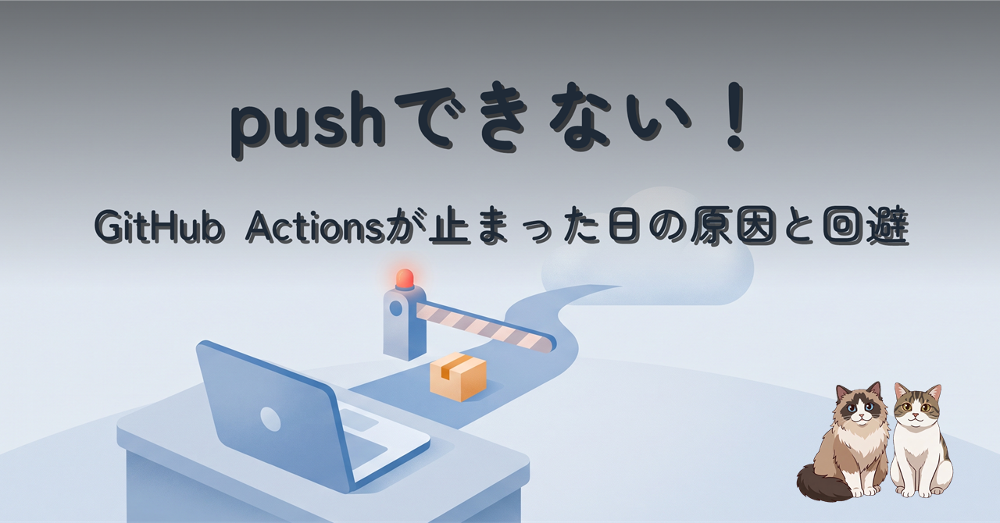
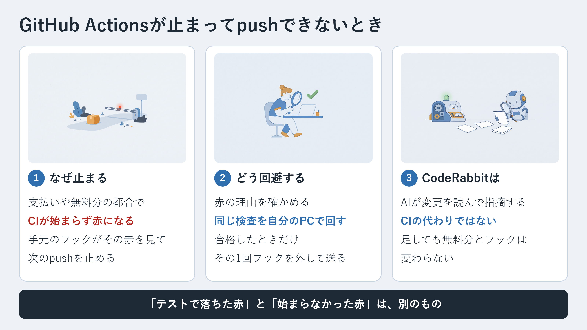
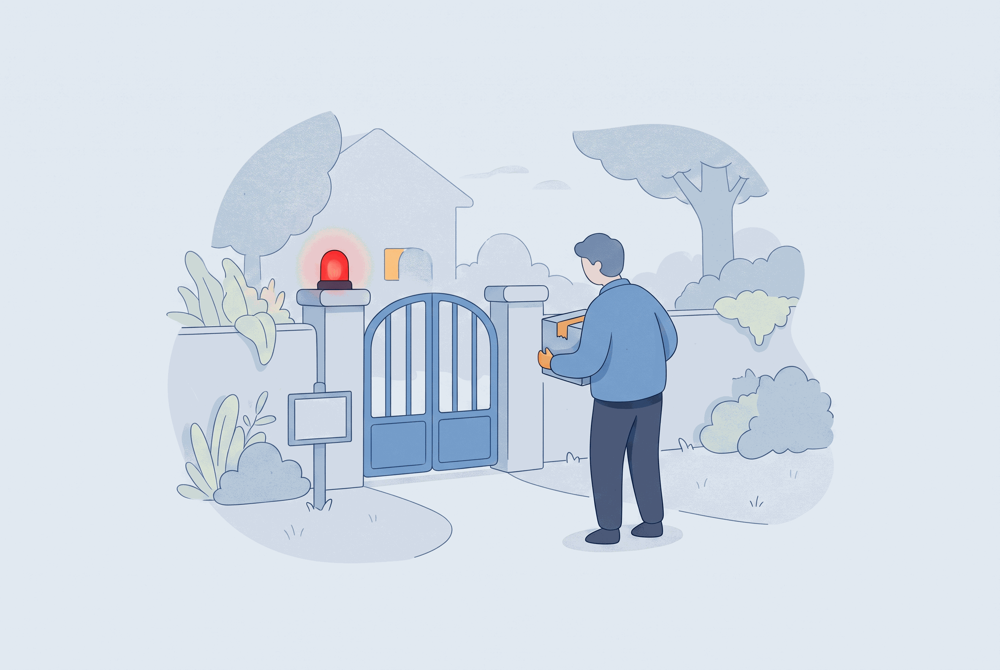
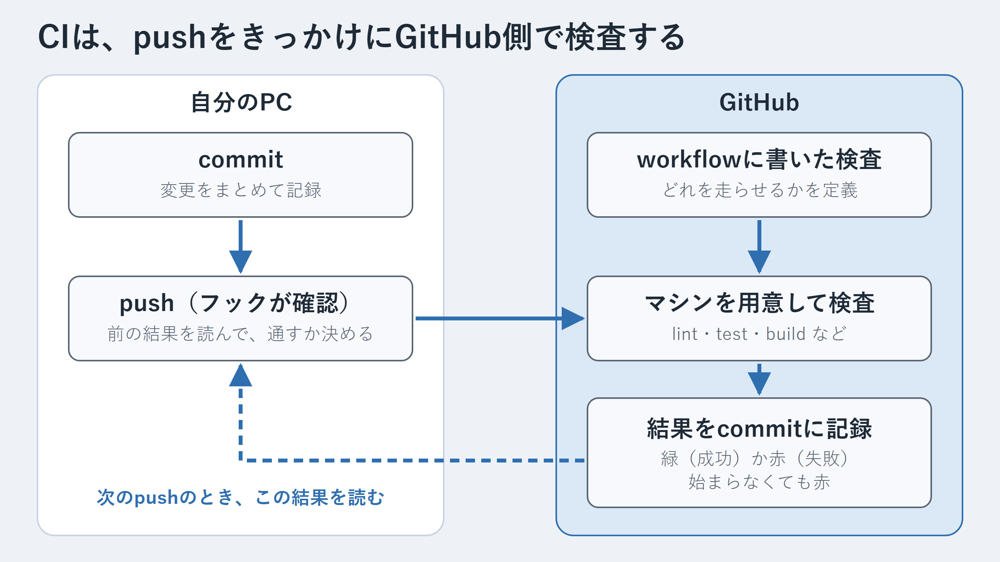
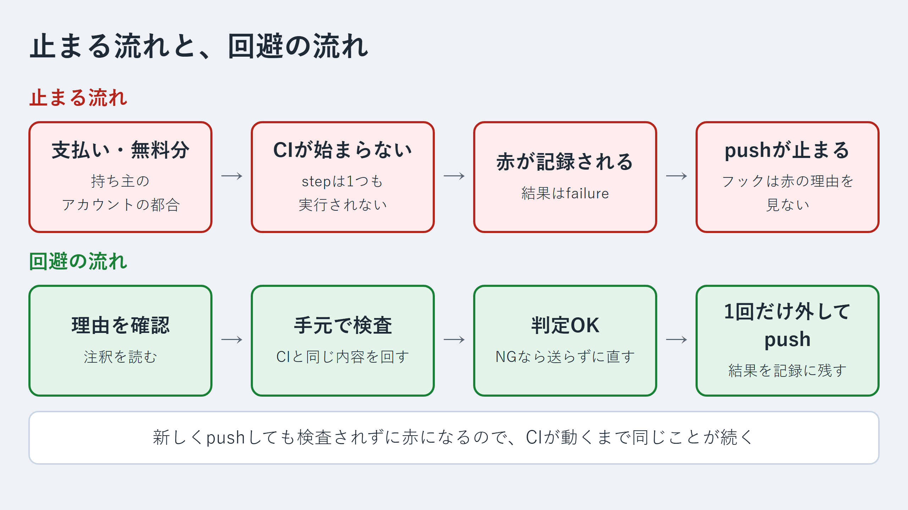
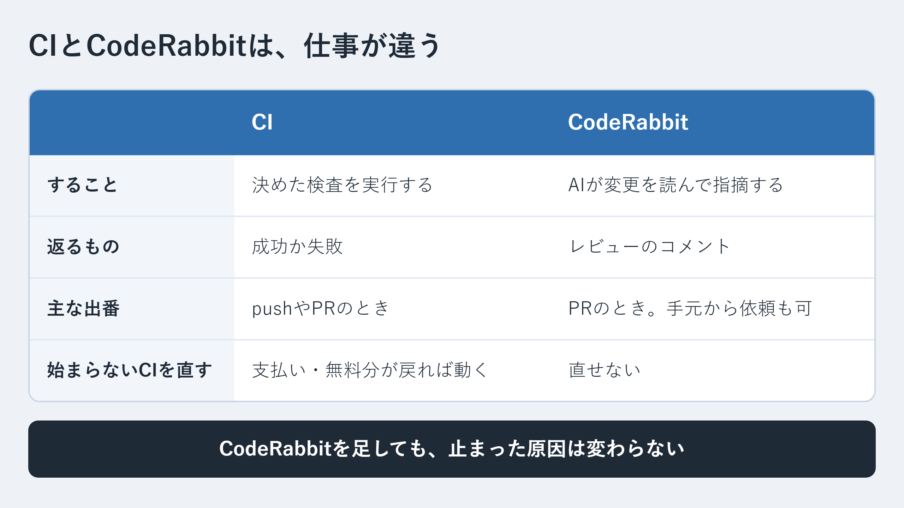

先に、結論を3行で書きます。
pushが止まった原因は、CIが始まらずに赤くなり、その赤を手元のフックが見て止めていたことでした。  
同じ検査を自分のPCで回し、合格したときだけ、その1回に限ってフックを外せば送れます。  
CodeRabbitを足しても、この止まり方は防げません。役割が違います。



## 「pushできないんですけど」から始まった

同じリポジトリで開発している人から、pushができなくなったと相談が来ました。手元で調べてもらうと、出てきたのはGitHubの支払いまわりの話です。CIのジョブがそもそも始まっていない、と。

じつは自分のPCでも同じ赤は出ていて、回避しながら普通にpushしていました。ただ、その回避の手順は、自分の手元のメモにしか書いていませんでした。



同じように止まった人向けに、先に手順を書いて、そのあと仕組みを順番に説明します。

## 先に、止まったときにやること

使うのはGit、GitHub CLI（`gh`）、それにCIで動かしている検査の道具一式です。

### 1. 赤の理由を確かめる

```bash
gh run list --branch main --limit 3
gh run view <上で出たrunのID>
```

注釈に次の文があれば、コードの中身が原因ではありません。

```text
The job was not started because recent account payments have failed or your
spending limit needs to be increased.
```

「支払いに失敗したか、上限を上げる必要があるので、ジョブを始めませんでした」という意味です。ジョブが動いて途中のstepで落ちている赤なら、ここから先は使わずに原因を直してください。

### 2. 同じ検査を手元で回す

CIのworkflowに書いてある検査を、スクリプトにまとめておきます。これは例です。

```bash
#!/usr/bin/env bash
# 使い方: bash ci-local.sh <検査したいブランチ>
set -u
target=${1:-HEAD}
work=$(mktemp -d)
trap 'git worktree remove --force "$work/wt" >/dev/null 2>&1; rm -rf "$work"' EXIT
git worktree add --quiet --detach "$work/wt" "$target" || exit 1

(
  cd "$work/wt" || exit 1
  # ここに CI の workflow と同じ検査を並べる（下は Node.js の例）
  npm ci && npm run lint && npm test
)
rc=$?

[ "$rc" -eq 0 ] && echo "判定: OK" || echo "判定: NG（push しない）"
exit "$rc"
```

一時的な`worktree`にcommit済みの内容を取り出して検査します。手元に書きかけのファイルがあっても、結果に混ざりません。CIがcheckoutした状態に近づけるためです。ただし、OSや道具の版がGitHub側と違えば、結果が違うことはあります。

先に相手の変更を取り込んでから回します。

```bash
git pull --no-rebase origin main
bash ci-local.sh main
```

### 3. 合格したら、その1回だけフックを外して送る

自分のフックが、次のように環境変数で確認を飛ばせる作りなら、pushの行の先頭に付けます。

```bash
ALLOW_PUSH_ON_RED_CI=1 git push origin main
```

PowerShellなら、使い終わったら消すところまでセットです。

```powershell
$env:ALLOW_PUSH_ON_RED_CI = '1'
git push origin main
Remove-Item Env:ALLOW_PUSH_ON_RED_CI
```

この指定はフックの確認を丸ごと飛ばします。手元の検査がOKのときだけにしてください。結果はどこかに残しておきます。あとでCIが再開しても、止まっていた間のcommitが自動で調べ直されるわけではないからです。

道具がどうしても入らない人は、まだ無いブランチ名へpushする手もあります。下で載せる例のフックは新しいブランチを止めないので、送ってもらったブランチを、道具が揃っている人が検査して取り込めます。

## CIって、そもそも何をしているのか

CI（継続的インテグレーション）は、共有するコードに変更を小さく頻繁に合わせて、自動の検査で早く確かめるやり方です。GitHub Actionsは、それを動かすための仕組みの1つ。pushやPRをきっかけに、GitHubがマシンを用意して、workflowに書いた検査を順に実行します。



大事なのは右下から左へ戻る矢印です。今回のリポジトリでは、次のpushのときに手元のフックがこの結果を読んでいました。

CIとCDの言葉の整理は、前の記事（末尾の「あわせて読みたい」）にまとめています。今回のリポジトリにあるのはCIだけで、本番への反映は手で実行する形でした。なので、CIが止まっても反映の仕組みそのものは動きます。

## なぜpushまで止まったのか

GitHubがpushを断ったわけではありません。止めていたのは、リポジトリに入れてある`pre-push`フックでした。中身を短くするとこうです。

```sh
#!/usr/bin/env sh
# push 先の先頭で CI が赤なら止める（例）
[ "${ALLOW_PUSH_ON_RED_CI:-}" = "1" ] && exit 0
command -v gh >/dev/null 2>&1 || exit 0

zero="0000000000000000000000000000000000000000"
status=0
while read -r local_ref local_sha remote_ref remote_sha; do
  [ "$remote_sha" = "$zero" ] && continue   # 新しいブランチは通す
  case "$remote_ref" in
    refs/heads/*) branch=${remote_ref#refs/heads/} ;;
    *) continue ;;
  esac
  failed=$(gh run list --branch "$branch" --commit "$remote_sha" --json conclusion \
    -q '[.[] | select(.conclusion == "failure")] | length') || continue
  if [ "${failed:-0}" -gt 0 ]; then
    echo "BLOCKED: $branch の先頭で CI が失敗しています" >&2
    status=1
  fi
done
exit $status
```

`.githooks/pre-push`に置いて実行権限を付け、`git config core.hooksPath .githooks`を打ったPCで動きます。

もともとは、CIの結果を見ないまま次のcommitを重ねて、赤が続いてしまったことがあって入れた決まりでした。赤を放ったまま積み上げないための確認です。

落とし穴は、赤の理由を見ていないことです。今回のジョブは1つのstepも実行されずに終わっていましたが、GitHub上の結果は`failure`です。フックから見れば、テストで落ちた赤と区別がつきません。



しかも新しくpushしたcommitも検査されないまま赤になるので、次の人もまた止まります。待っていても、CIが動くようになるまで直りません。

`gh`が無いときや結果が取れないときは通す作りなのに、「始まらなかった」は通さない。ここは考え漏れでした。

## 無料分はどこに消えたのか

非公開リポジトリのActionsは、アカウントごとに月の込み分があります。公式の料金ページ（2026年11月に確認）では、Freeで月12ドル分で、Linuxの標準ランナーの単価から計算すると約2,000分です。使った分は、pushした人ではなくリポジトリの持ち主に計上されます。公開リポジトリの標準ランナーと、自分で用意するランナーは、込み分を減らしません。

https://docs.github.com/en/billing/concepts/product-billing/github-actions

自分がpushしていたリポジトリは、持ち主が別のアカウントでした。そこで、同じ持ち主の非公開リポジトリのうち、自分が読める範囲の実行記録を足してみました。

```bash
#!/usr/bin/env bash
# 使い方: bash actions-minutes.sh OWNER/REPO 2026-11-01..2026-11-30
repo=$1
range=$2
for id in $(gh api --paginate "repos/$repo/actions/runs?created=$range&per_page=100" -q '.workflow_runs[].id'); do
  gh api "repos/$repo/actions/runs/$id/jobs?filter=all&per_page=100" \
    -q '.jobs[] | select((.steps | length) > 0 and .completed_at != null)
        | (((.completed_at | fromdate) - (.started_at | fromdate)) / 60 | ceil)'
done | awk '{ sum += $1 } END { print sum + 0, "分" }'
```

結果は、月の半ばの時点で込み分の近くに届いていました。止まって困っていたリポジトリ自身の分は一部で、大半は別のリポジトリです。枠はアカウントで1つなので、ほかで使い切れば、こちらも止まります。

この数え方は、ジョブごとに1分単位で切り上げたLinux前提の目安です。持ち主の請求画面は見ていないので、支払いの失敗なのか込み分切れなのかは断定できません。数字の合い方から、込み分切れの可能性が高いと見ています。そうなら、次の請求の周期に入ると戻ります。同じ使い方のままなら、また途中で尽きそうです。

## CodeRabbitを入れていれば防げたのか

聞きたくなるところですが、今回の止まり方は防げません。

CodeRabbitは、AIが変更を読んで指摘してくれるサービスです。主な使い方はPRのレビューで、PRを出す前にVS CodeやCLIから手元の変更を見てもらうこともできます。

https://docs.coderabbit.ai/overview/introduction



止まった原因は、Actionsのジョブが始まらないことと、フックがその赤を見ていることでした。CodeRabbitを足しても、この2つはどちらも変わりません。

公式ドキュメントを確かめた範囲では、次のように読めました。

- CIの失敗ログを読んで原因を指摘する機能はあります。ただ、CIそのものを肩代わりする説明は見つけられませんでした
- PRの取り込みを止める設定はあります。`git push`を止める仕組みは見つけられませんでした
- 非公開リポジトリの無料プランは、PRでは要約だけで、コードレビューはVS Code拡張とCLIから使う形です（回数の上限あり）

https://docs.coderabbit.ai/pr-reviews/cicd-pipeline-analysis
https://docs.coderabbit.ai/pr-reviews/status-check
https://docs.coderabbit.ai/management/plans

それに今回のリポジトリは、PRを使わず直接pushしていました。PRの自動レビューは、そもそも走る場面がありません。

役に立たないという話ではないです。人が見落とす所を指摘してもらうのと、決めた検査を毎回同じ基準で合否にするのは、別の仕事でした。

## 次に直したいこと

今回分かった穴は4つあります。まだどれも直していません。

- フックが「ジョブが始まらなかった赤」を見分けて、手元の検査を自動で回し、合格なら通す。使う人の手順が増えないので、最初に直すならこれです
- 回避の手順を、個人のメモではなくリポジトリ側の文書に置く
- 検査の一覧がworkflowと手元のスクリプトに分かれないよう、workflowからスクリプトを呼ぶ形にする
- CIが再開したら、最後に緑だったcommitから先をまとめて1回検査する

手元で回避できていても、仕組みは直っていません。まずは手順をリポジトリに書くところからです。

## あわせて読みたい

- [GitHub Actionsの検査を見直す前に、CI/CDの流れを整理した](https://qiita.com/ishizakahiroshi/items/430691b1ce54f0f5389a)（CIとCDの言葉と、検査を置く段階を整理した記事です）

---

※ ヘッダー画像とインフォグラフィックの絵は AI（画像生成）で作成しています。

※ 本文の挿絵も AI（画像生成）で作成しています。

書いた人: ishizakahiroshi
群馬の北部で、保護猫2匹と暮らす、在宅エンジニア（何でも屋）
https://ishizakahiroshi.com/
https://github.com/ishizakahiroshi
X（業務委託・各種相談はこちら）：
https://x.com/ishizakahiroshi

バックエンド・インフラ・AI連携まわりで、業務委託のご相談を受け付けています。フルリモートです。スポットや週2〜3時間からでも歓迎で、いろんな案件に携われたらうれしいです。こんな相談、歓迎です。
