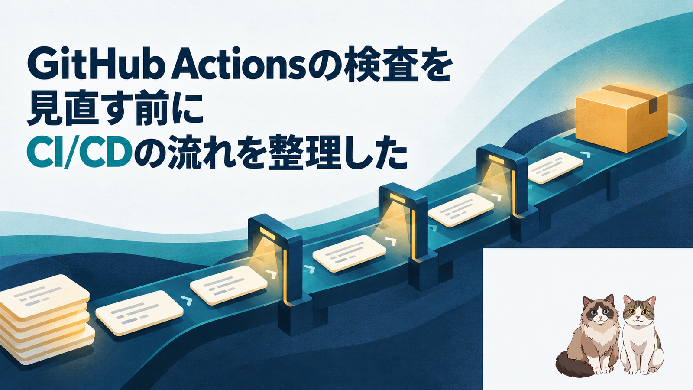
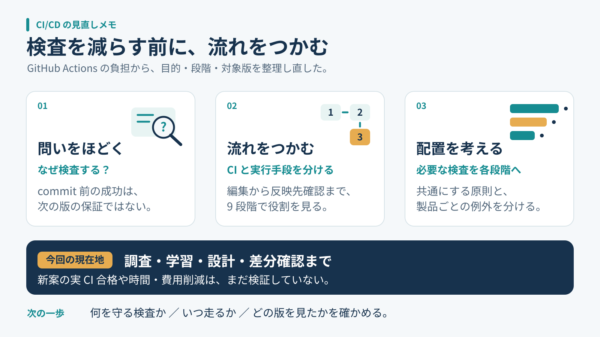
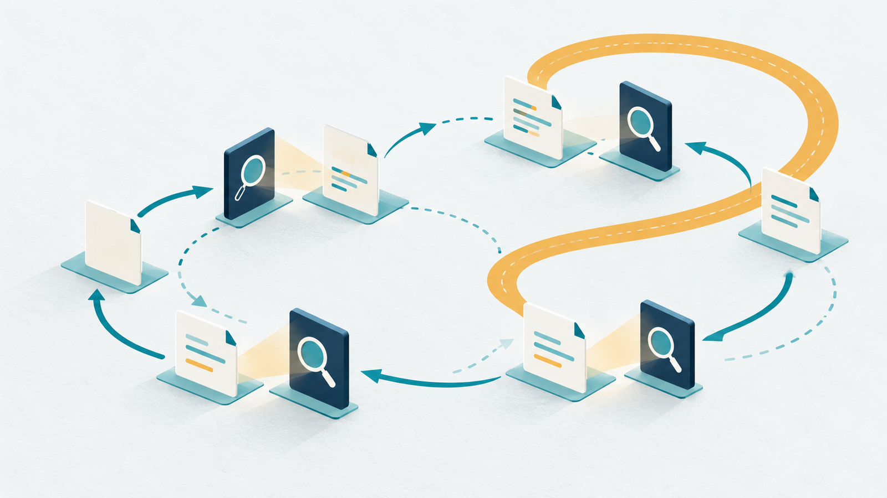
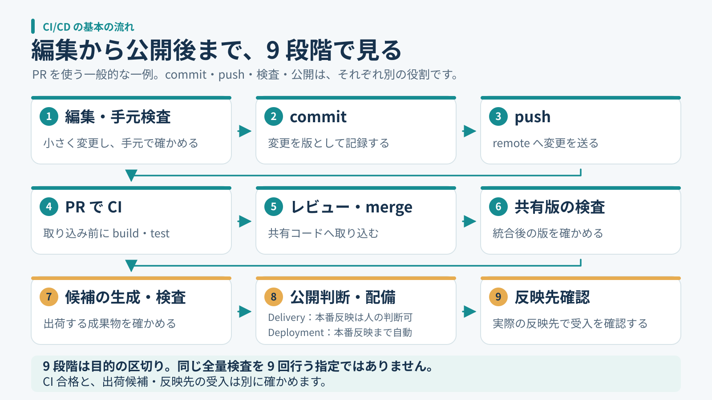
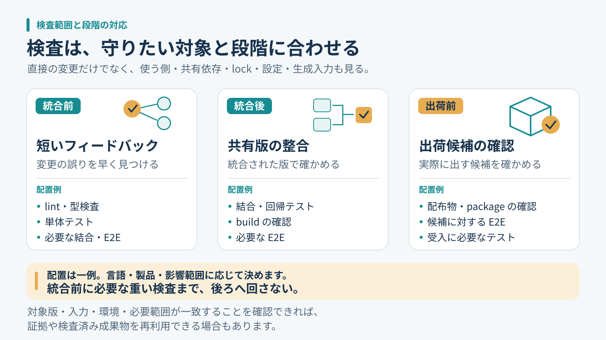

先に、結論を3行で書きます。
検査を減らす前に、何を、どの版で、いつ確かめるかを整理しました。  
CI/CDの流れをつかむと、共通にする原則と個別に決める部分が見えてきました。  
今回は設計と変更案の確認までで、実運用の高速化や本番移行はまだ検証していません。

## そもそも、何のためにこんなに検査しているのか

複数のリポジトリでGitHub Actionsを動かしていると、検査の負担が気になってきます。そこで最初に考えたのは、検査をどう減らすかでした。変更のたびに似た処理が並ぶと、同じことを繰り返していないか、という疑問が出てきます。

commitする前のコードが正しかったなら、新しく変えたところだけを確認すればよいのではないか。毎回全部を検査しているのか。手元で開発を終えてからまとめてpushすれば、検査も一度で済むのではないか。自動実行をやめて、必要なときだけ手動で動かす方法も考えました。

ただ、その判断をするには、自分が何を省こうとしているのかを理解する必要がありました。Actionsに処理を任せていても、それぞれの検査がどの段階を守っているのかまでは、十分に整理できていなかったのです。

今回は設定をすぐ書き換える前に、CI/CDの言葉と一般的な流れから確認し直しました。検査時間の話として始めたのに、途中から、検査結果をどう判断に使うかという話へ変わっていきました。

同じように見える検査が並んでいても、何を確かめるための処理なのかはまだ分かりません。まずは、それぞれの役割をほどくところから始めました。

## commit前に成功していたら、どこまで信用できるのか

まず、commitはコードの版を記録する操作です。テストに合格したという証明が、commitそのものに付くわけではありません。pushも、変更をremoteへ送る操作です。pushしたら何が実行されるかは、workflowの設定によります。この二つを検査や公開とまとめて考えないようにしました。[Gitのcommit説明](https://git-scm.com/docs/git-commit)と[push説明](https://git-scm.com/docs/git-push)で、操作の役割を確認できます。

手元での成功にも意味はあります。ただし、その結果は、そのときのコード、依存、設定、環境、実行した検査についての結果です。後から別の変更が合わさったり、lockファイルが変わったりした場合まで、そのまま保証するものではありません。

たとえば共通関数を一つ直したとします。変更したファイルのテストが通っても、その関数を使う画面や処理が期待どおりとは限りません。直接編集していない利用側にも影響は広がります。DORAも、小さく見える単一ファイルの変更が全体に副作用を持ち得ることを、CIが扱う問題として説明しています。[DORAのCI解説](https://dora.dev/capabilities/continuous-integration/)

ここで、変更行だけを見ればよい、とは言えなくなりました。一方で、どんな変更でもすべての検査を無条件に繰り返す、と決める材料にもなりません。どこまで影響する変更なのか、以前の結果と今の入力が同じなのかを、先に分けて考えます。

## CIとActionsを分けると、流れを追いやすい

CIはContinuous Integration、継続的インテグレーションです。共有するコードへ小さく頻繁に変更を合わせ、自動buildやtestで早く検証する実践として捉え直しました。GitHub Actionsは、それを実行するために使える仕組みの一つです。Actionsが動いていることだけで、統合を小さく頻繁にできているとは限りません。[GitHubのCI説明](https://docs.github.com/en/actions/get-started/continuous-integration)

Martin Fowlerの説明でも、変更を頻繁に統合し、その統合を自動buildとtestで確かめる点が中心です。そこで、手元に変更を長くためて最後に一度だけ確認する案は、実行回数が減るとしても、問題を見つけるタイミングを遅らせる可能性があると考えました。[Continuous Integration](https://martinfowler.com/articles/continuousIntegration.html)

個人開発なら、いつでも他人の変更と衝突するわけではありません。それでも、一度に多くの変更を加えた後の失敗では、どの変更が原因なのかを追う範囲が広がります。自分の作業量に対して、短い確認をどこに置くと戻りやすいか。その視点を残しておきたいと思いました。

## 編集から公開後まで、何を順番に確認するのか

全体像は、PRを使う一般的な例として、次の九段階に整理しました。PRは説明のための一例で、CIの定義に必須の手続きではありません。以下はすべての組織に同じ手順を強制する標準ではなく、自分の検査を置く場所を考えるための整理です。

最初は、編集と手元の検査です。書いた直後に小さな間違いを見つけられれば、原因を探す範囲も小さくできます。次にcommitで変更を記録し、pushで共有先へ送ります。ここまでを行っただけでは、取り込みや公開が完了したことにはなりません。

四段階目は、PRでのCIです。提案した変更について、統合前に必要な検査を行います。五段階目でレビューし、必要な条件を満たした変更をmergeします。六段階目では共有版を検査します。統合前の候補と、ほかの変更も入った共有版では、確かめる対象が変わり得ます。

七段階目は、出荷候補を生成して、その候補を検査することです。ソースのテストが通るかに加え、配るファイルや動かす形を確認します。八段階目で公開の判断と配備を行い、九段階目で反映先を確認します。処理が終了したことと、利用者が使う場所で期待した版になっていることも、分けて見ます。

九段階に分けたのは目的を追うためで、九回の独立した検査を要求するためではありません。各段階で同じ全量検査を繰り返す図にもしていません。たとえば、検査した版と後で使う版、依存や生成入力、環境条件、必要な範囲が一致し、その一致を確かめられるなら、既存の結果を使える場合があります。

検査済みの成果物を後段へ渡すなら、途中で別の入力から作り直していないかも確認します。反対に、統合によって対象が変わった場合は、以前の緑をそのまま移せません。名前の似た検査が二つあるというだけで重複と決めず、対象が同じかを見てから整理するつもりです。再利用を無条件に認めることも、毎回ゼロからやり直すことも、先に決めないようにしました。検査したpackageと配備するpackageを同じにする考え方は、[Continuous Deliveryのパターン](https://continuousdelivery.com/implementing/patterns/)も参考になります。

この流れの中で、build、test、配備などを自動化できるのがActionsです。workflowはイベント等で起動し、jobやstepとして処理を組み立てます。どのタイミングに何を配置するかは、その仕組みの上で設計することになります。[GitHub Actionsの構成要素](https://docs.github.com/en/actions/get-started/understand-github-actions)

CDも確認しました。Continuous Deliveryは、必要な確認を経て、出荷できる状態を保つ考え方です。公開の判断を人に残す運用もできます。Continuous Deploymentは、条件を満たした変更の本番反映まで自動化します。毎回人が本番反映を承認する説明は、こちらには含めません。検査を自動化する話から、いきなり本番も自動で変える話へ飛ぶ必要はありません。[Continuous Deliveryの説明](https://continuousdelivery.com/)、[DeliveryとDeploymentの区別](https://martinfowler.com/articles/continuousIntegration.html#HowDoesContinuousDeploymentFitInWithAllThis)

## 全部手動にすれば、負担は減るのだろうか

必要なときだけ実行する案には、分かりやすさがあります。ただ、誰が、どの版に対して、何を忘れずに実行するかを、別に支える必要が出てきます。自動起動を外した分だけ、確認の責任が消えるわけではありません。

GitHub Actionsには、workflow_dispatchによる手動実行があります。一方、その実行でjobが成功したことを、そのままPRのrequired checkの代用品にはできません。現行の公式説明では、workflow_dispatchで起動したworkflowのjobが報告したcheckは、PRのrequired status checkを満たさないとされています。[手動実行](https://docs.github.com/en/actions/how-tos/manage-workflow-runs/manually-run-a-workflow)、[必須チェックの説明](https://docs.github.com/en/pull-requests/how-tos/merge-and-close-pull-requests/troubleshooting-required-status-checks)

また、画面に緑が並んでいても、必要な検査が本当に走ったかは見ます。GitHubが取り込み条件として認める状態と、テストを実行して成功したという事実は同じとは限りません。skipを実行成功と数えず、対象の版、起動条件、実行内容を確認する方針にしました。

検査が動いていることと、失敗した変更の取り込みを実際に防げることも分けます。結果を見るだけの運用なのか、必要なcheckを取り込み条件として設定しているのか。同じ成功表示でも、その先の扱いは違います。手動化を考えるときは、ボタン一つの置き換えではなく、この判断までつながるかを確認したいと思いました。

そのため、全検査を手動化することを共通の答えにはしませんでした。まず短い自動検査を残し、重い検査や例外の置き場所を考える。手動で動かす処理を設ける場合も、それがどの判断を支えるものかを書いておく、という順番です。

## 約3時間の一例を、どこまで深掘りするか

調べた中には、Test stepが約3時間かかった実行例がありました。ただし、確認したのは一例です。毎回そうなのか、平均がどの程度なのか、費用にどう響くのかは集計していません。短縮した実績もありません。

長い数字を見ると、そこから直したくなります。しかし、もし例外的で頻度や影響が小さいなら、深掘りする優先度は下げてもよいと考えました。これは、まれだと証明できたという意味ではありません。頻度が未確認であることを残したうえで、何から調べるかの判断です。

そこで、一件の長時間実行の原因分析と、全リポジトリの検査の考え方をそろえる作業を分けました。前者には実行内容や待ち時間などの追加調査が必要です。後者は、検査の目的、対象、段階が説明できるかを先に整理できます。一つの数字から全体の設定を変えないようにしました。

## 共通にするのは、同じYAMLより判断の仕方

全体を見直すといっても、言語も製品の形も違います。そこで、共通の原則、言語や製品ごとの実装、実行条件、個別の例外を分けました。同じYAMLを配ることや、独自の差分判定エンジンを作ることは、出発点にしません。

短い検査一式が十分速いなら、それを流す方が単純です。差分を細かく選ぶ仕組みを入れると、今度はその選び方が必要な検査を落とさないかを確かめる仕事が増えます。依存の取得をcacheで省くことと、以前のテスト合格を再利用することも、別の判断として扱います。

検査の役割は、名前からもう一度確認しました。lintや型の検査は記述や接続の問題、単体テストは小さな処理の振る舞い、結合テストは組み合わせ、E2Eは利用者の操作の流れ、buildや配布物の確認は出荷する形を見ます。どれか一種類の成功で、ほかも済んだとは扱いません。[GitHubの検査例](https://docs.github.com/en/actions/get-started/continuous-integration)や[DORAのテスト自動化の説明](https://dora.dev/capabilities/test-automation/)を参考に、役割を分けて整理しました。

配置を考えるときは、共有前に早く返したい検査、共有版の組み合わせを確認する検査、出荷候補に必要な検査を対応させました。これは重いものを全部merge後へ送るという話ではありません。取り込み前に必要な重い検査は、その前に置きます。DORAも統合前後の自動検査を説明しています。[DORAのCI解説](https://dora.dev/capabilities/continuous-integration/)

自分の運用では、画像や文書だけの軽い変更は一度目視し、テストやCIを追加実行しないという選択も持っています。これは一般の強制規則ではありません。生成処理、認証、権限などに影響するなら、拡張子だけで軽い変更と決めないようにします。共通化を理由に個別の運用を無断で上書きしないことも、今回の整理に含めました。

レビューでは、検査の後にも別の確認が残ると分かりました。たとえば公開処理を順番に動かすだけでは、古い候補が遅れて公開される可能性まで消せません。最新の候補だけを出す運用にするなら、公開直前にも、その候補を今出してよいか確認する必要があります。これは今回の設計上の指摘で、実際に事故が起きたという話ではありません。

公開の結果が分からない場合と、外部への変更は確認できたけれど、利用者の目線ではまだ確かめていない場合も分けました。前者を失敗と決めて同じ操作を重ねるのも、後者を受入完了にするのも早すぎます。検査を通過した記録だけでなく、その先に何が分かっていて何が未確認かを残す。自分の案では、この状態の違いも共通化する対象にしました。

こうして見ると、共通にしたいのはjobの数や一律の実行頻度より、判断に必要な情報でした。個別の製品に合わせて検査内容が違っても、何を確かめた結果なのかが読めれば、例外を設けた理由も後から確認できます。

## AIに改善案を頼む前に、流れを共有しておけばよかった

今回、AIが作った資料は、共通差分や代表的なpatchの説明に寄っていました。変更案はあっても、一般的なCIの流れが抜けていたのです。そのままでは、何を変える案なのかを判断する土台が足りませんでした。

不足を伝え、編集から公開までの九段階を資料の冒頭に加えて説明し直しました。これは、説明を長くすればよいという話でもありません。今回なら、検査を減らす判断の前に、検査が入る場所を理解する必要があったということです。

資料の見栄えが整っていても、読む側が判断に使えるとは限らない。この点は、コードの改善案とは別に持ち帰ったことです。変更内容だけ詳しくしても、今の流れとのつながりが見えなければ、採用する理由も保留する理由も説明しづらくなります。

次に同じ種類の依頼をするときは、最初に通常の流れを示し、そのうえで、現状のどこを変えるのか、何を残すのか、まだ分からないことは何かを並べてもらおうと思います。完成した差分だけを見るより、判断の順序を合わせてから比較する方が、自分には使いやすそうです。

## 次は、一つの検査の役割から確認する

自分のリポジトリを見直すなら、まず既存のworkflowと実行結果を読み、次の問いを一つずつ確かめるところから始められます。設定変更や全量の再実行を、最初の作業にする必要はありません。

- この検査は、何の失敗を見つけるためにあるか。
- 手元、提案中の変更、共有版、出荷候補のどれを見ているか。
- どの変更やイベントで走り、何がskipされるか。
- 取り込みや公開を止める条件として、実際に結び付いているか。
- 結果が不明だったとき、成功と決めずに何を確認するか。

この棚卸しで、似た検査が本当に重複しているのか、違う対象を確かめているのかを見分けたいと思います。短くできそうな場所が見つかっても、先に成功条件を決めます。省いた後に困らないかを確かめる対象が決まれば、改善案を試す範囲も小さくできます。

今回済んだのは、設定や経路の読取調査、学習資料と全体標準案の整理、代表的な変更用・戻し用patchの準備です。固定したコピーで適用と復元、構文を確認し、別担当の独立レビューも行いました。

まだ、新案を製品のworkflowへ適用していません。実際のCIでの動作、出荷候補や本番の受入、全体移行、時間や費用の削減も未検証です。したがって、この記事の到達点は、検査を速くできたことではなく、見直すための考え方を整理したところまでです。

次は、一つの検査について、目的と対象の版を自分の言葉で説明できるかを確認します。そこで説明が途切れる場所が見つかれば、先に調べる場所も決めやすくなりそうです。

---

※ ヘッダー画像は AI（画像生成）で作成しています。

※ 本文の挿絵も AI（画像生成）で作成しています。

書いた人: ishizakahiroshi
群馬の北部で、保護猫2匹と暮らす、在宅エンジニア（何でも屋）
https://ishizakahiroshi.com/
https://github.com/ishizakahiroshi
X（業務委託・各種相談はこちら）：
https://x.com/ishizakahiroshi

バックエンド・インフラ・AI連携まわりで、業務委託のご相談を受け付けています。フルリモートです。スポットや週2〜3時間からでも歓迎で、いろんな案件に携われたらうれしいです。こんな相談、歓迎です。

<!-- dots-article:ci-cd-learning-20261102 -->
